# Niseko — galerie de vérification

> **INTERNE — Images candidates uniquement. Aucune image n'est encore approuvée pour publication.**

**Couverture :** 12/12 photographies des établissements, 9/9 scènes locales, 21/21 en tout.

**Revue humaine initiale :** certains visuels ont des alertes éditoriales détaillées dans le tableau ; 21/21 désigne uniquement les fichiers physiquement récupérés.

**Statut de publication :** aucune validation visuelle globale, aucun feu vert de publication commerciale. Le guide reste en brouillon et non indexable.

## Hôtels : 4 adresses × 3 images

| Établissement et emplacement | Photo WebP authentique à examiner | Source / licence déclarée | Contrôles restants |
|---|---|---|---|
| Park Hyatt Niseko Hanazono · view-1 | 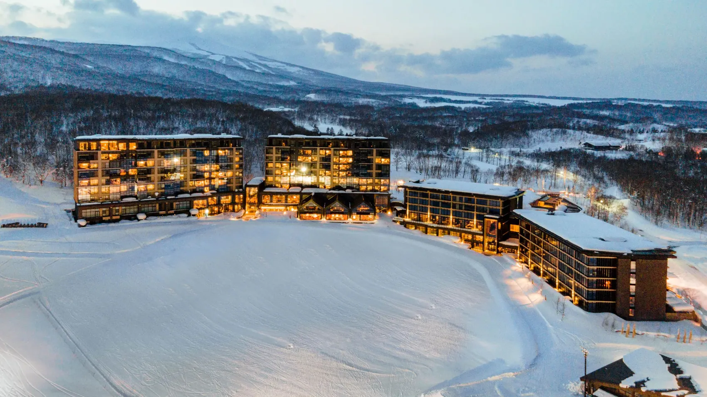 | <a href="https://www.hyatt.com/park-hyatt/en-US/ctsph-park-hyatt-niseko-hanazono/gallery">Source originale</a> / Licence indépendante non confirmée | Visuel non approuvé; Droits de publication à contrôler |
| Park Hyatt Niseko Hanazono · view-2 | 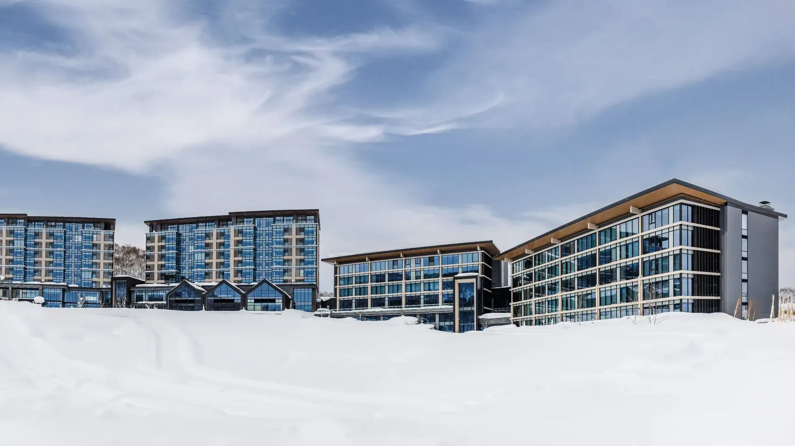 | <a href="https://www.hyatt.com/park-hyatt/en-US/ctsph-park-hyatt-niseko-hanazono/gallery">Source originale</a> / Licence indépendante non confirmée | Visuel non approuvé; Droits de publication à contrôler |
| Park Hyatt Niseko Hanazono · view-3 | 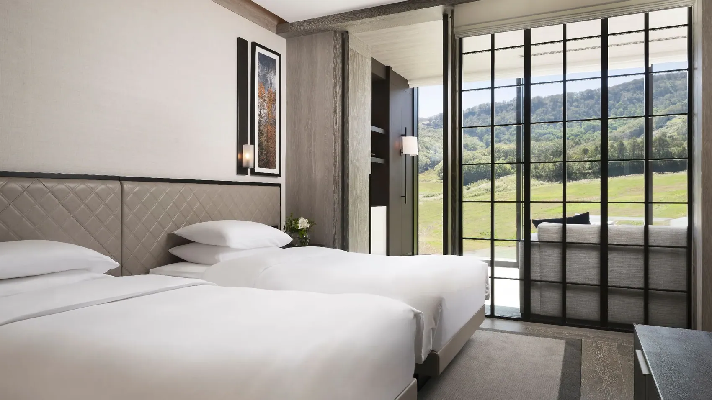 | <a href="https://www.hyatt.com/park-hyatt/en-US/ctsph-park-hyatt-niseko-hanazono/gallery">Source originale</a> / Licence indépendante non confirmée | Visuel non approuvé; Droits de publication à contrôler |
| Higashiyama Niseko Village, a Ritz-Carlton Reserve · view-1 | 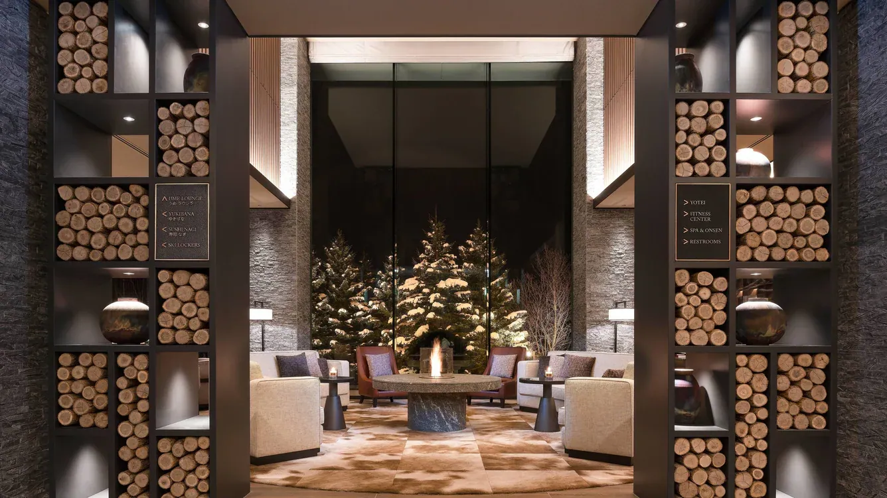 | <a href="https://www.ritzcarlton.com/en/hotels/ctsrz-higashiyama-niseko-village-a-ritz-carlton-reserve/overview/">Source originale</a> / Licence indépendante non confirmée | Visuel non approuvé; Droits de publication à contrôler |
| Higashiyama Niseko Village, a Ritz-Carlton Reserve · view-2 | 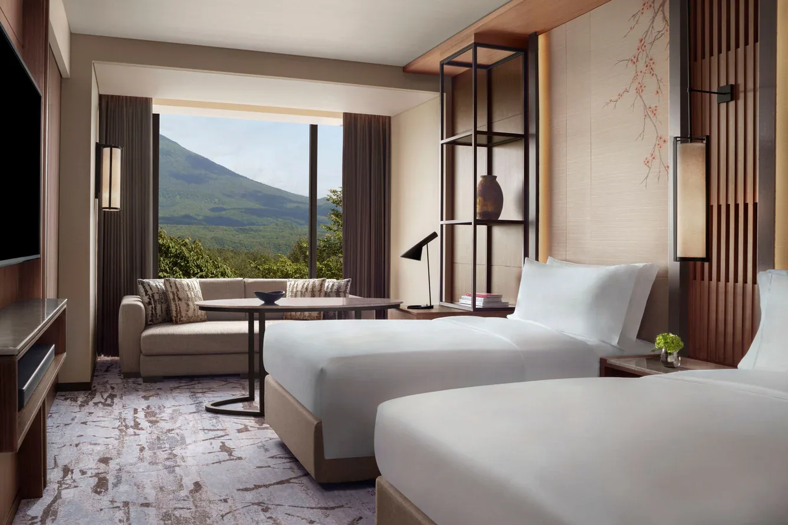 | <a href="https://www.ritzcarlton.com/en/hotels/ctsrz-higashiyama-niseko-village-a-ritz-carlton-reserve/overview/">Source originale</a> / Licence indépendante non confirmée | Visuel non approuvé; Droits de publication à contrôler |
| Higashiyama Niseko Village, a Ritz-Carlton Reserve · view-3 | 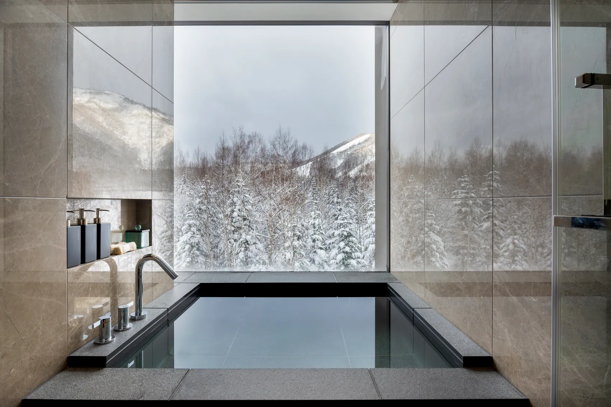 | <a href="https://www.ritzcarlton.com/en/hotels/ctsrz-higashiyama-niseko-village-a-ritz-carlton-reserve/overview/">Source originale</a> / Licence indépendante non confirmée | Visuel non approuvé; Droits de publication à contrôler |
| Setsu Niseko · view-1 | 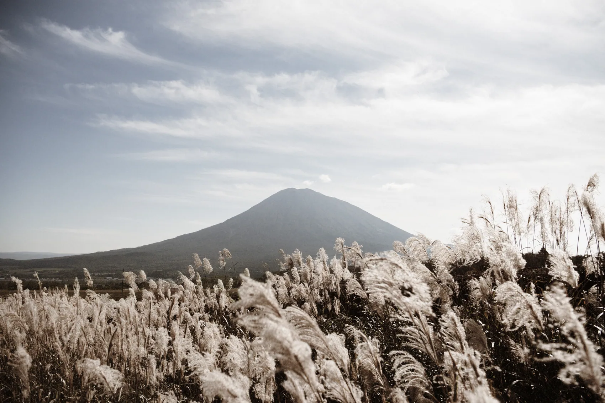 | <a href="https://setsuniseko.com/en/gallery/">Source originale</a> / Licence indépendante non confirmée | Visuel non approuvé; Droits de publication à contrôler; Contrôle visuel : paysage du mont Yōtei SANS bâtiment Setsu identifiable. Ne doit PAS être présenté comme une photo de l'hôtel ; À REMPLACER par une suite ou un espace de Setsu. |
| Setsu Niseko · view-2 | 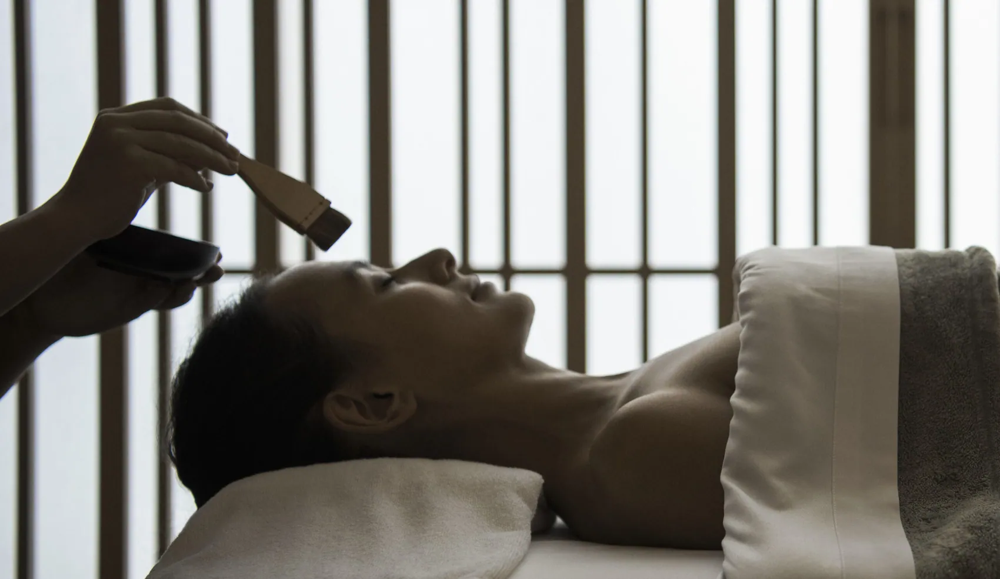 | <a href="https://setsuniseko.com/en/gallery/">Source originale</a> / Licence indépendante non confirmée | Visuel non approuvé; Droits de publication à contrôler; Contrôle visuel : soin visage en espace bien-être, non la chambre ou la résidence. Utiliser seulement pour illustrer le spa si l'appartenance à Setsu est confirmée. |
| Setsu Niseko · view-3 | 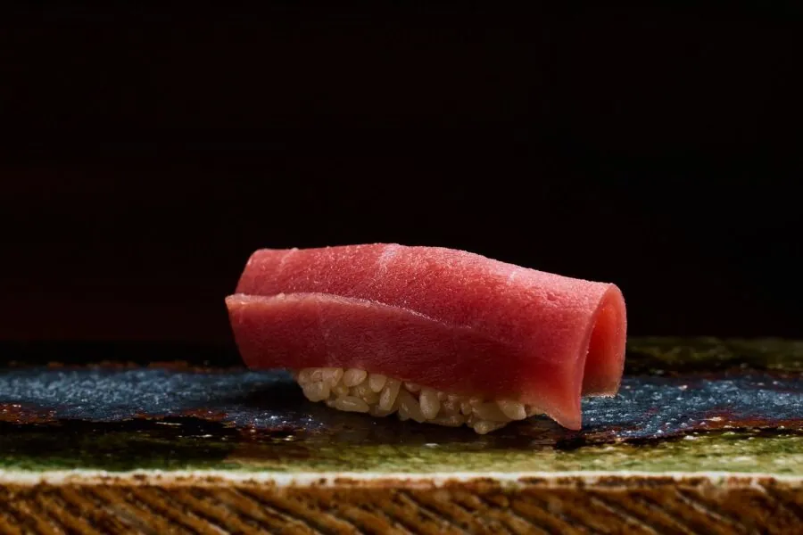 | <a href="https://setsuniseko.com/en/gallery/">Source originale</a> / Licence indépendante non confirmée | Visuel non approuvé; Droits de publication à contrôler |
| AYA Niseko · view-1 | 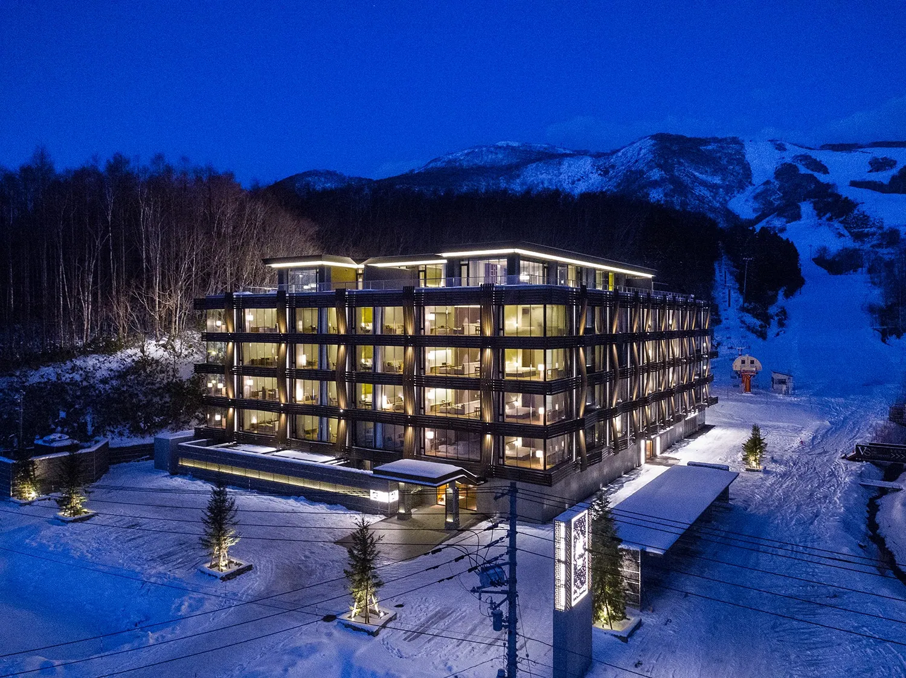 | <a href="https://www.ayaniseko.com/">Source originale</a> / Licence indépendante non confirmée | Visuel non approuvé; Droits de publication à contrôler |
| AYA Niseko · view-2 | 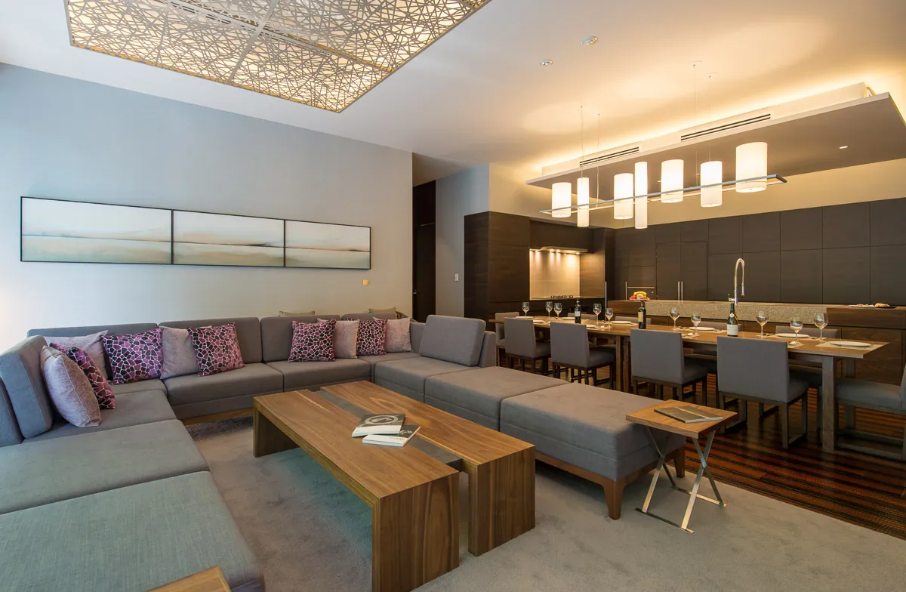 | <a href="https://www.ayaniseko.com/accommodation/residences">Source originale</a> / Licence indépendante non confirmée | Visuel non approuvé; Droits de publication à contrôler |
| AYA Niseko · view-3 | 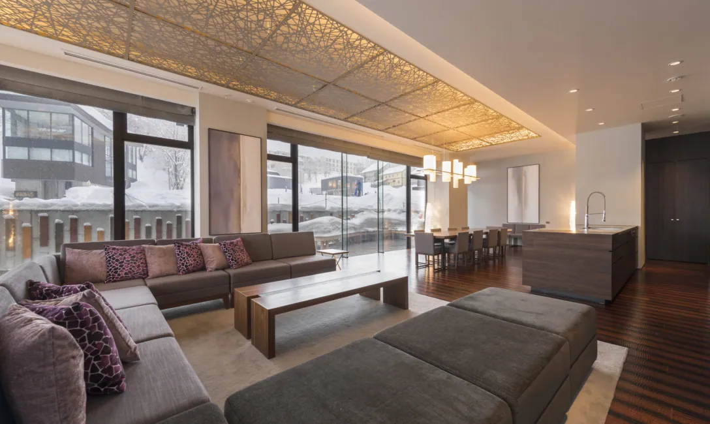 | <a href="https://www.ayaniseko.com/accommodation/residences">Source originale</a> / Licence indépendante non confirmée | Visuel non approuvé; Droits de publication à contrôler |

## Destination : 9 scènes à identifier précisément

| Site ou quartier | Photo WebP authentique à examiner | Source / licence déclarée | Contrôles restants |
|---|---|---|---|
| Mount Yotei · scene-1 | 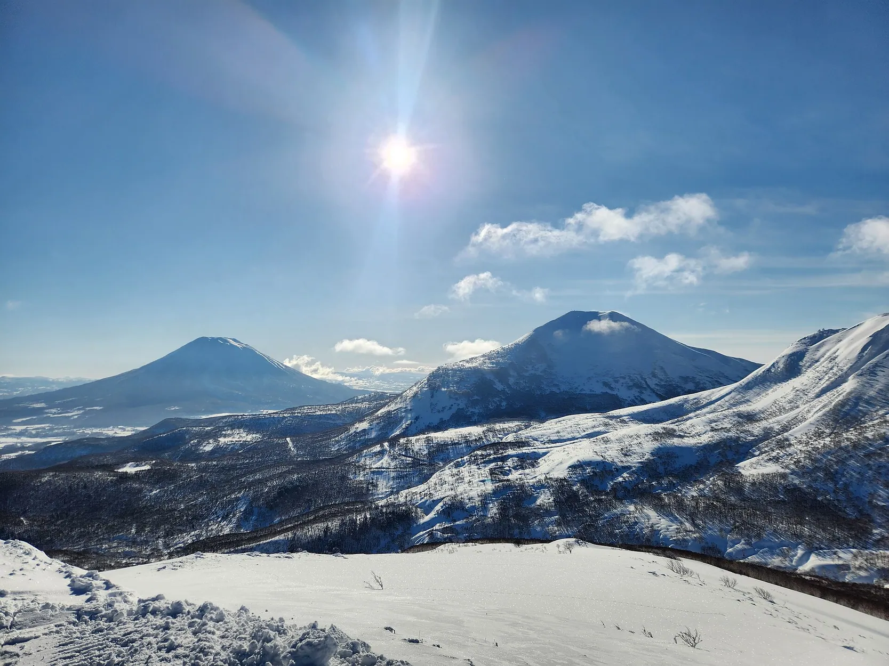 | <a href="https://commons.wikimedia.org/wiki/File:Mount_Yōtei_and_Mount_Niseko-Annupuri.jpg">Source originale</a> / CC BY-SA 4.0 | Visuel non approuvé; Droits de publication à contrôler |
| Niseko Grand Hirafu · scene-2 | 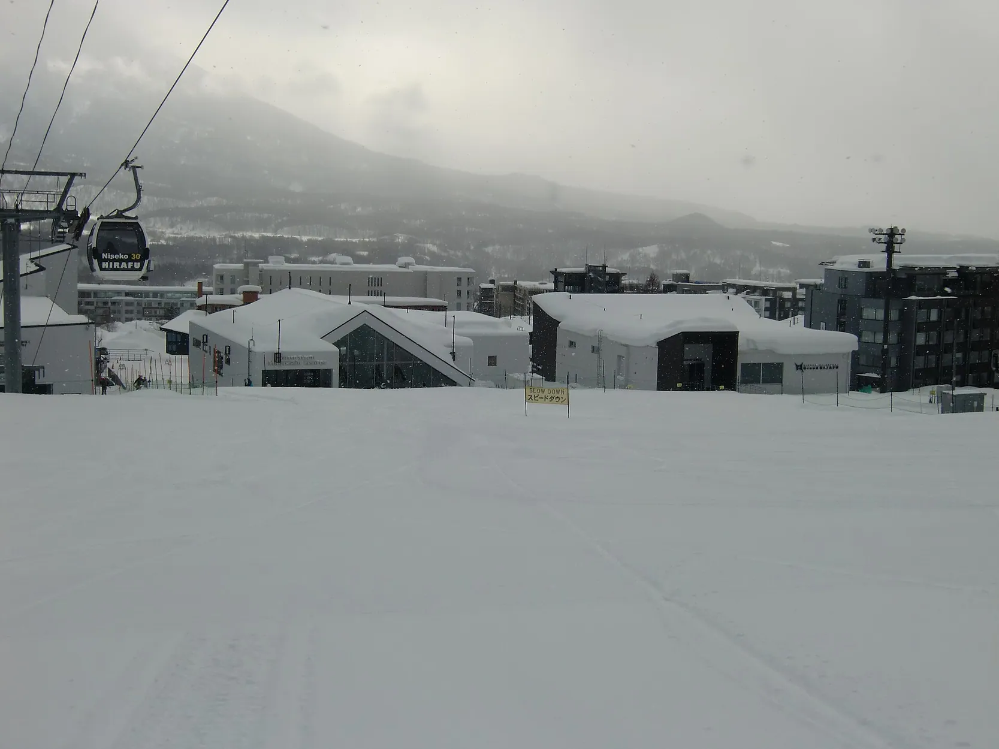 | <a href="https://commons.wikimedia.org/wiki/File:Grand_HIRAFU_Mountain_Center_and_Annex.jpg">Source originale</a> / CC BY-SA 4.0 | Visuel non approuvé; Droits de publication à contrôler |
| Niseko Hanazono · scene-3 | 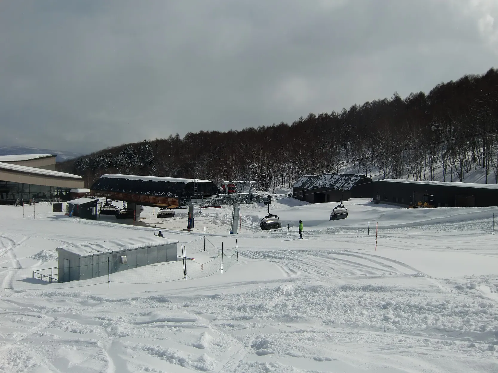 | <a href="https://commons.wikimedia.org/wiki/File:HANAZONO_1st_Lift_(6-seater).jpg">Source originale</a> / CC BY-SA 4.0 | Visuel non approuvé; Droits de publication à contrôler |
| Niseko Village · scene-4 | 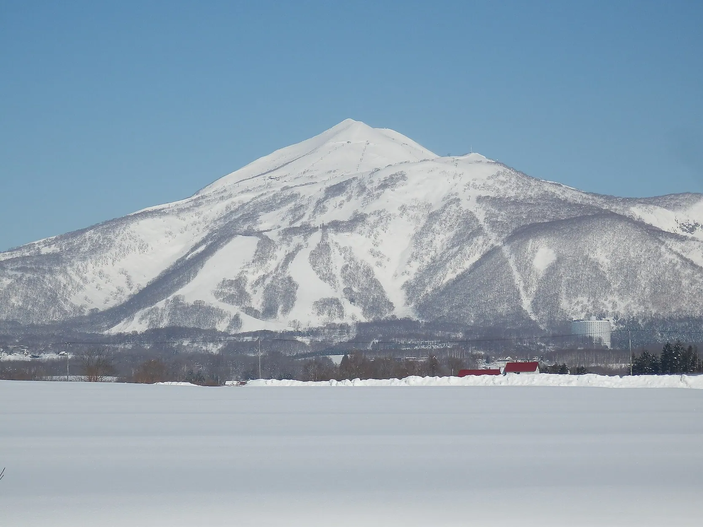 | <a href="https://commons.wikimedia.org/wiki/File:Niseko-Higashiyama.JPG">Source originale</a> / Public domain | Visuel non approuvé; Droits de publication à contrôler |
| Niseko Annupuri · scene-5 | 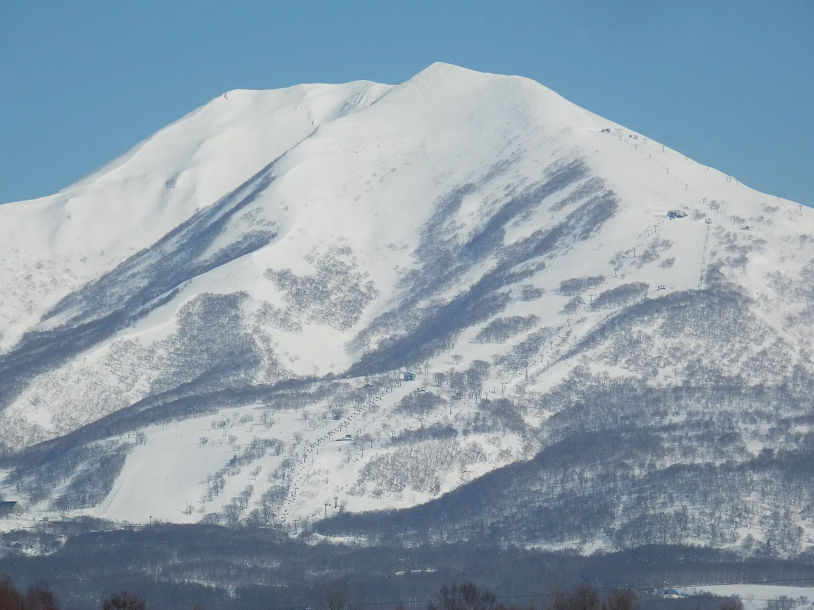 | <a href="https://commons.wikimedia.org/wiki/File:Niseko-Annupuri.JPG">Source originale</a> / Public domain | Visuel non approuvé; Droits de publication à contrôler |
| Kutchan · scene-6 | 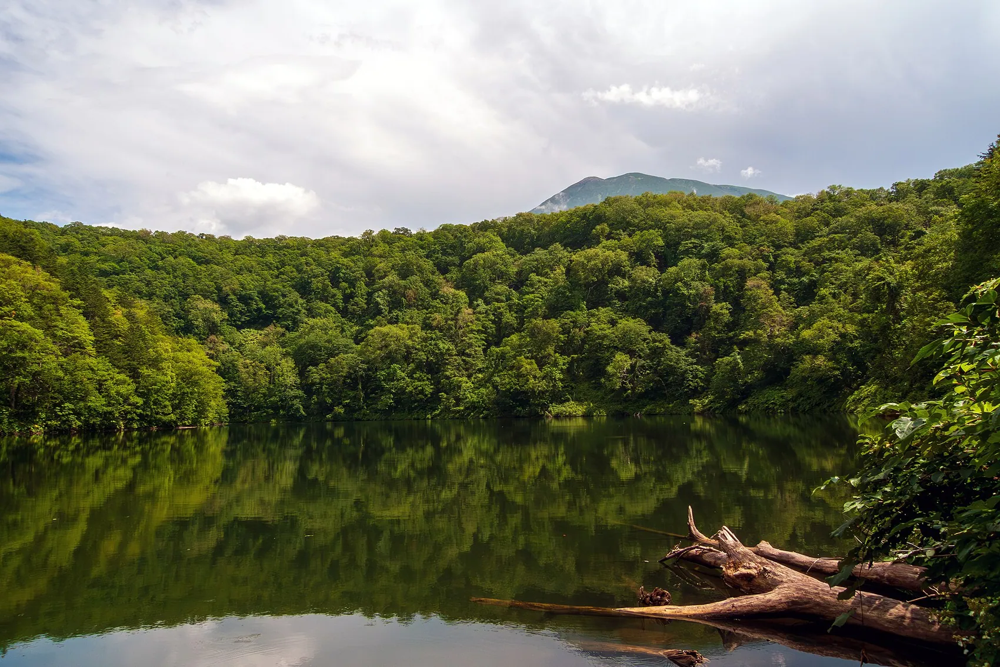 | <a href="https://commons.wikimedia.org/wiki/File:Kutchan-STA_2024.jpg">Source originale</a> / CC0 | Visuel non approuvé; Droits de publication à contrôler |
| Niseko winter · scene-7 | 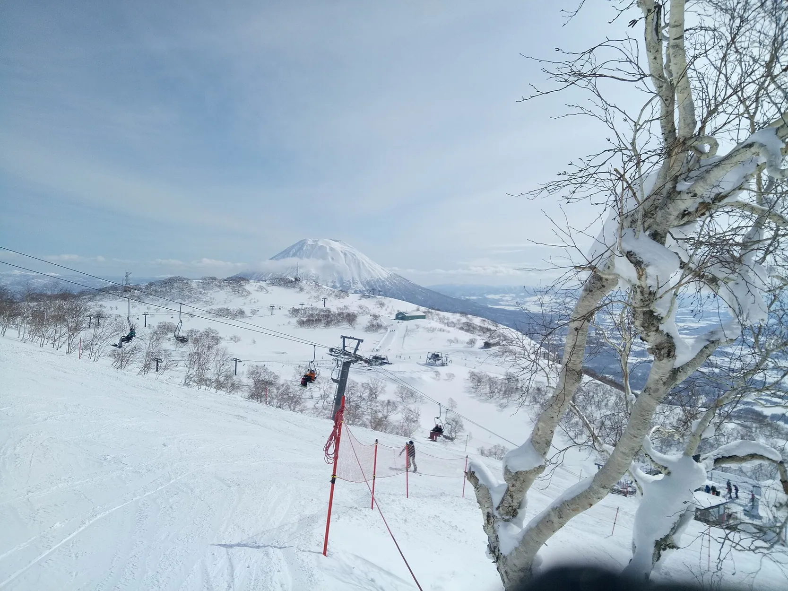 | <a href="https://commons.wikimedia.org/wiki/File:2018_skiing_in_niseko.jpg">Source originale</a> / CC BY-SA 3.0 | Visuel non approuvé; Droits de publication à contrôler |
| Niseko forest · scene-8 | 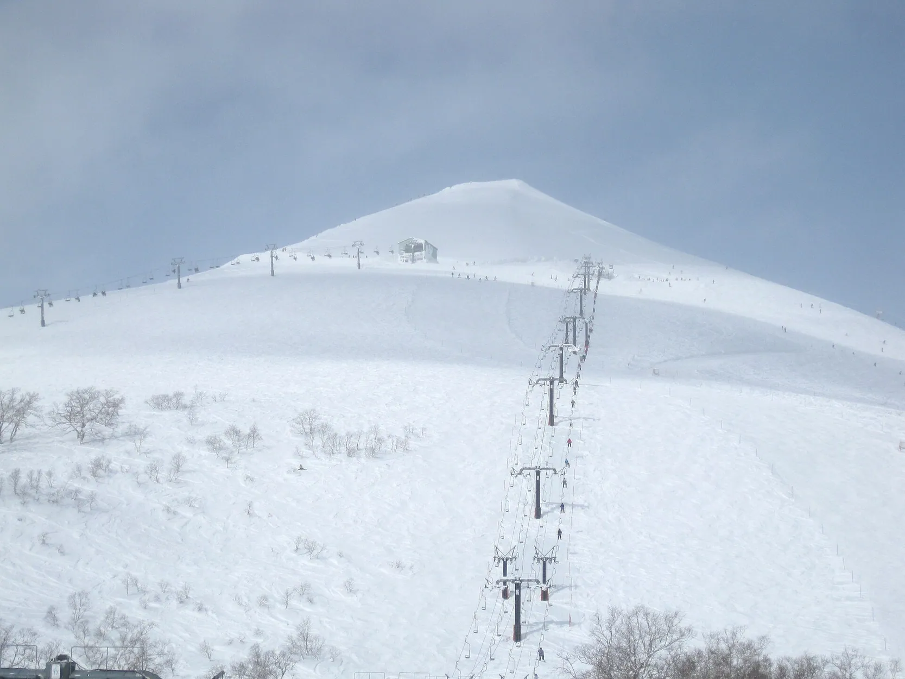 | <a href="https://commons.wikimedia.org/wiki/File:2010-02.niseko_annupuri.jpg">Source originale</a> / CC BY 3.0 | Visuel non approuvé; Droits de publication à contrôler |
| Hokkaido onsen · scene-9 | 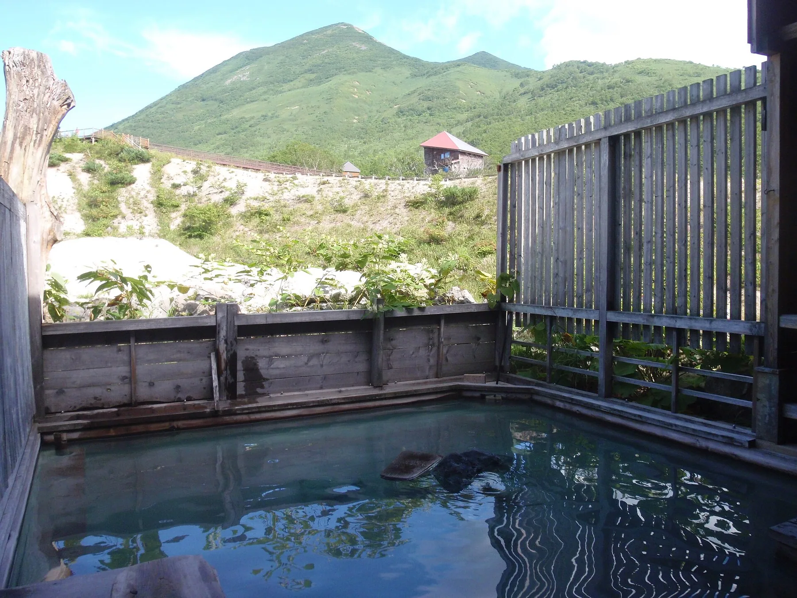 | <a href="https://commons.wikimedia.org/wiki/File:Goshiki_spa_roten.JPG">Source originale</a> / Public domain | Visuel non approuvé; Droits de publication à contrôler; Contrôle visuel : vrai bain extérieur Goshiki Onsen mais photo estivale ancienne, qualité peu premium ; À REMPLACER par un visuel d'onsen local plus adapté avant publication. |

## Contrôles complémentaires

- [ ] Confirmer que chaque photo montre effectivement l'établissement ou l'endroit annoncé, et qu'il ne s'agit pas de variantes recadrées du même cliché.
- [ ] Contrôler la source, l'auteur, la licence commerciale et les obligations CC BY/CC BY-SA ou de marques.
- [ ] Vérifier les vues et les catégories de chambre pour éviter toute promesse implicite d'inventaire.
- [ ] Rédiger les descriptions alternatives FR/EN sur la base de chaque image effectivement contrôlée.
- [ ] Ne jamais activer ces trois pages premium, les photos ou le SEO indexable avant le contrôle final.
