# St. Moritz — galerie de vérification

> **INTERNE — Images candidates uniquement. Aucune image n'est encore approuvée pour publication.**

**Couverture :** 12/12 photographies des établissements, 9/9 scènes locales, 21/21 en tout.

**Revue humaine initiale :** certains visuels ont des alertes éditoriales détaillées dans le tableau ; 21/21 désigne uniquement les fichiers physiquement récupérés.

**Statut de publication :** aucune validation visuelle globale, aucun feu vert de publication commerciale. Le guide reste en brouillon et non indexable.

## Hôtels : 4 adresses × 3 images

| Établissement et emplacement | Photo WebP authentique à examiner | Source / licence déclarée | Contrôles restants |
|---|---|---|---|
| Badrutt&#x27;s Palace Hotel · view-1 | 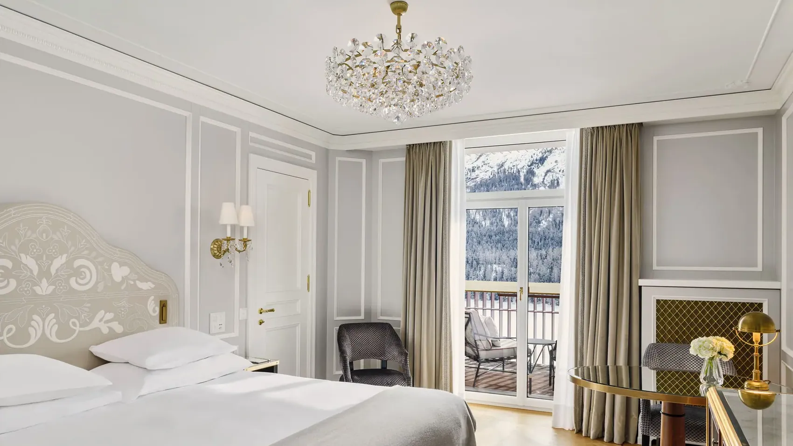 | <a href="https://badruttspalace.com/en/winter/accommodation/rooms/">Source originale</a> / Licence indépendante non confirmée | Visuel non approuvé; Droits de publication à contrôler |
| Badrutt&#x27;s Palace Hotel · view-2 | 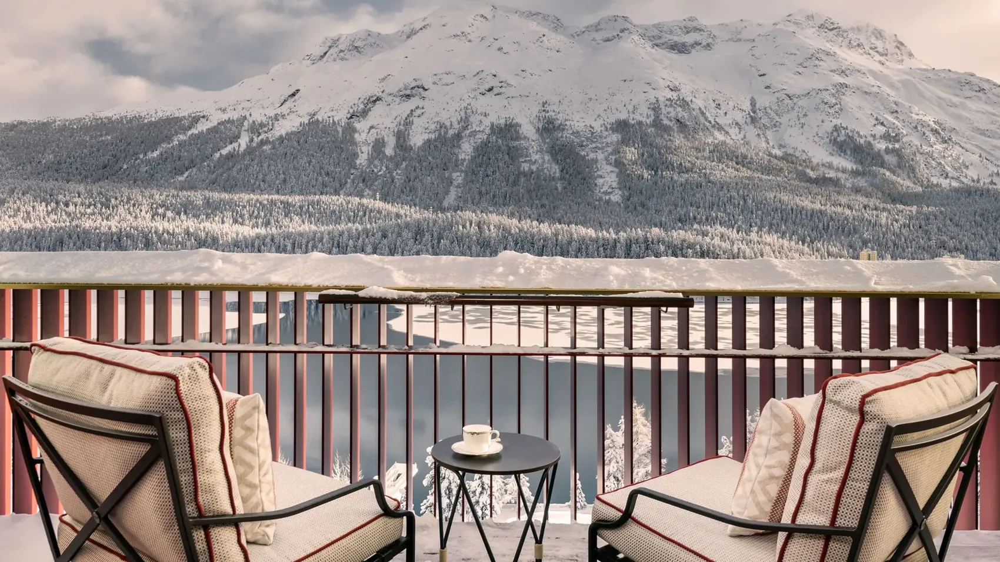 | <a href="https://badruttspalace.com/en/winter/accommodation/rooms/">Source originale</a> / Licence indépendante non confirmée | Visuel non approuvé; Droits de publication à contrôler |
| Badrutt&#x27;s Palace Hotel · view-3 | 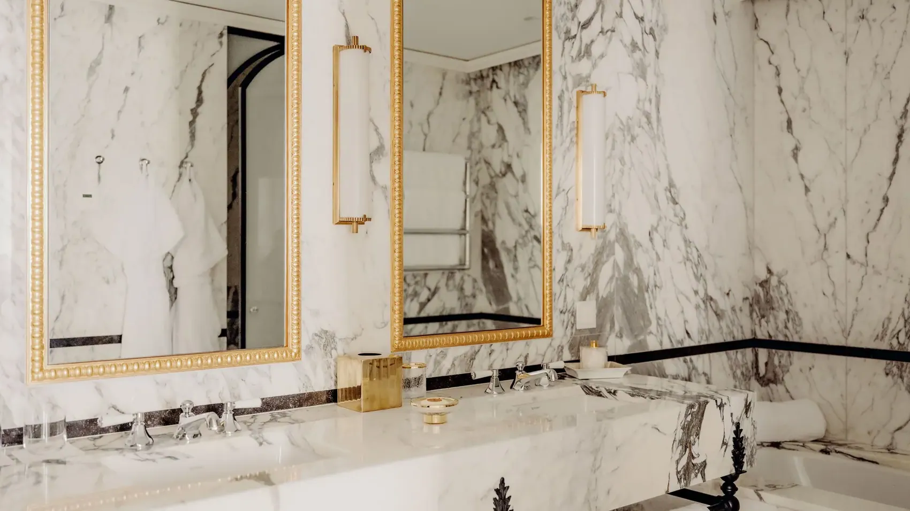 | <a href="https://badruttspalace.com/en/winter/accommodation/rooms/">Source originale</a> / Licence indépendante non confirmée | Visuel non approuvé; Droits de publication à contrôler |
| Kulm Hotel St. Moritz · view-1 | 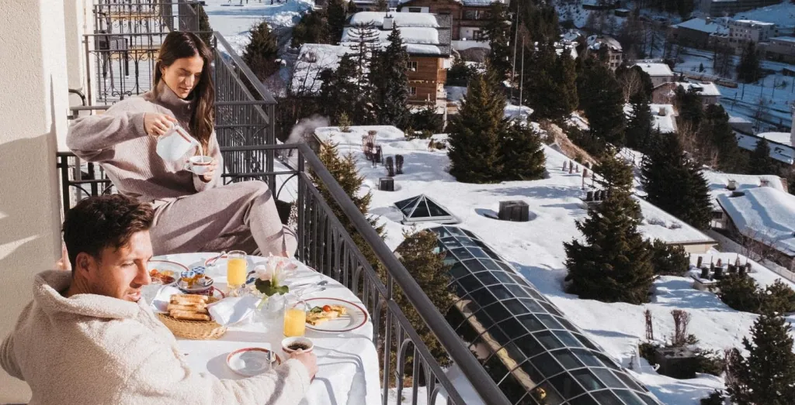 | <a href="https://www.kulm.com/en/winter/">Source originale</a> / Licence indépendante non confirmée | Visuel non approuvé; Droits de publication à contrôler |
| Kulm Hotel St. Moritz · view-2 | 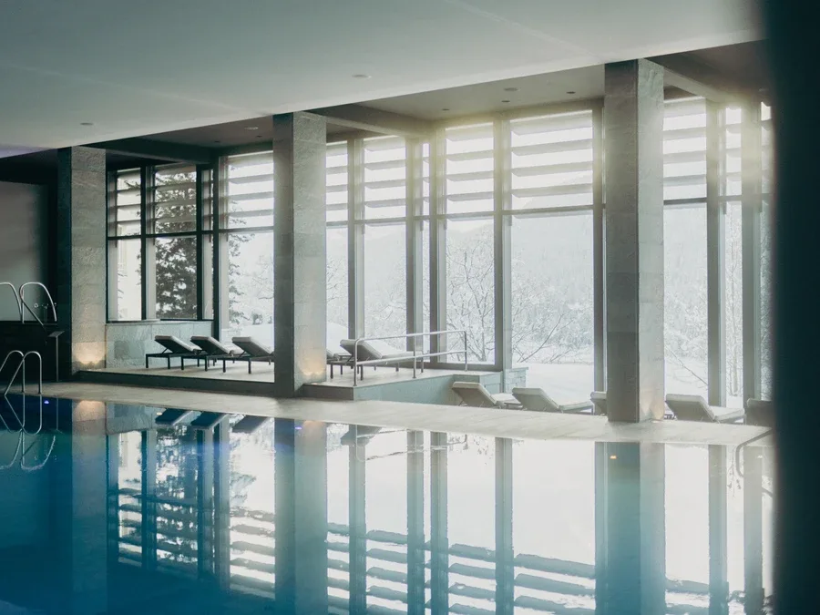 | <a href="https://commons.wikimedia.org/wiki/File:Kulm_Hotel_Sankt_Moritz_2022-09-25_01.jpg">Source originale</a> / CC0 | Visuel non approuvé; Droits de publication à contrôler; Contrôle visuel : entrée réelle du Kulm, mais cliché extérieur de 2022 peu représentatif d'un palace d'hiver ; conserver uniquement en photo secondaire tant qu'une meilleure image n'est pas sélectionnée. |
| Kulm Hotel St. Moritz · view-3 | 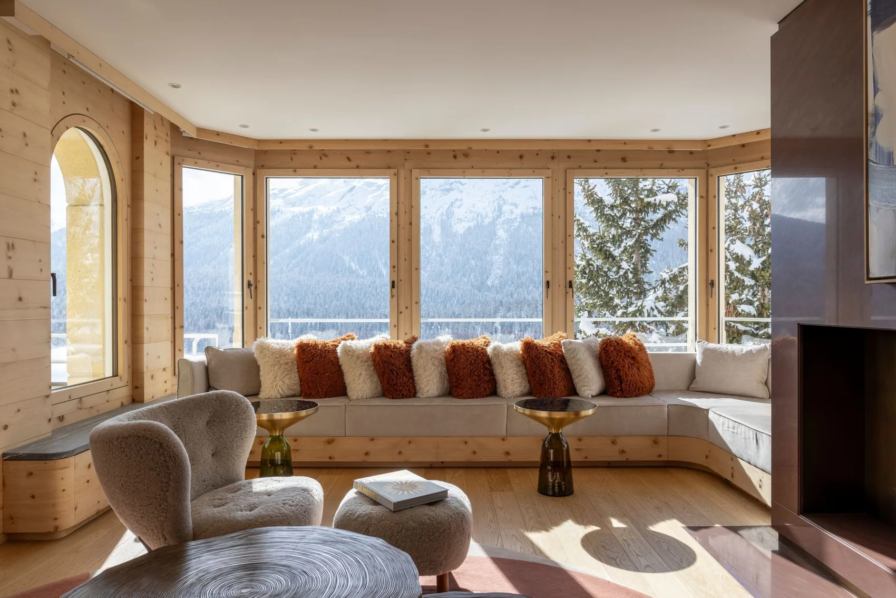 | <a href="https://commons.wikimedia.org/wiki/File:Kulm_Hotel_Sankt_Moritz_2022-09-25_03.jpg">Source originale</a> / CC0 | Visuel non approuvé; Droits de publication à contrôler; Contrôle visuel : pelouse et terrain extérieur du domaine, sans mise en valeur de l'hôtel ; À REMPLACER par une photo intérieure, spa ou façade du Kulm. |
| Suvretta House · view-1 | 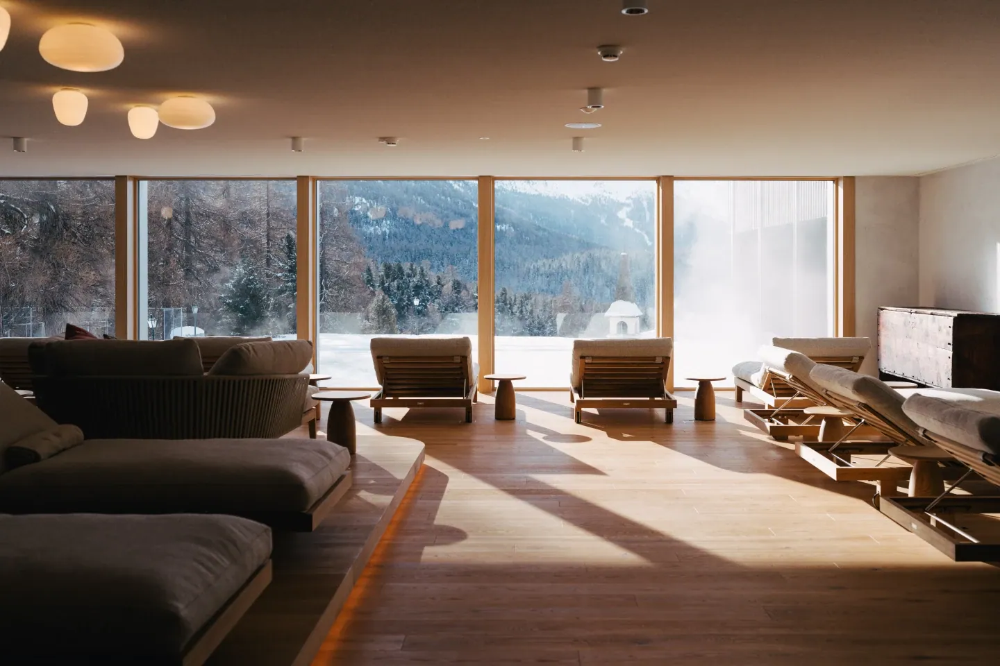 | <a href="https://suvrettahouse.ch/en/startseite-winter">Source originale</a> / Licence indépendante non confirmée | Visuel non approuvé; Droits de publication à contrôler |
| Suvretta House · view-2 | 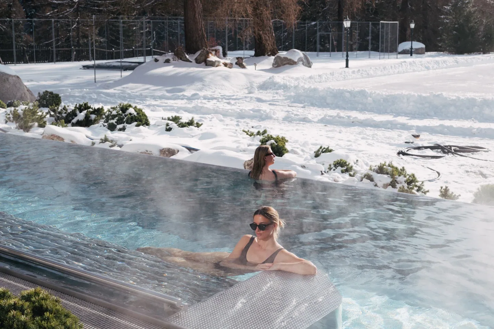 | <a href="https://suvrettahouse.ch/en/startseite-winter">Source originale</a> / Licence indépendante non confirmée | Visuel non approuvé; Droits de publication à contrôler |
| Suvretta House · view-3 | 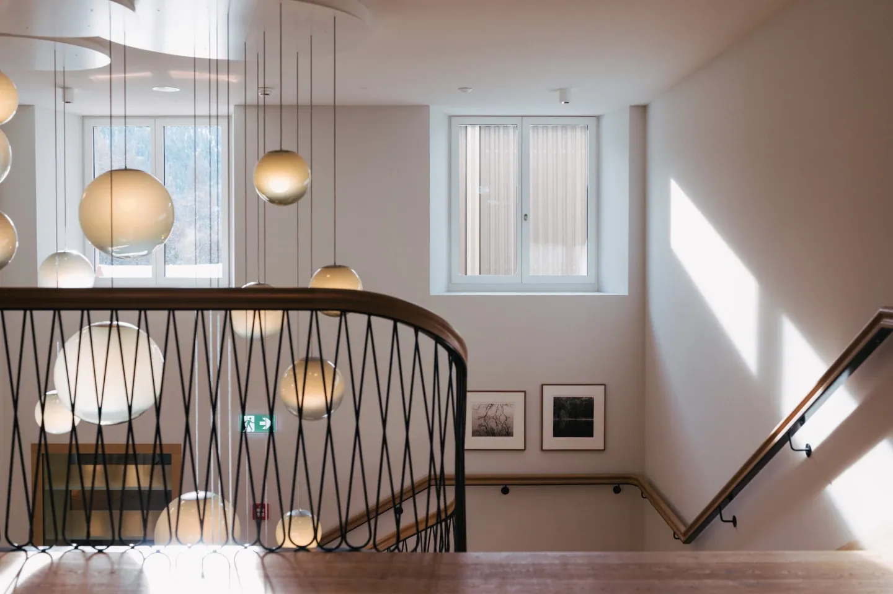 | <a href="https://suvrettahouse.ch/en/startseite-winter">Source originale</a> / Licence indépendante non confirmée | Visuel non approuvé; Droits de publication à contrôler |
| Carlton Hotel St. Moritz · view-1 | 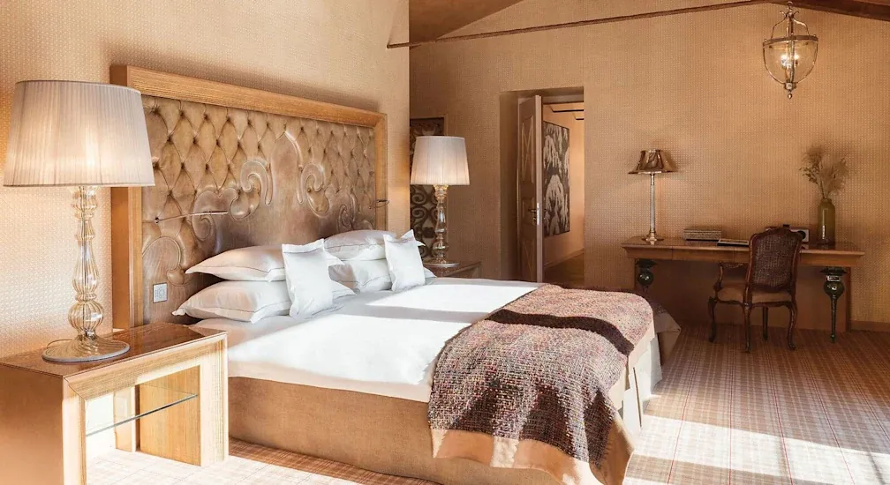 | <a href="https://tschuggencollection.ch/en/hotel/carlton-hotel">Source originale</a> / Licence indépendante non confirmée | Visuel non approuvé; Droits de publication à contrôler |
| Carlton Hotel St. Moritz · view-2 | 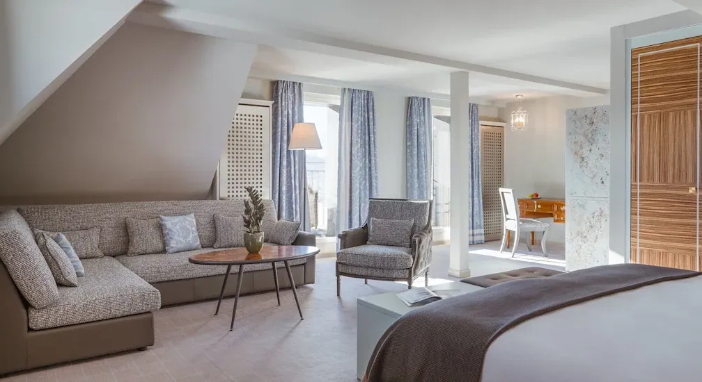 | <a href="https://tschuggencollection.ch/en/hotel/carlton-hotel">Source originale</a> / Licence indépendante non confirmée | Visuel non approuvé; Droits de publication à contrôler |
| Carlton Hotel St. Moritz · view-3 | 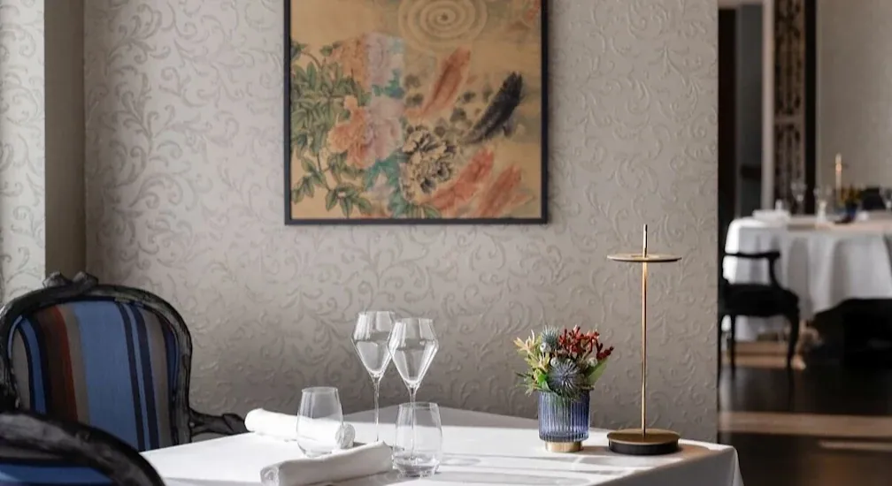 | <a href="https://tschuggencollection.ch/en/hotel/carlton-hotel">Source originale</a> / Licence indépendante non confirmée | Visuel non approuvé; Droits de publication à contrôler |

## Destination : 9 scènes à identifier précisément

| Site ou quartier | Photo WebP authentique à examiner | Source / licence déclarée | Contrôles restants |
|---|---|---|---|
| St. Moritz lake · scene-1 | 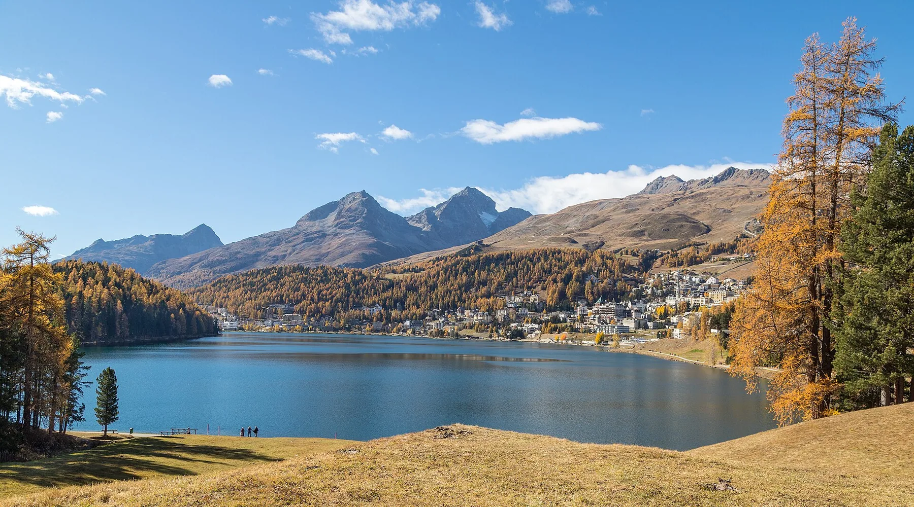 | <a href="https://commons.wikimedia.org/wiki/File:Blick_über_den_Sankt_Moritzersee_auf_Sankt_Moritz.jpg">Source originale</a> / CC BY-SA 4.0 | Visuel non approuvé; Droits de publication à contrôler; Contrôle visuel : panorama réel du lac en automne. Ne pas légender comme une vue d'hiver ni utiliser pour promettre les conditions de neige. |
| St. Moritz Dorf · scene-2 | 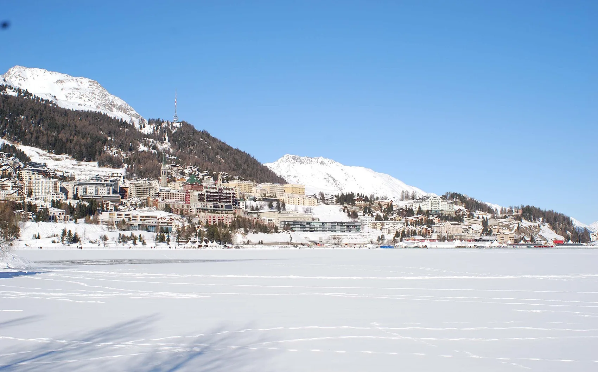 | <a href="https://commons.wikimedia.org/wiki/File:St._Moritz_village_and_baths_Grisons_Switzerland.jpg">Source originale</a> / CC BY-SA 2.0 | Visuel non approuvé; Droits de publication à contrôler |
| St. Moritz Bad · scene-3 | 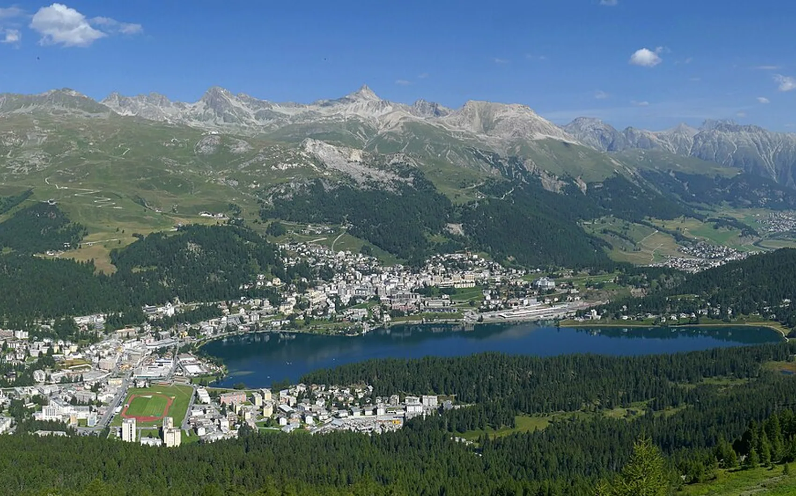 | <a href="https://commons.wikimedia.org/wiki/File:St._Moritz_Forum_Paracelsus.JPG">Source originale</a> / CC BY-SA 4.0 | Visuel non approuvé; Droits de publication à contrôler |
| Suvretta · scene-4 | 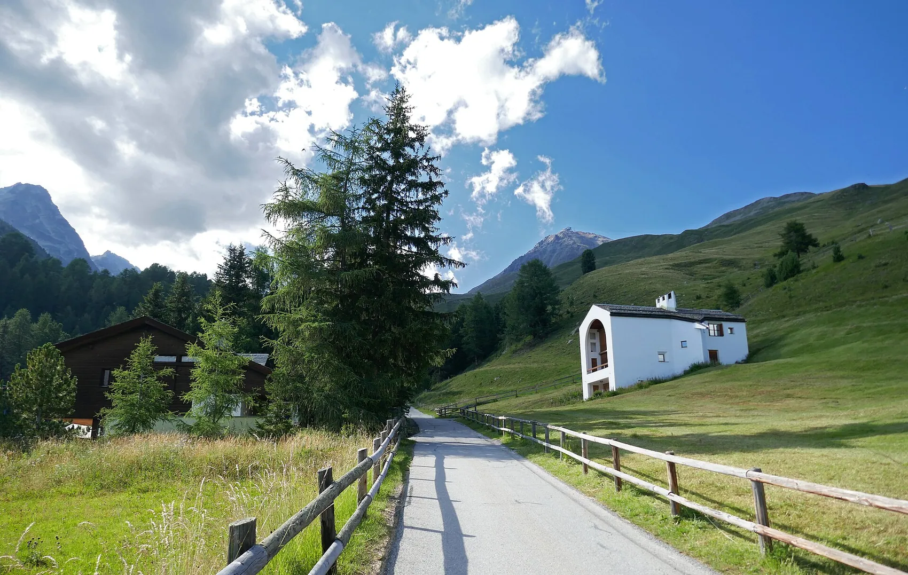 | <a href="https://commons.wikimedia.org/wiki/File:Via_Suvretta.jpg">Source originale</a> / CC BY-SA 4.0 | Visuel non approuvé; Droits de publication à contrôler |
| Corviglia · scene-5 | 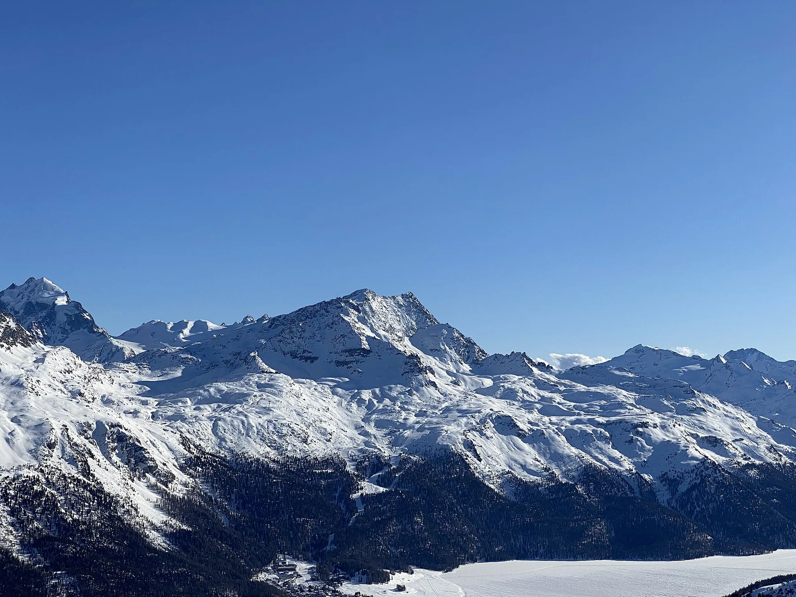 | <a href="https://commons.wikimedia.org/wiki/File:St._Moritz_Corviglia_2.jpg">Source originale</a> / CC BY-SA 4.0 | Visuel non approuvé; Droits de publication à contrôler |
| Celerina · scene-6 | 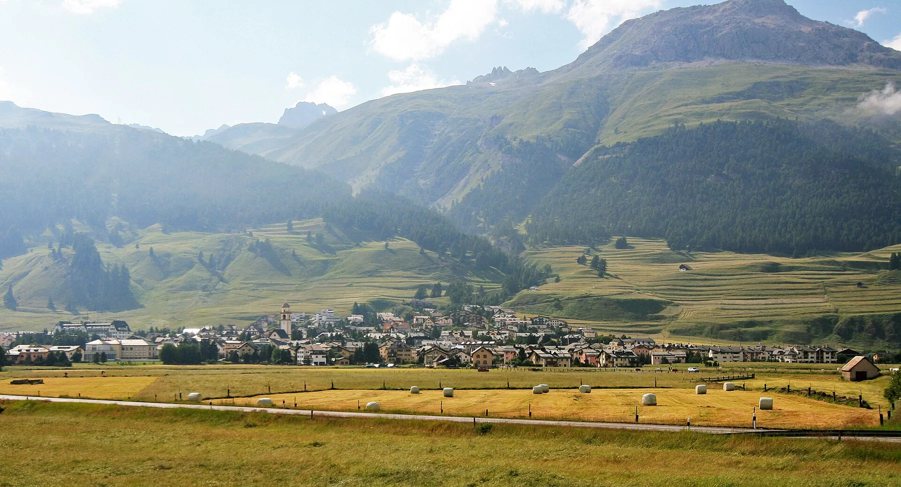 | <a href="https://commons.wikimedia.org/wiki/File:Celerina_Engadin.jpg">Source originale</a> / Public domain | Visuel non approuvé; Droits de publication à contrôler |
| Pontresina · scene-7 | 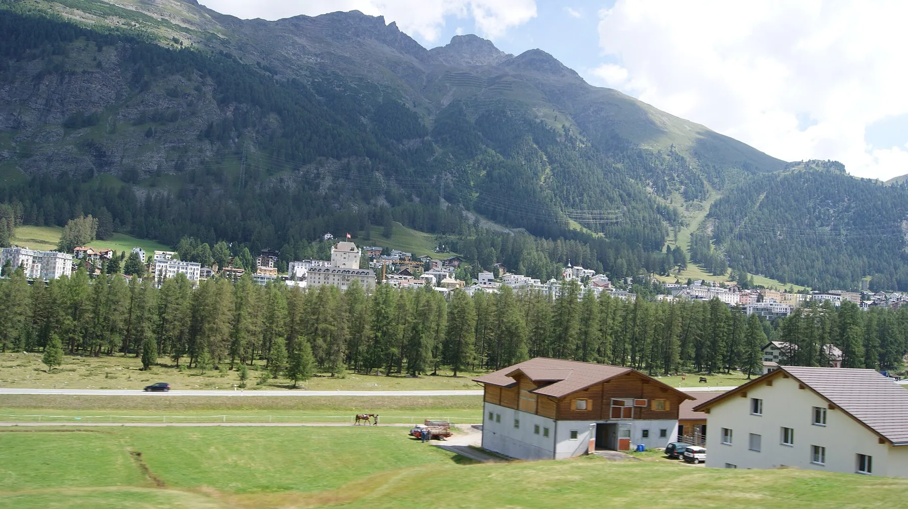 | <a href="https://commons.wikimedia.org/wiki/File:Pontresina-01.jpg">Source originale</a> / CC BY-SA 4.0 | Visuel non approuvé; Droits de publication à contrôler |
| St. Moritz winter · scene-8 | 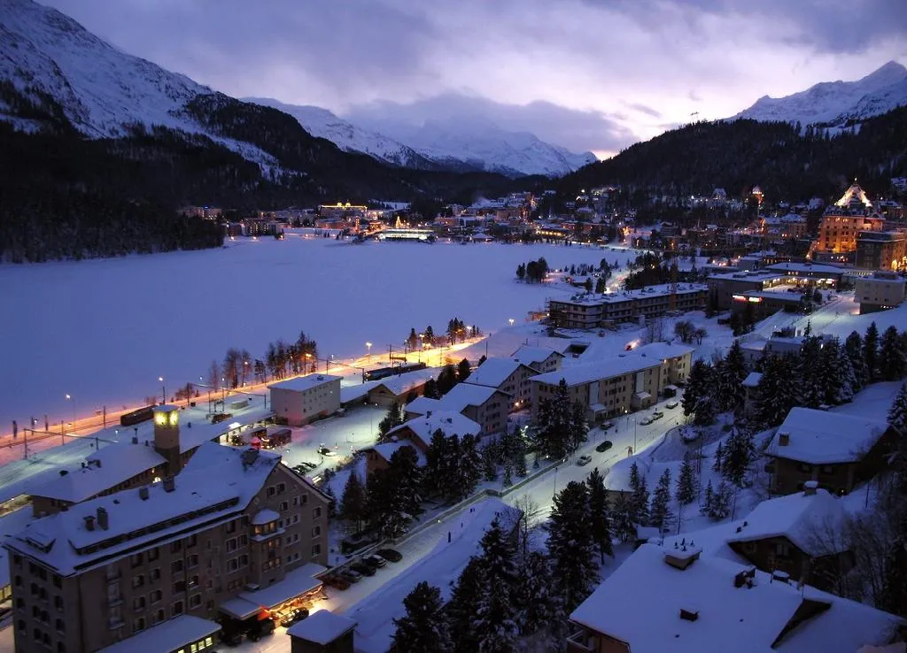 | <a href="https://commons.wikimedia.org/wiki/File:StMoritz.jpg">Source originale</a> / Public domain | Visuel non approuvé; Droits de publication à contrôler |
| Engadin landscape · scene-9 | 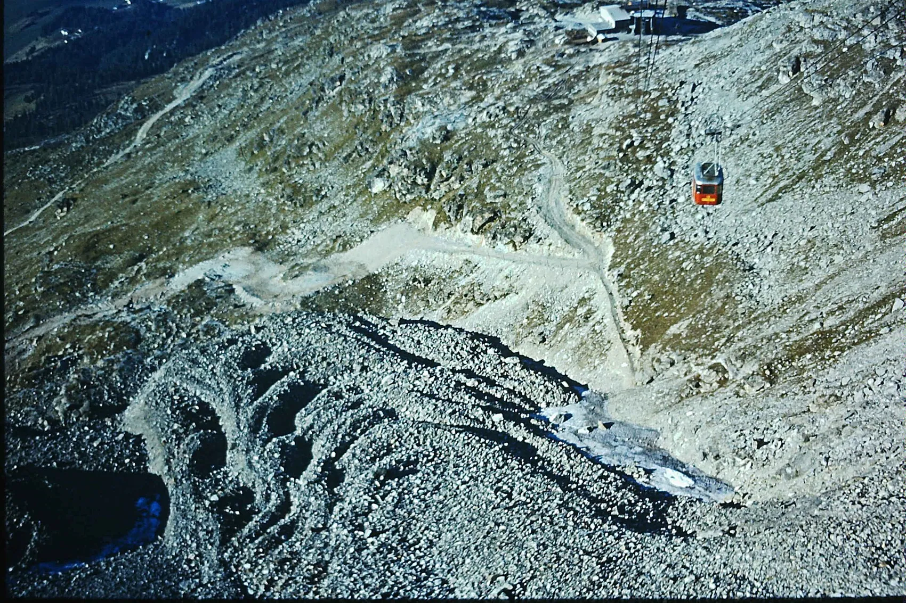 | <a href="https://commons.wikimedia.org/wiki/File:St._Moritz_-_Pontresina.jpg">Source originale</a> / CC BY-SA 4.0 | Visuel non approuvé; Droits de publication à contrôler |

## Contrôles complémentaires

- [ ] Confirmer que chaque photo montre effectivement l'établissement ou l'endroit annoncé, et qu'il ne s'agit pas de variantes recadrées du même cliché.
- [ ] Contrôler la source, l'auteur, la licence commerciale et les obligations CC BY/CC BY-SA ou de marques.
- [ ] Vérifier les vues et les catégories de chambre pour éviter toute promesse implicite d'inventaire.
- [ ] Rédiger les descriptions alternatives FR/EN sur la base de chaque image effectivement contrôlée.
- [ ] Ne jamais activer ces trois pages premium, les photos ou le SEO indexable avant le contrôle final.
