# Val d'Isère — galerie de vérification

> **INTERNE — Images candidates uniquement. Aucune image n'est encore approuvée pour publication.**

**Couverture :** 12/12 photographies des établissements, 5/9 scènes locales, 17/21 en tout.

**Statut de publication :** aucune validation visuelle globale, aucun feu vert de publication commerciale. Le guide reste en brouillon et non indexable.

## Hôtels : 4 adresses × 3 images

| Établissement et emplacement | Photo WebP authentique à examiner | Source / licence déclarée | Contrôles restants |
|---|---|---|---|
| Airelles Val d&#x27;Isère · view-1 | 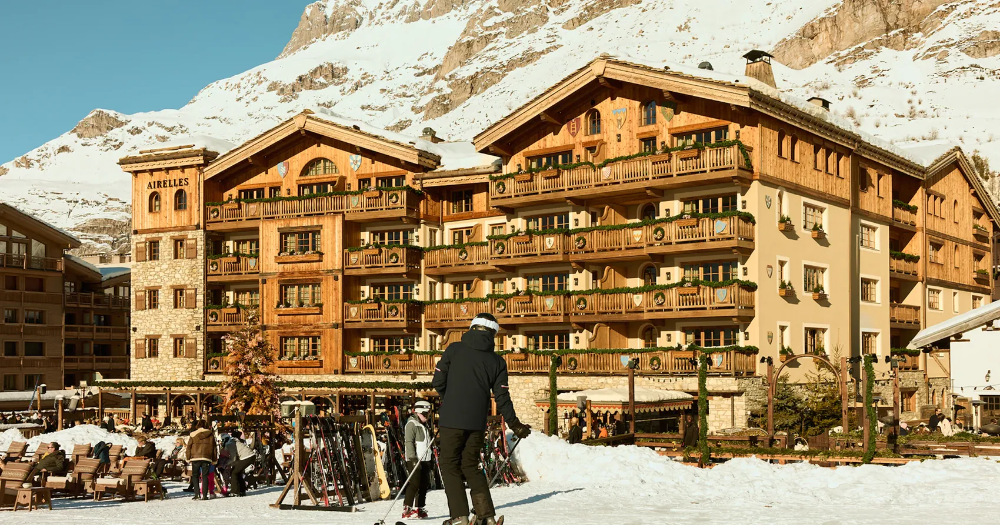 | <a href="https://airelles.com/fr/destination/val-d-isere-hotel">Source originale</a> / Licence indépendante non confirmée | Visuel non approuvé; Droits de publication à contrôler |
| Airelles Val d&#x27;Isère · view-2 | 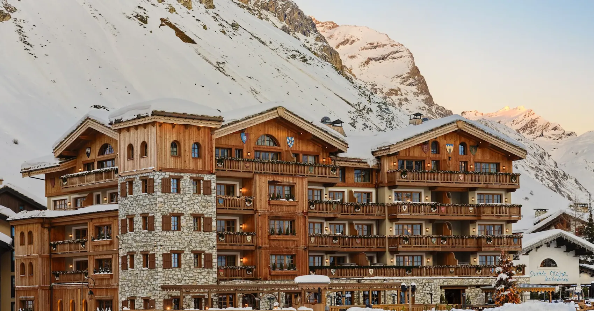 | <a href="https://airelles.com/en/destination/val-d-isere-hotel">Source originale</a> / Licence indépendante non confirmée | Visuel non approuvé; Droits de publication à contrôler |
| Airelles Val d&#x27;Isère · view-3 | 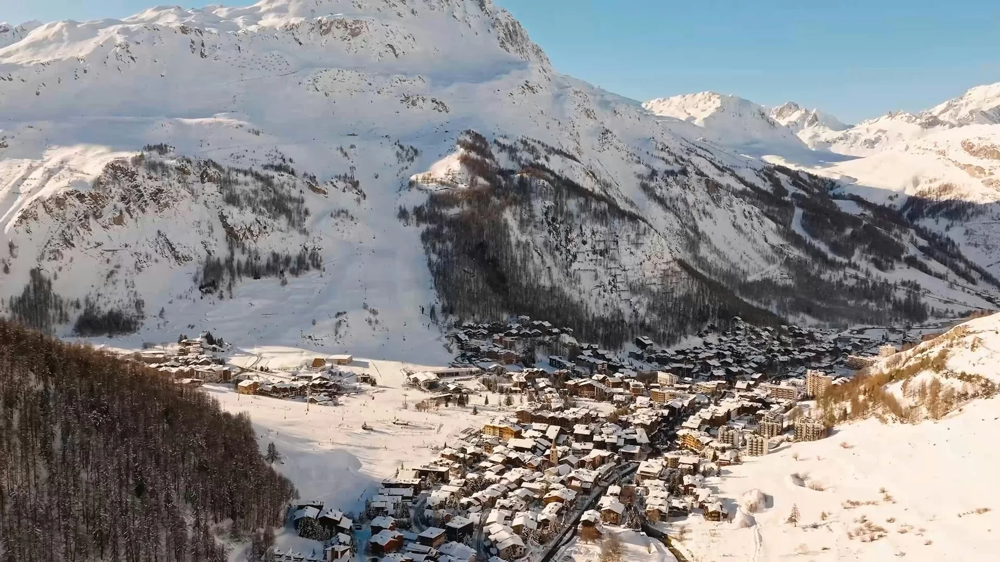 | <a href="https://airelles.com/en/destination/val-d-isere-hotel">Source originale</a> / Licence indépendante non confirmée | Visuel non approuvé; Droits de publication à contrôler |
| Le K2 Chogori · view-1 | 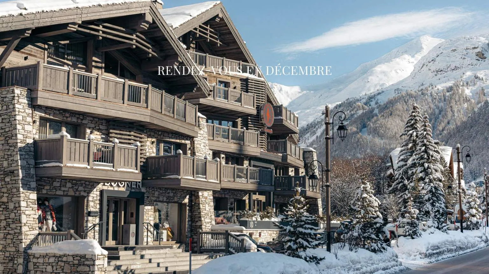 | <a href="https://lek2chogori.com/fr/">Source originale</a> / Licence indépendante non confirmée | Visuel non approuvé; Droits de publication à contrôler |
| Le K2 Chogori · view-2 | 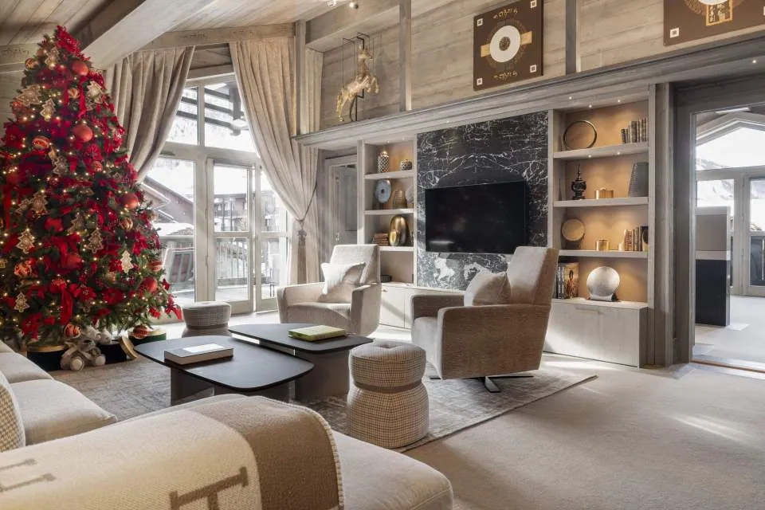 | <a href="https://lek2chogori.com/fr/">Source originale</a> / Licence indépendante non confirmée | Visuel non approuvé; Droits de publication à contrôler |
| Le K2 Chogori · view-3 | 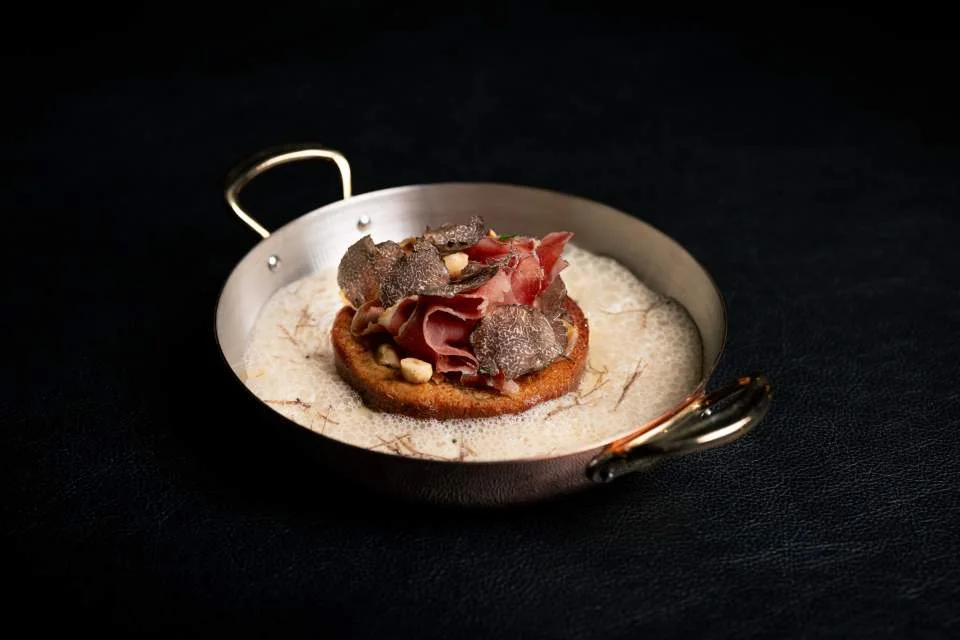 | <a href="https://lek2chogori.com/fr/">Source originale</a> / Licence indépendante non confirmée | Visuel non approuvé; Droits de publication à contrôler |
| La Mourra · view-1 | 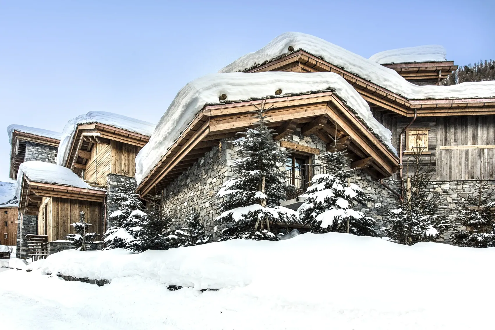 | <a href="https://www.hotellamourra.com/fr/">Source originale</a> / Licence indépendante non confirmée | Visuel non approuvé; Droits de publication à contrôler |
| La Mourra · view-2 | 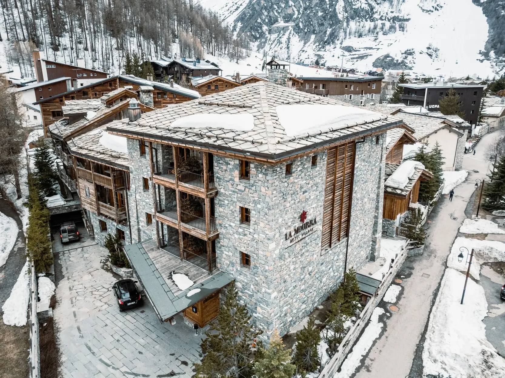 | <a href="https://www.hotellamourra.com/fr/">Source originale</a> / Licence indépendante non confirmée | Visuel non approuvé; Droits de publication à contrôler |
| La Mourra · view-3 | 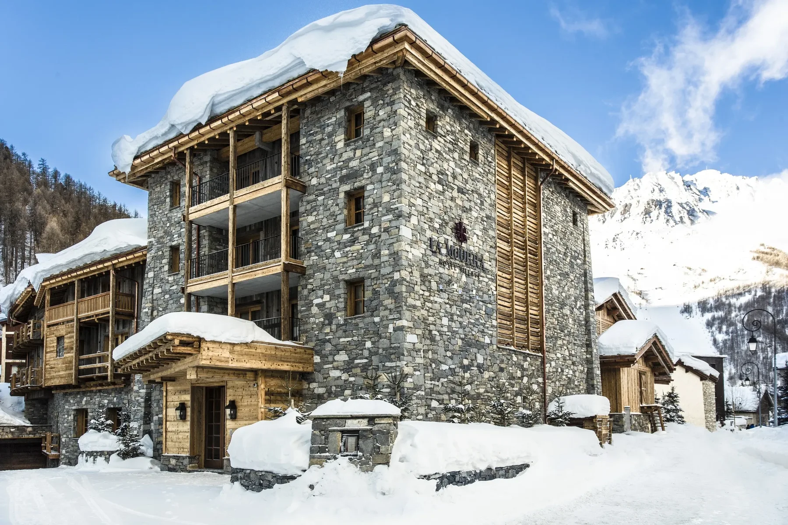 | <a href="https://www.hotellamourra.com/fr/">Source originale</a> / Licence indépendante non confirmée | Visuel non approuvé; Droits de publication à contrôler |
| Le Blizzard · view-1 | 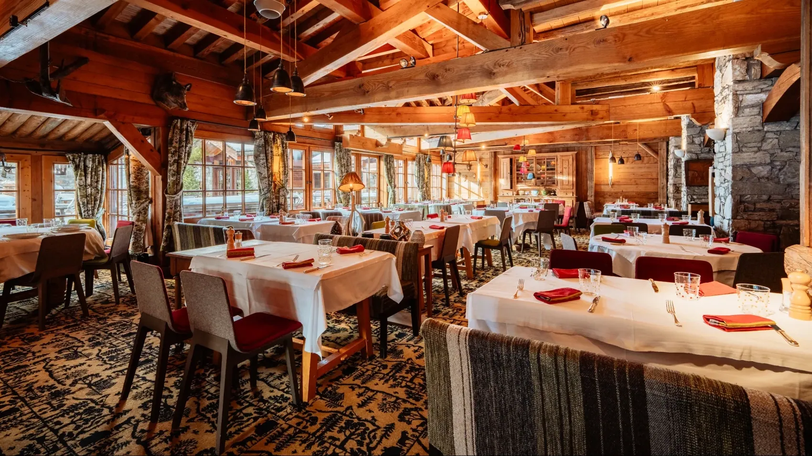 | <a href="https://hotelblizzard.com/fr/">Source originale</a> / Licence indépendante non confirmée | Visuel non approuvé; Droits de publication à contrôler |
| Le Blizzard · view-2 | 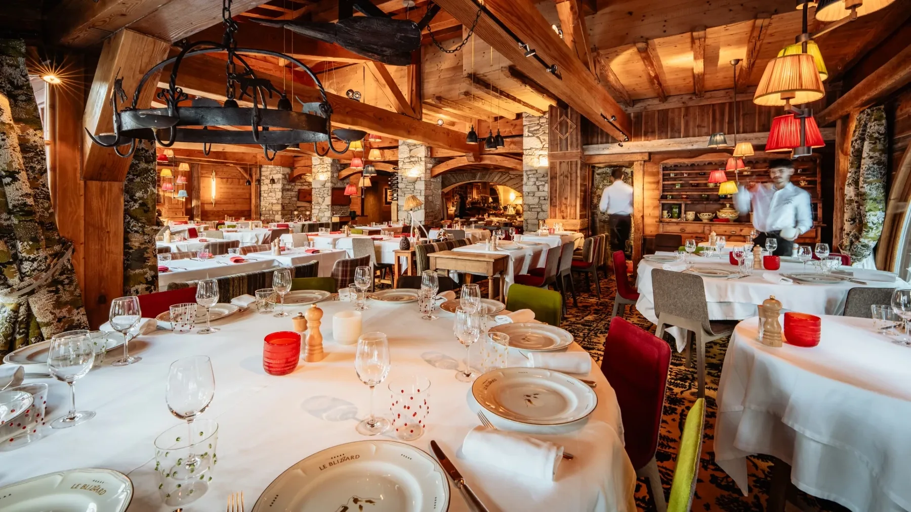 | <a href="https://hotelblizzard.com/fr/">Source originale</a> / Licence indépendante non confirmée | Visuel non approuvé; Droits de publication à contrôler |
| Le Blizzard · view-3 | 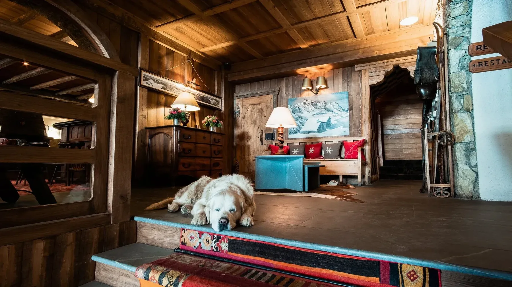 | <a href="https://hotelblizzard.com/fr/">Source originale</a> / Licence indépendante non confirmée | Visuel non approuvé; Droits de publication à contrôler |

## Destination : 9 scènes à identifier précisément

| Site ou quartier | Photo WebP authentique à examiner | Source / licence déclarée | Contrôles restants |
|---|---|---|---|
| Val d&#x27;Isère old village · scene-1 | 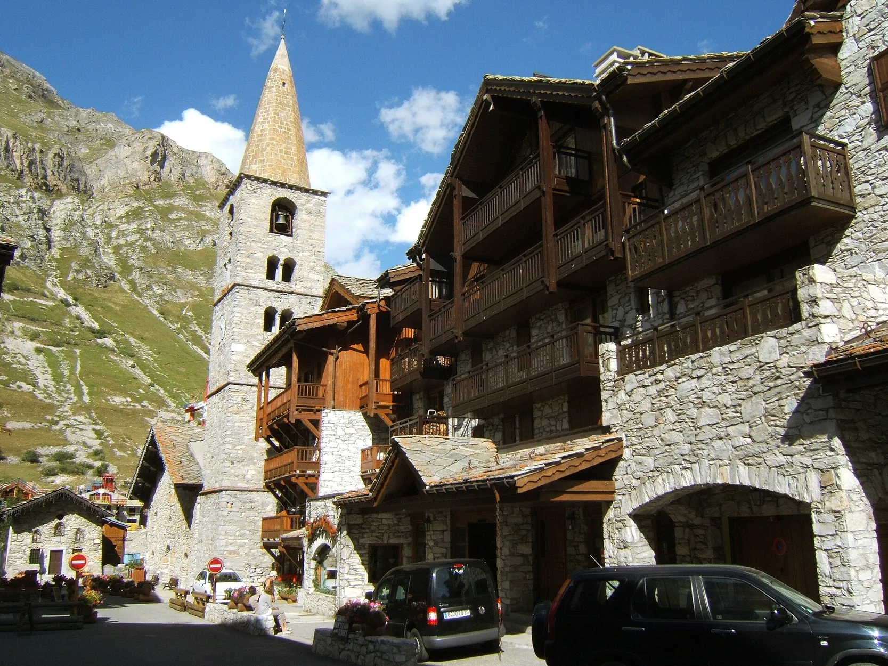 | <a href="https://commons.wikimedia.org/wiki/File:Val-dIsere-église-chemin-du-Charvet.JPG">Source originale</a> / Public domain | Visuel non approuvé; Droits de publication à contrôler; Scene identity and season supported by filename, but still needs independent visual/legal/commercial review. |
| Solaise slopes · scene-2 | 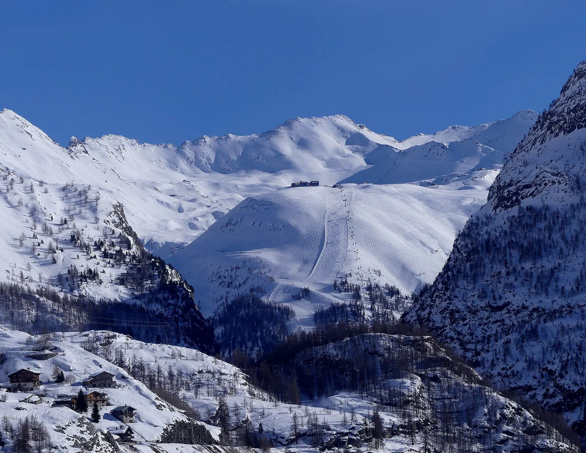 | <a href="https://commons.wikimedia.org/wiki/File:Solaise_à_Val-d&#x27;Isère_depuis_Barrage_de_Tignes_(février_2026).JPG">Source originale</a> / CC BY-SA 4.0 | Visuel non approuvé; Droits de publication à contrôler; Scene identity and season supported by filename, but still needs independent visual/legal/commercial review. |
| Bellevarde slopes · scene-3 | Image absente | À identifier / Licence indépendante non confirmée | PHOTO ABSENTE; Visuel non approuvé; Droits de publication à contrôler |
| La Daille Funival · scene-4 | 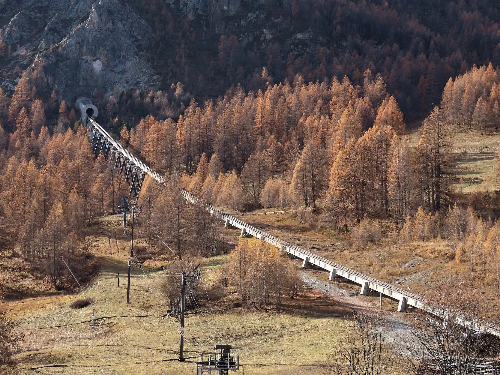 | <a href="https://commons.wikimedia.org/wiki/File:Funival_@_La_Daille_01.jpg">Source originale</a> / CC BY-SA 4.0 | Visuel non approuvé; Droits de publication à contrôler; Scene identity and season supported by filename, but still needs independent visual/legal/commercial review. |
| Le Laisinant · scene-5 | Image absente | À identifier / Licence indépendante non confirmée | PHOTO ABSENTE; Visuel non approuvé; Droits de publication à contrôler |
| Le Fornet winter · scene-6 | 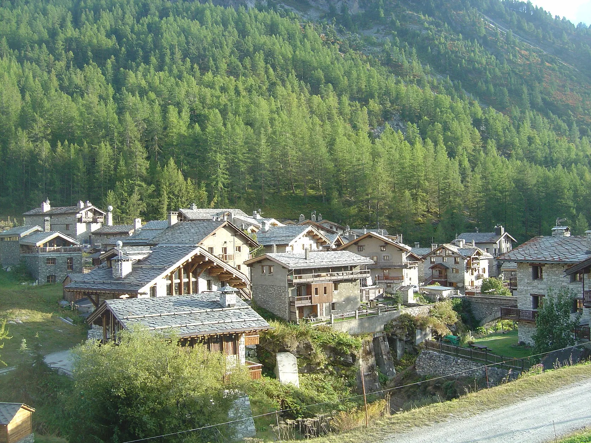 | <a href="https://commons.wikimedia.org/wiki/File:Maisons_Le_Fornet_Val_d&#x27;Isère.jpg">Source originale</a> / CC BY-SA 4.0 | Visuel non approuvé; Droits de publication à contrôler; Actual Le Fornet hamlet photographed in September 2016; NOT a winter photograph, cannot be captioned &#x27;Le Fornet winter&#x27;. Change season or replace. |
| Manchet valley · scene-7 | Image absente | À identifier / Licence indépendante non confirmée | PHOTO ABSENTE; Visuel non approuvé; Droits de publication à contrôler |
| Prariond chalets · scene-8 | Image absente | À identifier / Licence indépendante non confirmée | PHOTO ABSENTE; Visuel non approuvé; Droits de publication à contrôler |
| Val d&#x27;Isère summer · scene-9 | 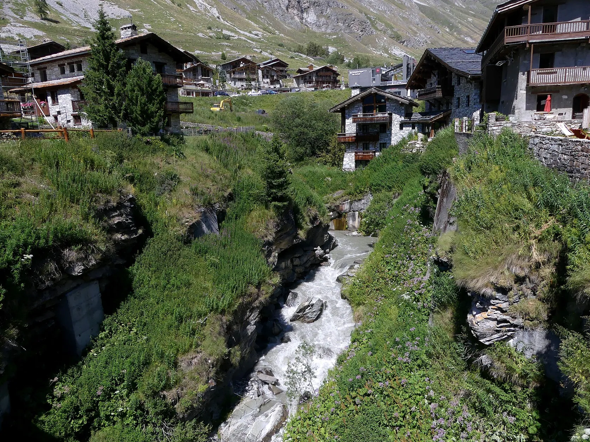 | <a href="https://commons.wikimedia.org/wiki/File:Isère_au_Fornet_à_Val-d&#x27;Isère_en_été_(juillet_2022).JPG">Source originale</a> / CC BY-SA 4.0 | Visuel non approuvé; Droits de publication à contrôler; Scene identity and season supported by filename, but still needs independent visual/legal/commercial review. |

## Contrôles complémentaires

- [ ] Confirmer que chaque photo montre effectivement l'établissement ou l'endroit annoncé, et qu'il ne s'agit pas de variantes recadrées du même cliché.
- [ ] Contrôler la source, l'auteur, la licence commerciale et les obligations CC BY/CC BY-SA ou de marques.
- [ ] Vérifier les vues et les catégories de chambre pour éviter toute promesse implicite d'inventaire.
- [ ] Rédiger les descriptions alternatives FR/EN sur la base de chaque image effectivement contrôlée.
- [ ] Ne jamais activer ces trois pages premium, les photos ou le SEO indexable avant le contrôle final.
