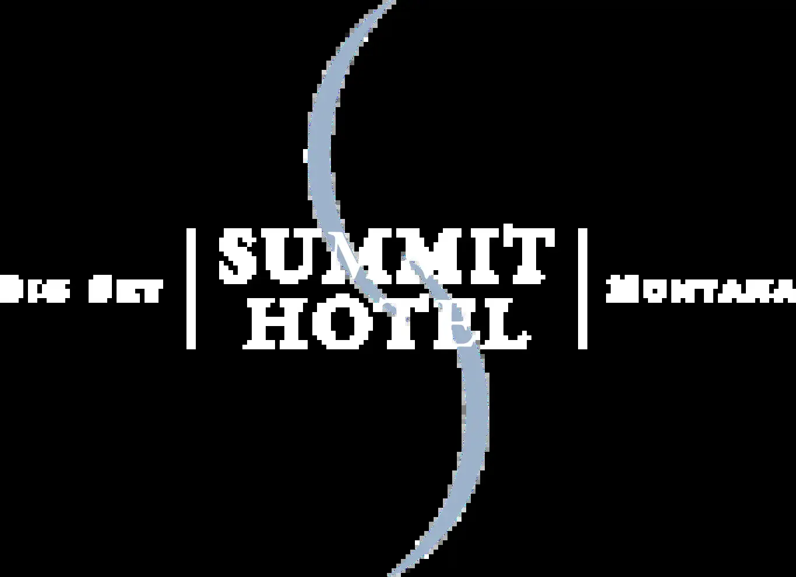

# Big Sky — galerie de vérification

> **INTERNE — Images candidates uniquement. Aucune image n'est encore approuvée pour publication.**

**Couverture :** 9/12 photographies des établissements, 3/9 scènes locales, 12/21 en tout.

**Statut de publication :** aucune validation visuelle globale, aucun feu vert de publication commerciale. Le guide reste en brouillon et non indexable.

## Hôtels : 4 adresses × 3 images

| Établissement et emplacement | Photo WebP authentique à examiner | Source / licence déclarée | Contrôles restants |
|---|---|---|---|
| Montage Big Sky · view-1 |  | <a href="https://www.montage.com/bigsky/accommodations/">Source originale</a> / Licence indépendante non confirmée | Visuel non approuvé; Droits de publication à contrôler |
| Montage Big Sky · view-2 |  | <a href="https://www.montage.com/bigsky/accommodations/">Source originale</a> / Licence indépendante non confirmée | Visuel non approuvé; Droits de publication à contrôler |
| Montage Big Sky · view-3 |  | <a href="https://www.montage.com/bigsky/">Source originale</a> / Licence indépendante non confirmée | Visuel non approuvé; Droits de publication à contrôler |
| One&amp;Only Moonlight Basin · view-1 | Image absente | À identifier / Licence indépendante non confirmée | PHOTO ABSENTE; Visuel non approuvé; Droits de publication à contrôler |
| One&amp;Only Moonlight Basin · view-2 | Image absente | À identifier / Licence indépendante non confirmée | PHOTO ABSENTE; Visuel non approuvé; Droits de publication à contrôler |
| One&amp;Only Moonlight Basin · view-3 | Image absente | À identifier / Licence indépendante non confirmée | PHOTO ABSENTE; Visuel non approuvé; Droits de publication à contrôler |
| Lone Mountain Ranch · view-1 |  | <a href="https://lonemountainranch.com/">Source originale</a> / Licence indépendante non confirmée | Visuel non approuvé; Droits de publication à contrôler |
| Lone Mountain Ranch · view-2 |  | <a href="https://lonemountainranch.com/">Source originale</a> / Licence indépendante non confirmée | Visuel non approuvé; Droits de publication à contrôler |
| Lone Mountain Ranch · view-3 |  | <a href="https://lonemountainranch.com/">Source originale</a> / Licence indépendante non confirmée | Visuel non approuvé; Droits de publication à contrôler |
| Summit Hotel · view-1 |  | <a href="https://www.bigskyresort.com/lodging/hotels/summit-hotel">Source originale</a> / Licence indépendante non confirmée | Visuel non approuvé; Droits de publication à contrôler |
| Summit Hotel · view-2 |  | <a href="https://www.bigskyresort.com/lodging">Source originale</a> / Licence indépendante non confirmée | Visuel non approuvé; Droits de publication à contrôler |
| Summit Hotel · view-3 |  | <a href="https://www.bigskyresort.com/lodging/hotels/summit-hotel">Source originale</a> / Licence indépendante non confirmée | Visuel non approuvé; Droits de publication à contrôler |

## Destination : 9 scènes à identifier précisément

| Site ou quartier | Photo WebP authentique à examiner | Source / licence déclarée | Contrôles restants |
|---|---|---|---|
| Lone Peak · scene-1 |  | <a href="https://commons.wikimedia.org/wiki/File:Lone_Peak,_Big_Sky,_Montana.jpg">Source originale</a> / CC BY 3.0 | Visuel non approuvé; Droits de publication à contrôler |
| Mountain Village · scene-2 | Image absente | À identifier / Licence indépendante non confirmée | PHOTO ABSENTE; Visuel non approuvé; Droits de publication à contrôler |
| Spanish Peaks · scene-3 |  | <a href="https://commons.wikimedia.org/wiki/File:Theb0802_-_Flickr_-_NOAA_Photo_Library.jpg">Source originale</a> / Public domain | Visuel non approuvé; Droits de publication à contrôler |
| Moonlight Basin · scene-4 |  | <a href="https://commons.wikimedia.org/wiki/File:Moonlight_Basin_replica.jpg">Source originale</a> / CC BY 2.0 | Visuel non approuvé; Droits de publication à contrôler |
| Lone Mountain Ranch · scene-5 | Image absente | À identifier / Licence indépendante non confirmée | PHOTO ABSENTE; Visuel non approuvé; Droits de publication à contrôler |
| Nordic trail · scene-6 | Image absente | À identifier / Licence indépendante non confirmée | PHOTO ABSENTE; Visuel non approuvé; Droits de publication à contrôler |
| Horse riding · scene-7 | Image absente | À identifier / Licence indépendante non confirmée | PHOTO ABSENTE; Visuel non approuvé; Droits de publication à contrôler |
| Big Sky forest · scene-8 | Image absente | À identifier / Licence indépendante non confirmée | PHOTO ABSENTE; Visuel non approuvé; Droits de publication à contrôler |
| Montana winter lodge · scene-9 | Image absente | À identifier / Licence indépendante non confirmée | PHOTO ABSENTE; Visuel non approuvé; Droits de publication à contrôler |

## Contrôles complémentaires

- [ ] Confirmer que chaque photo montre effectivement l'établissement ou l'endroit annoncé, et qu'il ne s'agit pas de variantes recadrées du même cliché.
- [ ] Contrôler la source, l'auteur, la licence commerciale et les obligations CC BY/CC BY-SA ou de marques.
- [ ] Vérifier les vues et les catégories de chambre pour éviter toute promesse implicite d'inventaire.
- [ ] Rédiger les descriptions alternatives FR/EN sur la base de chaque image effectivement contrôlée.
- [ ] Ne jamais activer ces trois pages premium, les photos ou le SEO indexable avant le contrôle final.
