# Big Sky — revue de 21 photos attendues

**Récupérées : 13/21** (8/12 hôtels, 5/9 destination). **5 alertes** détectées. Toutes les photos restent candidates et non approuvées commercialement.

## Hôtels : photo de l'établissement EXACT uniquement

| Hôtel & cliché | Photo | Origine et licence | Contrôle restant |
|---|---|---|---|
| Montage Big Sky · view-1 | 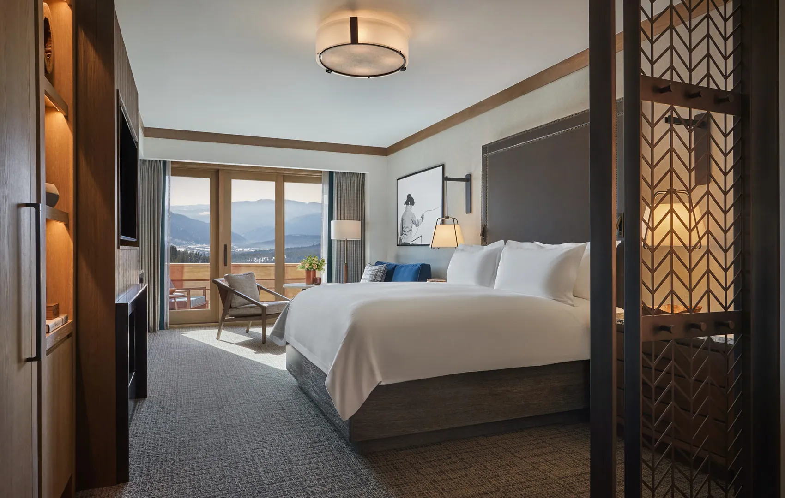 | [Source originale](https://www.montage.com/bigsky/accommodations/) · Droits commerciaux non vérifiés | Vérifier visuellement la correspondance, saison et droits de publication. |
| Montage Big Sky · view-2 |  | [Source originale](https://www.montage.com/bigsky/accommodations/) · Droits commerciaux non vérifiés | Vérifier visuellement la correspondance, saison et droits de publication. |
| Montage Big Sky · view-3 | 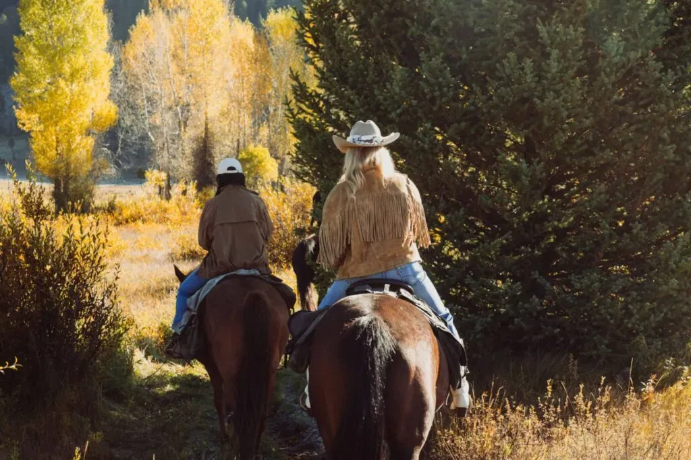 | [Source originale](https://www.montage.com/bigsky/) · Droits commerciaux non vérifiés | Vérifier visuellement la correspondance, saison et droits de publication. |
| One&Only Moonlight Basin · view-1 | À remplacer | Source non confirmée · Droits commerciaux non vérifiés | Photo manquante. |
| One&Only Moonlight Basin · view-2 | À remplacer | Source non confirmée · Droits commerciaux non vérifiés | Photo manquante. |
| One&Only Moonlight Basin · view-3 | À remplacer | Source non confirmée · Droits commerciaux non vérifiés | Photo manquante. |
| Lone Mountain Ranch · view-1 | 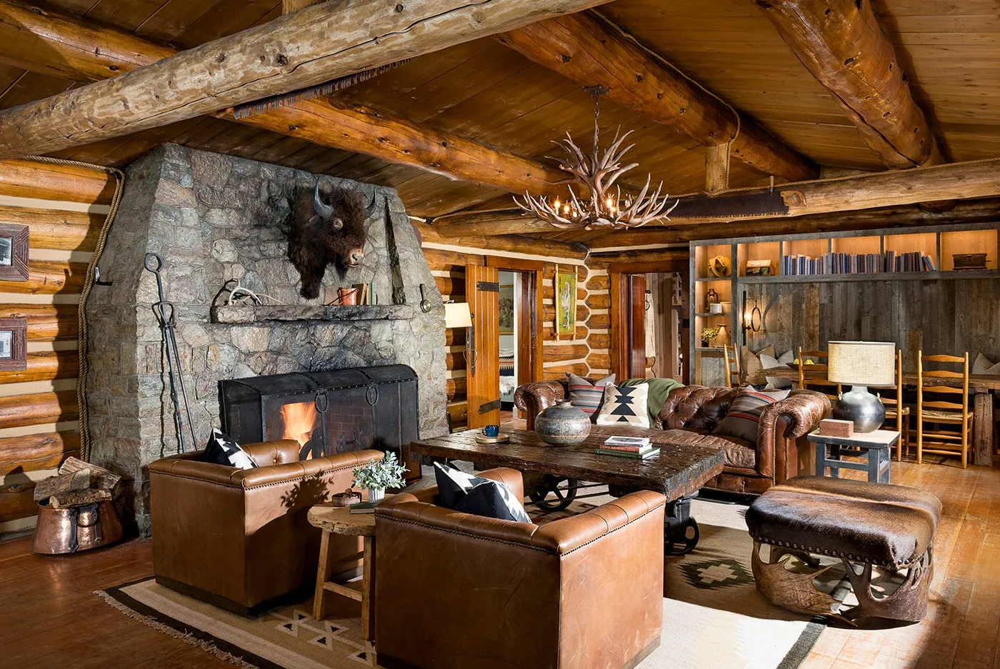 | [Source originale](https://lonemountainranch.com/) · Droits commerciaux non vérifiés | Vérifier visuellement la correspondance, saison et droits de publication. |
| Lone Mountain Ranch · view-2 | 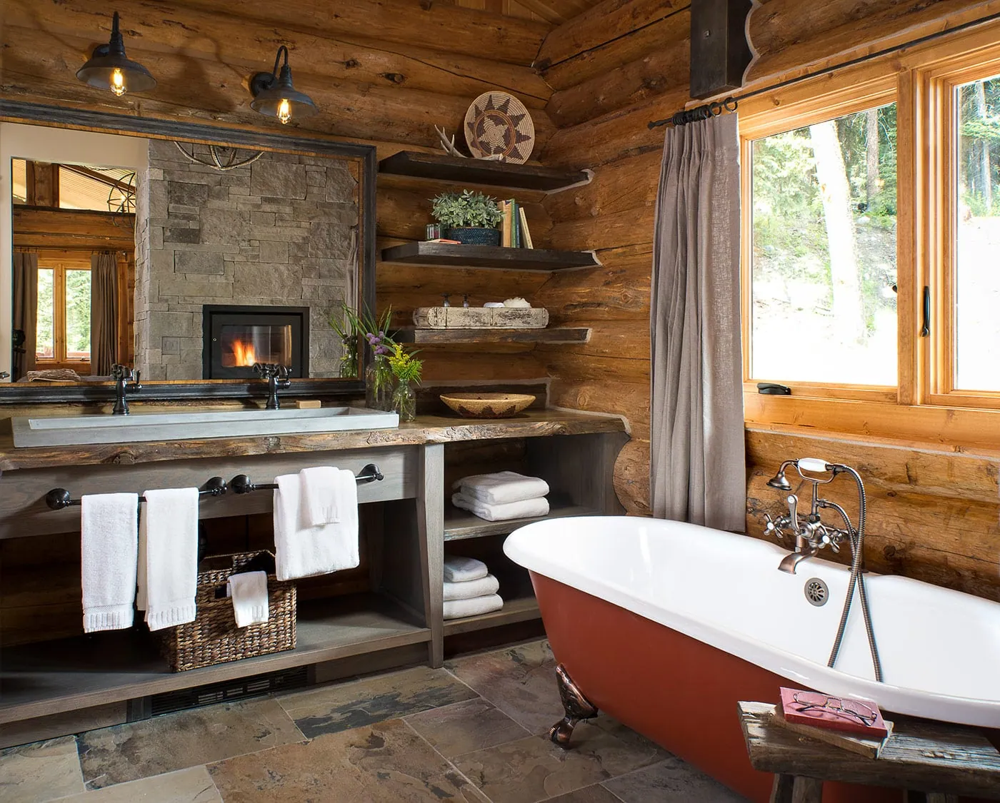 | [Source originale](https://lonemountainranch.com/) · Droits commerciaux non vérifiés | Vérifier visuellement la correspondance, saison et droits de publication. |
| Lone Mountain Ranch · view-3 | 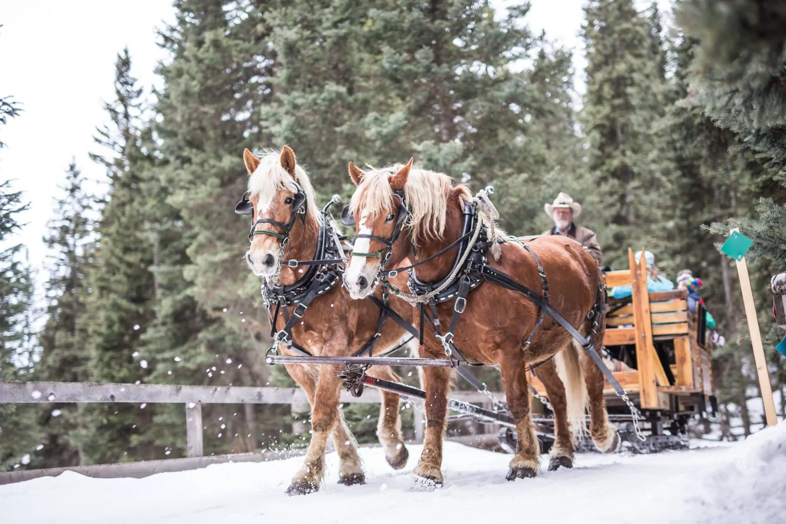 | [Source originale](https://lonemountainranch.com/) · Droits commerciaux non vérifiés | Vérifier visuellement la correspondance, saison et droits de publication. |
| Summit Hotel · view-1 | 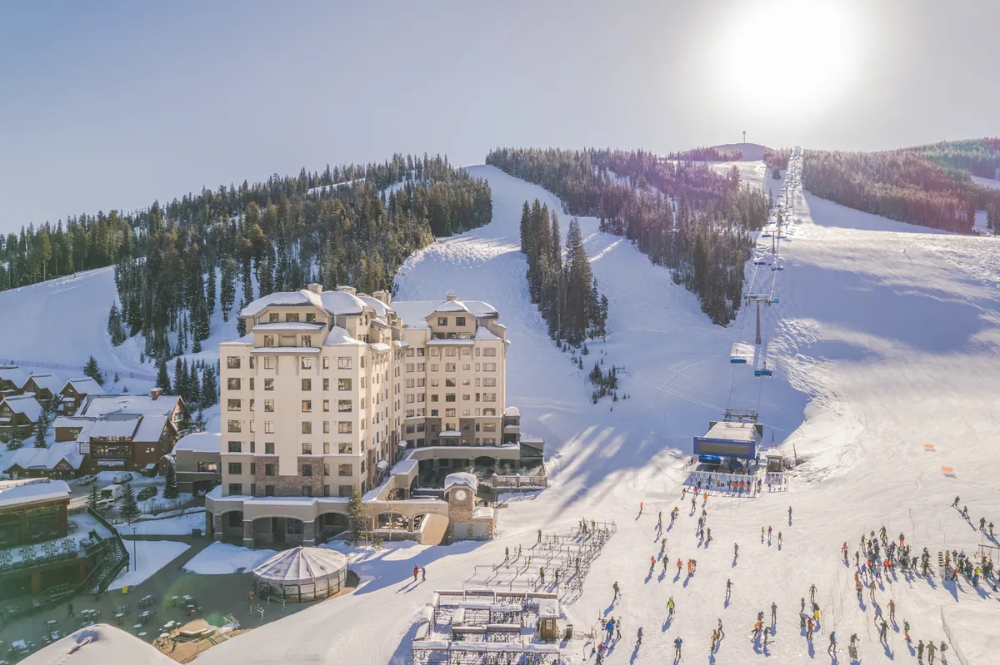 | [Source originale](https://www.bigskyresort.com/lodging/hotels/summit-hotel) · Droits commerciaux non vérifiés | Vérifier visuellement la correspondance, saison et droits de publication. |
| Summit Hotel · view-2 | 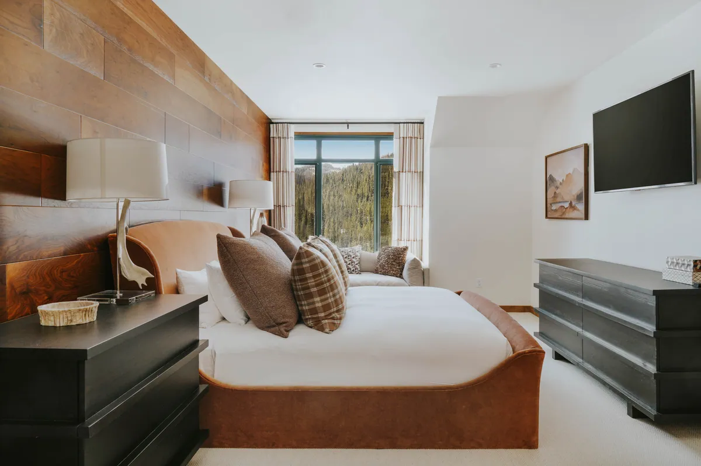 | [Source originale](https://www.bigskyresort.com/lodging) · Droits commerciaux non vérifiés | Vérifier visuellement la correspondance, saison et droits de publication. |
| Summit Hotel · view-3 | À remplacer | Source non confirmée · Droits commerciaux non vérifiés | EXCLU : photographie trop petite (10 740 octets), inadéquate pour une galerie hôtelière haut de gamme. |

## Destination et quartiers

| Lieu & cliché | Photo | Origine et licence | Contrôle restant |
|---|---|---|---|
| Lone Peak · scene-1 | 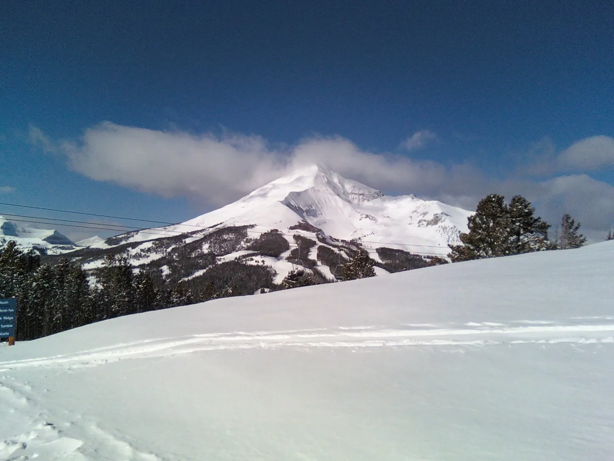 | [Source originale](https://commons.wikimedia.org/wiki/File:Lone_Peak,_Big_Sky,_Montana.jpg) · CC BY 3.0 | Vérifier visuellement la correspondance, saison et droits de publication. |
| Mountain Village · scene-2 | 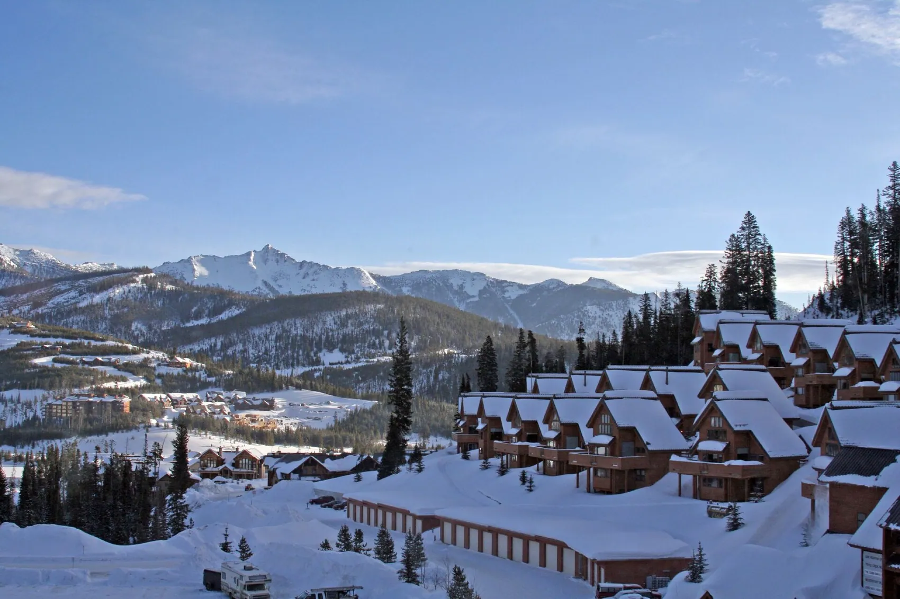 | [Source originale](https://commons.wikimedia.org/wiki/File:Big_Sky_resort.jpg) · CC BY-SA 2.0 | Commons title/source grounded, but manual geographic, season and aesthetic QA required. |
| Spanish Peaks · scene-3 | 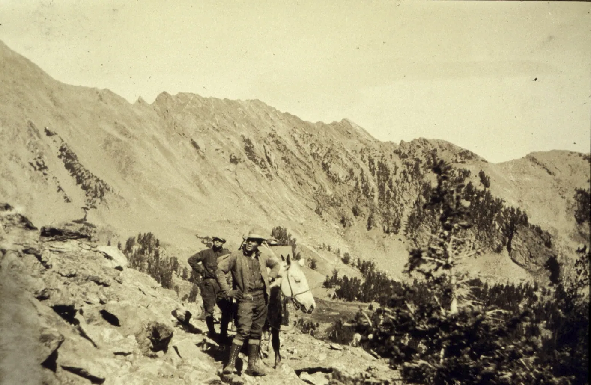 | [Source originale](https://commons.wikimedia.org/wiki/File:Theb0802_-_Flickr_-_NOAA_Photo_Library.jpg) · Public domain | Localisation incertaine : le fichier source NOAA ne documente pas clairement Spanish Peaks du Montana. Ne pas afficher sous cette légende. |
| Moonlight Basin · scene-4 | 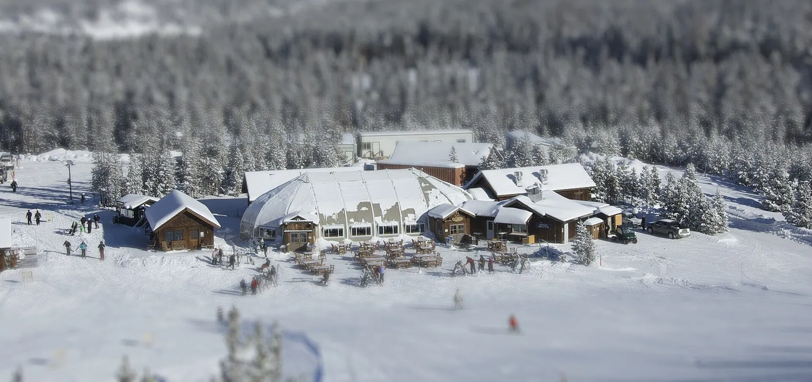 | [Source originale](https://commons.wikimedia.org/wiki/File:Moonlight_Basin_replica.jpg) · CC BY 2.0 | Source intitulée « Moonlight Basin replica » : impossible de garantir une vraie scène du domaine Moonlight Basin. Ne pas afficher sous cette légende. |
| Lone Mountain Ranch · scene-5 | 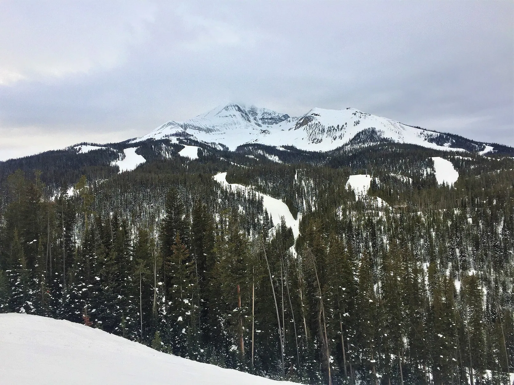 | [Source originale](https://commons.wikimedia.org/wiki/File:Lone_Mountain,_January_2018.jpg) · CC BY-SA 4.0 | Photographie de Lone Mountain, pas de Lone Mountain Ranch. Ne PAS la présenter comme montrant les cabanes ou les installations du ranch. |
| Nordic trail · scene-6 | À remplacer | Source non confirmée · Droits commerciaux non vérifiés | Photo manquante. |
| Horse riding · scene-7 | À remplacer | Source non confirmée · Droits commerciaux non vérifiés | Photo manquante. |
| Big Sky forest · scene-8 | À remplacer | Source non confirmée · Droits commerciaux non vérifiés | Photo manquante. |
| Montana winter lodge · scene-9 | À remplacer | Source non confirmée · Droits commerciaux non vérifiés | Photo manquante. |

## Conditions avant intégration

- [ ] Vérifier chaque photo contre l'hôtel ou le lieu véritable (pas de substitution).
- [ ] Remplacer les images trop petites, peu premium, géographiquement douteuses ou répétées.
- [ ] Examiner licences, crédits photographes, CC BY / CC BY-SA, marques et conditions de reproduction commerciale.
- [ ] Créer des alt et captions FR/EN correspondant aux images réellement montrées.
- [ ] Ne pas intégrer ces photos dans les pages premium ou leur JSON-LD avant approbation.
- [ ] Conserver les 88 destinations et le blocage Vercel sur la branche.
