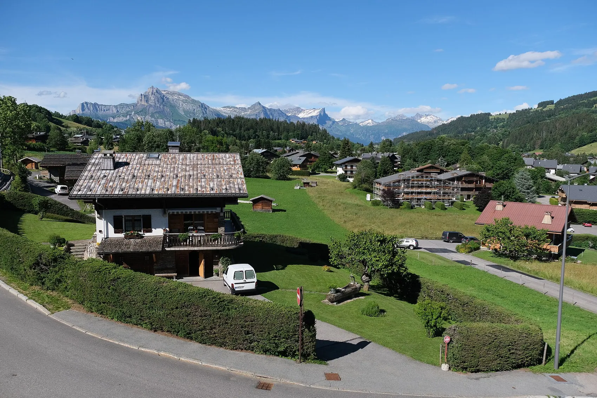
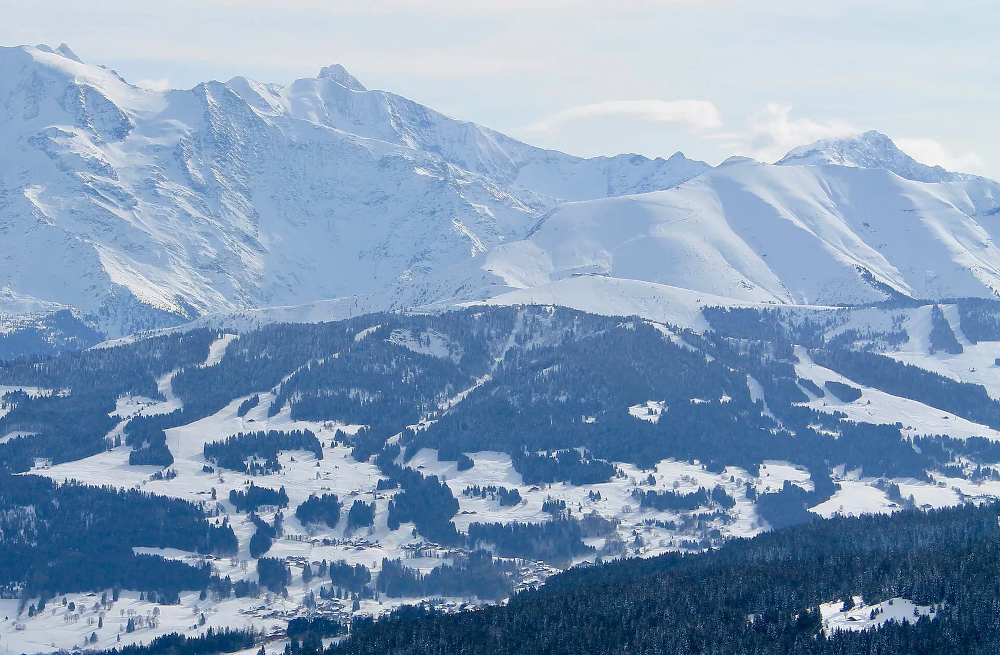
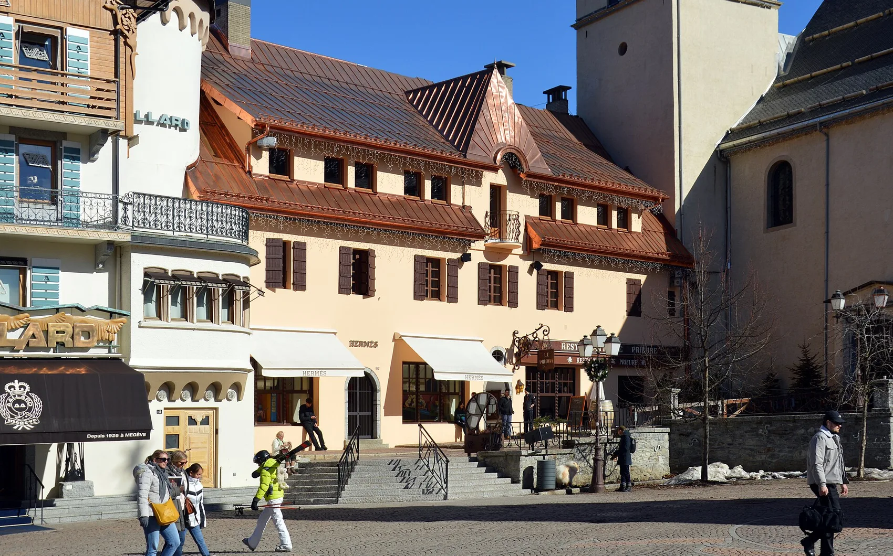
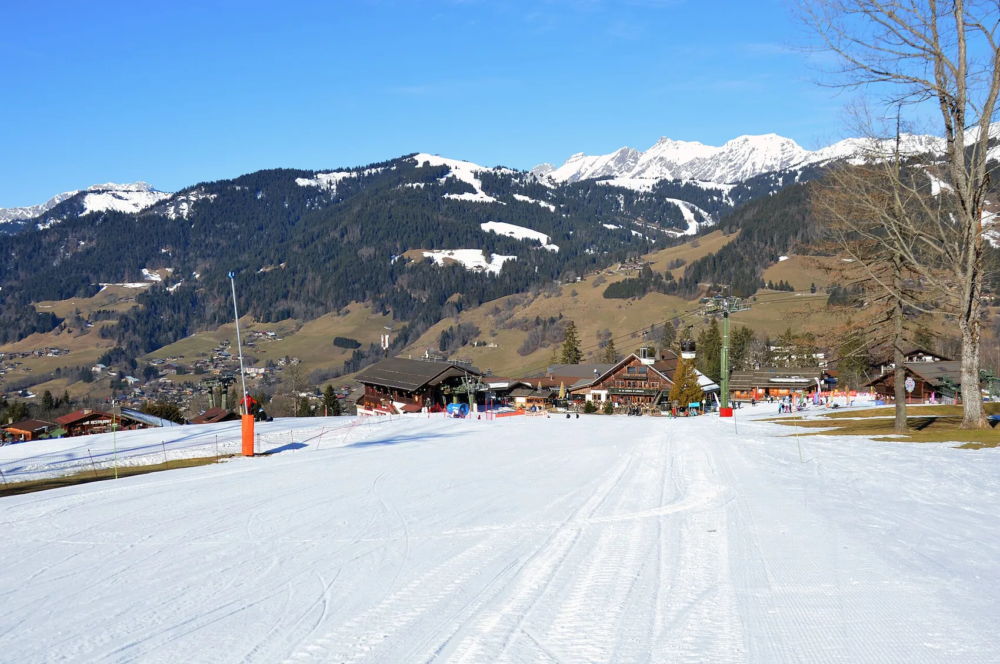

# Megève — revue de 21 photos attendues

**Récupérées : 16/21** (9/12 hôtels, 7/9 destination). **5 alertes** détectées. Toutes les photos restent candidates et non approuvées commercialement.

## Hôtels : photo de l'établissement EXACT uniquement

| Hôtel & cliché | Photo | Origine et licence | Contrôle restant |
|---|---|---|---|
| Four Seasons Resort Megève · view-1 | À remplacer | Source non confirmée · Droits commerciaux non vérifiés | Photo manquante. |
| Four Seasons Resort Megève · view-2 | À remplacer | Source non confirmée · Droits commerciaux non vérifiés | Photo manquante. |
| Four Seasons Resort Megève · view-3 | À remplacer | Source non confirmée · Droits commerciaux non vérifiés | Photo manquante. |
| Les Fermes de Marie · view-1 |  | [Source originale](https://www.fermesdemarie.com/en) · Droits commerciaux non vérifiés | Vérifier visuellement la correspondance, saison et droits de publication. |
| Les Fermes de Marie · view-2 |  | [Source originale](https://www.fermesdemarie.com/en/hiver/hotel-megeve) · Droits commerciaux non vérifiés | Vérifier visuellement la correspondance, saison et droits de publication. |
| Les Fermes de Marie · view-3 |  | [Source originale](https://www.fermesdemarie.com/en/hiver/hotel-megeve) · Droits commerciaux non vérifiés | Vérifier visuellement la correspondance, saison et droits de publication. |
| L'Alpaga · view-1 |  | [Source originale](https://alpaga.com/fr/proprietes/hotel-alpaga/chambres-suites/) · Droits commerciaux non vérifiés | Vérifier visuellement la correspondance, saison et droits de publication. |
| L'Alpaga · view-2 |  | [Source originale](https://alpaga.com/fr/proprietes/hotel-alpaga/chambres-suites/) · Droits commerciaux non vérifiés | Vérifier visuellement la correspondance, saison et droits de publication. |
| L'Alpaga · view-3 |  | [Source originale](https://alpaga.com/fr/proprietes/hotel-alpaga/chambres-suites/) · Droits commerciaux non vérifiés | Vérifier visuellement la correspondance, saison et droits de publication. |
| Lodge Park · view-1 |  | [Source originale](https://www.lodgepark.com/en/hotel-center-of-megeve) · Droits commerciaux non vérifiés | Vérifier visuellement la correspondance, saison et droits de publication. |
| Lodge Park · view-2 |  | [Source originale](https://www.lodgepark.com/en/hotel-center-of-megeve) · Droits commerciaux non vérifiés | Vérifier visuellement la correspondance, saison et droits de publication. |
| Lodge Park · view-3 |  | [Source originale](https://www.lodgepark.com/en/hotel-center-of-megeve) · Droits commerciaux non vérifiés | Vérifier visuellement la correspondance, saison et droits de publication. |

## Destination et quartiers

| Lieu & cliché | Photo | Origine et licence | Contrôle restant |
|---|---|---|---|
| Megève village · scene-1 |  | [Source originale](https://commons.wikimedia.org/wiki/File:Village_@_Megève_(51295072586).jpg) · CC BY 2.0 | Commons title/source grounded, but manual geographic, season and aesthetic QA required. |
| Mont d'Arbois · scene-2 |  | [Source originale](https://commons.wikimedia.org/wiki/File:Mont-d'Arbois-Megève_(2017).jpg) · CC BY-SA 4.0 | Commons title/source grounded, but manual geographic, season and aesthetic QA required. |
| Rochebrune · scene-3 |  | [Source originale](https://commons.wikimedia.org/wiki/File:Rochebrune_@_Megève_(51036605028).jpg) · CC BY 2.0 | Vérifier visuellement la correspondance, saison et droits de publication. |
| Jaillet · scene-4 |  | [Source originale](https://commons.wikimedia.org/wiki/File:Tête_du_Torraz.JPG) · CC BY 3.0 | Photo du Tête du Torraz ; n'affirmer le lien exact avec Jaillet qu'après contrôle cartographique. |
| Cote 2000 · scene-5 | À remplacer | Source non confirmée · Droits commerciaux non vérifiés | Photo manquante. |
| Church square · scene-6 |  | [Source originale](https://commons.wikimedia.org/wiki/File:Megève_-_Eglise_Saint-Jean-Baptiste_48.jpg) · CC0 | Commons title/source grounded, but manual geographic, season and aesthetic QA required. |
| Megève ski slopes · scene-7 |  | [Source originale](https://commons.wikimedia.org/wiki/File:View_of_the_Mont_d'Arbois_front_de_neige,_Megève,_2025.jpg) · CC0 | Commons title/source grounded, but manual geographic, season and aesthetic QA required. |
| Megève summer · scene-8 | À remplacer | Source non confirmée · Droits commerciaux non vérifiés | Photo manquante. |
| Mont Blanc view · scene-9 |  | [Source originale](https://commons.wikimedia.org/wiki/File:Mont_Blanc_@_Megève_(51037173286).jpg) · CC BY 2.0 | Vérifier visuellement la correspondance, saison et droits de publication. |

## Conditions avant intégration

- [ ] Vérifier chaque photo contre l'hôtel ou le lieu véritable (pas de substitution).
- [ ] Remplacer les images trop petites, peu premium, géographiquement douteuses ou répétées.
- [ ] Examiner licences, crédits photographes, CC BY / CC BY-SA, marques et conditions de reproduction commerciale.
- [ ] Créer des alt et captions FR/EN correspondant aux images réellement montrées.
- [ ] Ne pas intégrer ces photos dans les pages premium ou leur JSON-LD avant approbation.
- [ ] Conserver les 88 destinations et le blocage Vercel sur la branche.
