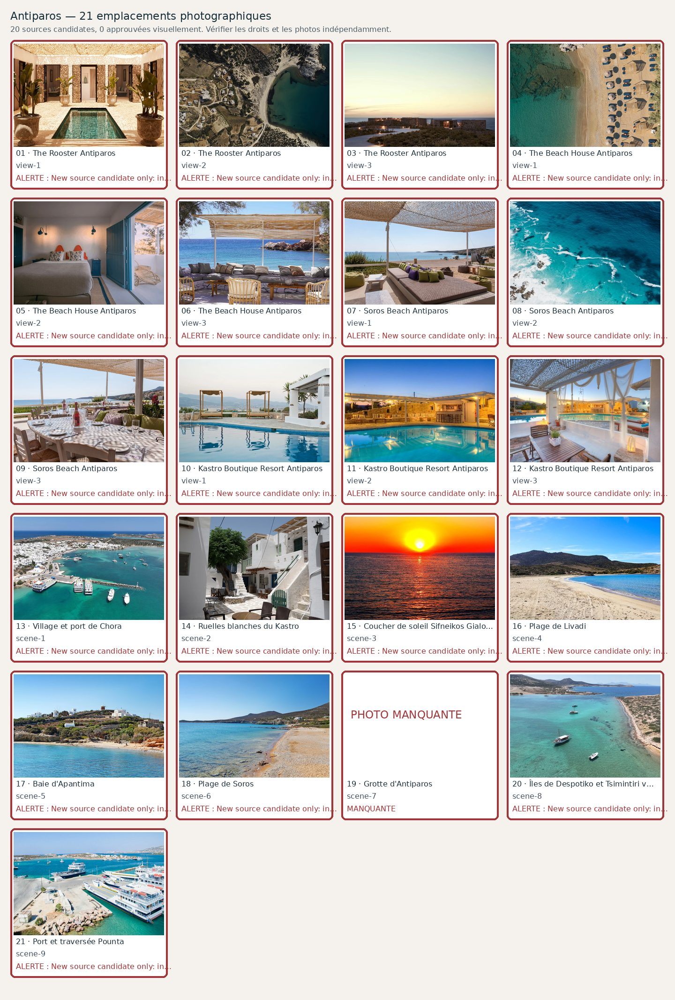

# Antiparos — 21 photographies à contrôler

**Candidats récupérés : 20/21 · Validés visuellement : 0/21**. Aucune validation ne résulte du seul téléchargement.

| No | Etablissement / lieu | Source et métadonnées | État |
|---:|---|---|---|
| 1 | The Rooster Antiparos — view-1 | [Source](https://therooster.me/) ·    | Candidate; **New source candidate only: inspect actual photograph, property/geolocation, aesthetic quality and rights before approval.** |
| 2 | The Rooster Antiparos — view-2 | [Source](https://therooster.me/) ·    | Candidate; **New source candidate only: inspect actual photograph, property/geolocation, aesthetic quality and rights before approval.** |
| 3 | The Rooster Antiparos — view-3 | [Source](https://therooster.me/) ·    | Candidate; **New source candidate only: inspect actual photograph, property/geolocation, aesthetic quality and rights before approval.** |
| 4 | The Beach House Antiparos — view-1 | [Source](https://beachhouseantiparos.com/) ·    | Candidate; **New source candidate only: inspect actual photograph, property/geolocation, aesthetic quality and rights before approval.** |
| 5 | The Beach House Antiparos — view-2 | [Source](https://greciamia.it/products/antiparos-beach-house) · Real renovated Beach House guestroom at Apantima, Cycladic blue and white interior| Candidate; **New source candidate only: inspect actual photograph, property/geolocation, aesthetic quality and rights before approval.** |
| 6 | The Beach House Antiparos — view-3 | [Source](https://www.turquoiseholidays.co.uk/destinations/mediterranean/greece/paros-antiparos/the-beach-house/) · Actual Beach House Antiparos shaded outdoor lounge beside Apantima cove| Candidate; **New source candidate only: inspect actual photograph, property/geolocation, aesthetic quality and rights before approval.** |
| 7 | Soros Beach Antiparos — view-1 | [Source](https://www.living-postcards.com/blog/soros-beach-seafood-suites) · Real Soros Beach Antiparos beach daybeds with olive-and-purple cushions beneath straw shading, NOT a fashion advertiseme| Candidate; **New source candidate only: inspect actual photograph, property/geolocation, aesthetic quality and rights before approval.** |
| 8 | Soros Beach Antiparos — view-2 | [Source](https://www.sorosbeach.gr/) ·    | Candidate; **New source candidate only: inspect actual photograph, property/geolocation, aesthetic quality and rights before approval.** |
| 9 | Soros Beach Antiparos — view-3 | [Source](https://www.living-postcards.com/blog/soros-beach-seafood-suites) · Verified Soros Beach seaside dining terrace with tables and parasols| Candidate; **New source candidate only: inspect actual photograph, property/geolocation, aesthetic quality and rights before approval.** |
| 10 | Kastro Boutique Resort Antiparos — view-1 | [Source](https://www.myboutiquehotel.com/en/boutique-hotels-antiparos-town/kastro-antiparos.html) · Kastro Boutique Resort genuine pool and cabana daybeds in sunlight| Candidate; **New source candidate only: inspect actual photograph, property/geolocation, aesthetic quality and rights before approval.** |
| 11 | Kastro Boutique Resort Antiparos — view-2 | [Source](https://www.myboutiquehotel.com/en/boutique-hotels-antiparos-town/kastro-antiparos.html) · True Kastro Boutique Resort poolside bar and stone pergola at blue hour (NOT a guestroom)| Candidate; **New source candidate only: inspect actual photograph, property/geolocation, aesthetic quality and rights before approval.** |
| 12 | Kastro Boutique Resort Antiparos — view-3 | [Source](https://www.myboutiquehotel.com/en/boutique-hotels-antiparos-town/kastro-antiparos.html) · Kastro Antiparos real shaded pergola outdoor dining area beside pool| Candidate; **New source candidate only: inspect actual photograph, property/geolocation, aesthetic quality and rights before approval.** |
| 13 | Village et port de Chora — scene-1 | [Source](https://traveler.welcomepickups.com/en/paros/sightseeing_rides/antiparos-ride-cave-town-castle-experience) · Real aerial photograph of Antiparos Chora and port with boats and clear turquoise water| Candidate; **New source candidate only: inspect actual photograph, property/geolocation, aesthetic quality and rights before approval.** |
| 14 | Ruelles blanches du Kastro — scene-2 | [Source](https://commons.wikimedia.org/wiki/File:Antiparos,_Kastro,_247356.jpg) · Antiparos village near the historic Kastro, Zde 2024| Candidate; **New source candidate only: inspect actual photograph, property/geolocation, aesthetic quality and rights before approval.** |
| 15 | Coucher de soleil Sifneikos Gialos — scene-3 | [Source](https://commons.wikimedia.org/wiki/File:Sunset_Over_Sifnos_IV.jpg) · Sunset seen from Antiparos toward Sifnos, recorded in Antiparos images, source to verify visual quality| Candidate; **New source candidate only: inspect actual photograph, property/geolocation, aesthetic quality and rights before approval.** |
| 16 | Plage de Livadi — scene-4 | [Source](https://www.greekislandhopping.de/blog/antiparos-straende) · Livadia beach on Antiparos with west-coast dunes and natural wide sandy cove, not Livadia on Paros| Candidate; **New source candidate only: inspect actual photograph, property/geolocation, aesthetic quality and rights before approval.** |
| 17 | Baie d'Apantima — scene-5 | [Source](https://www.thethinkingtraveller.com/greece/antiparos/villas/lexie) · True Apantima Antiparos coastal hillside and shallow bay with traditional windmill| Candidate; **New source candidate only: inspect actual photograph, property/geolocation, aesthetic quality and rights before approval.** |
| 18 | Plage de Soros — scene-6 | [Source](https://www.thethinkingtraveller.com/greece/antiparos/villas/yvoni) · Actual Soros sandy beach and clear sea with hilly background; source path specifically identifies Soros| Candidate; **New source candidate only: inspect actual photograph, property/geolocation, aesthetic quality and rights before approval.** |
| 19 | Grotte d'Antiparos — scene-7 | [Source](https://commons.wikimedia.org/wiki/File:Antiparos_cave.JPG) · | Manquante; **2024 cave close-up does not show cave scale; select grand chamber with stairs and warm lighting.** |
| 20 | Îles de Despotiko et Tsimintiri vues depuis la mer — scene-8 | [Source](https://www.sight2sight.com/de/c/despotiko/c/private-touren-despotiko) · Real turquoise shallow bay off Despotiko with small boats and rocky island shoreline, exact island tour operator photo; | Candidate; **New source candidate only: inspect actual photograph, property/geolocation, aesthetic quality and rights before approval.** |
| 21 | Port et traversée Pounta — scene-9 | [Source](https://www.bonatsahouse.com/lifestyle/antiparos-travel-tips) · Original Antiparos ferry quay photograph showing passenger and vehicle boats by island waterfront| Candidate; **New source candidate only: inspect actual photograph, property/geolocation, aesthetic quality and rights before approval.** |
