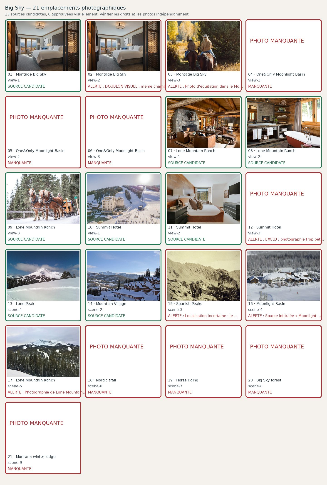

# Big Sky — 21 photographies à contrôler

**Candidats récupérés : 13/21 · Validés visuellement : 8/21**. Aucune validation ne résulte du seul téléchargement.

| No | Etablissement / lieu | Source et métadonnées | État |
|---:|---|---|---|
| 1 | Montage Big Sky — view-1 | [Source](https://www.montage.com/bigsky/accommodations/) · Official page sharing image| Candidate |
| 2 | Montage Big Sky — view-2 | [Source](https://www.montage.com/bigsky/accommodations/) · Official page sharing image| Candidate; **DOUBLON VISUEL : même chambre que view-1, autre dérivé.** |
| 3 | Montage Big Sky — view-3 | [Source](https://www.montage.com/bigsky/) · Two women riding horses in Big Sky| Candidate; **Photo d'équitation dans le Montana, sans bâtiments Montage identifiables ; mauvais visuel pour fiche hôtel.** |
| 4 | One&Only Moonlight Basin — view-1 | Source à trouver · | Manquante |
| 5 | One&Only Moonlight Basin — view-2 | Source à trouver · | Manquante |
| 6 | One&Only Moonlight Basin — view-3 | Source à trouver · | Manquante |
| 7 | Lone Mountain Ranch — view-1 | [Source](https://lonemountainranch.com/) · | cabins 1| Candidate |
| 8 | Lone Mountain Ranch — view-2 | [Source](https://lonemountainranch.com/) · | cabins 3| Candidate |
| 9 | Lone Mountain Ranch — view-3 | [Source](https://lonemountainranch.com/) · CSS image from official property page| Candidate |
| 10 | Summit Hotel — view-1 | [Source](https://www.bigskyresort.com/lodging/hotels/summit-hotel) · Official page sharing image| Candidate |
| 11 | Summit Hotel — view-2 | [Source](https://www.bigskyresort.com/lodging) · Official page sharing image| Candidate |
| 12 | Summit Hotel — view-3 | Source à trouver · | Manquante; **EXCLU : photographie trop petite (10 740 octets), inadéquate pour une galerie hôtelière haut de gamme.** |
| 13 | Lone Peak — scene-1 | [Source](https://commons.wikimedia.org/wiki/File:Lone_Peak,_Big_Sky,_Montana.jpg) · File:Lone Peak, Big Sky, Montana.jpg| Candidate |
| 14 | Mountain Village — scene-2 | [Source](https://commons.wikimedia.org/wiki/File:Big_Sky_resort.jpg) · File:Big Sky resort.jpg| Candidate |
| 15 | Spanish Peaks — scene-3 | [Source](https://commons.wikimedia.org/wiki/File:Theb0802_-_Flickr_-_NOAA_Photo_Library.jpg) · File:Theb0802 - Flickr - NOAA Photo Library.jpg| Candidate; **Localisation incertaine : le fichier source NOAA ne documente pas clairement Spanish Peaks du Montana. Ne pas afficher sous cette légende.** |
| 16 | Moonlight Basin — scene-4 | [Source](https://commons.wikimedia.org/wiki/File:Moonlight_Basin_replica.jpg) · File:Moonlight Basin replica.jpg| Candidate; **Source intitulée « Moonlight Basin replica » : impossible de garantir une vraie scène du domaine Moonlight Basin. Ne pas afficher sous cette légende.** |
| 17 | Lone Mountain Ranch — scene-5 | [Source](https://commons.wikimedia.org/wiki/File:Lone_Mountain,_January_2018.jpg) · File:Lone Mountain, January 2018.jpg| Candidate; **Photographie de Lone Mountain, pas de Lone Mountain Ranch. Ne PAS la présenter comme montrant les cabanes ou les installations du ranch.** |
| 18 | Nordic trail — scene-6 | Source à trouver · | Manquante |
| 19 | Horse riding — scene-7 | Source à trouver · | Manquante |
| 20 | Big Sky forest — scene-8 | Source à trouver · | Manquante |
| 21 | Montana winter lodge — scene-9 | Source à trouver · | Manquante |
