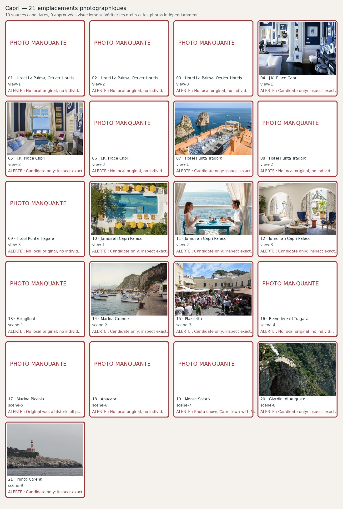

# Capri — 21 photographies à contrôler

**Candidats récupérés : 10/21 · Validés visuellement : 0/21**. Aucune validation ne résulte du seul téléchargement.

| No | Etablissement / lieu | Source et métadonnées | État |
|---:|---|---|---|
| 1 | Hotel La Palma, Oetker Hotels — view-1 | [Source](https://www.oetkerhotels.com/hotels/hotel-la-palma/) · | Manquante; **No local original, no individual photograph validation, no proven commercial licence: exclude.** |
| 2 | Hotel La Palma, Oetker Hotels — view-2 | [Source](https://www.oetkerhotels.com/hotels/hotel-la-palma/) · | Manquante; **No local original, no individual photograph validation, no proven commercial licence: exclude.** |
| 3 | Hotel La Palma, Oetker Hotels — view-3 | [Source](https://www.oetkerhotels.com/hotels/hotel-la-palma/) · | Manquante; **No local original, no individual photograph validation, no proven commercial licence: exclude.** |
| 4 | J.K. Place Capri — view-1 | [Source](https://jkcapri.com/en/) · J.K. Place Capri    | Candidate; **Candidate only: inspect exact WebP, real hotel/location, aesthetics, attribution and specific licence before approval.** |
| 5 | J.K. Place Capri — view-2 | [Source](https://jkcapri.com/en/) · Hotel page background candidate| Candidate; **Candidate only: inspect exact WebP, real hotel/location, aesthetics, attribution and specific licence before approval.** |
| 6 | J.K. Place Capri — view-3 | [Source](https://jkcapri.com/en/) · | Manquante; **No local original, no individual photograph validation, no proven commercial licence: exclude.** |
| 7 | Hotel Punta Tragara — view-1 | [Source](https://www.capri.com/en/c/punta-tragara) ·     | Candidate; **Candidate only: inspect exact WebP, real hotel/location, aesthetics, attribution and specific licence before approval.** |
| 8 | Hotel Punta Tragara — view-2 | [Source](https://manfredihotels.com/tragara/) · | Manquante; **No local original, no individual photograph validation, no proven commercial licence: exclude.** |
| 9 | Hotel Punta Tragara — view-3 | [Source](https://manfredihotels.com/tragara/) · | Manquante; **No local original, no individual photograph validation, no proven commercial licence: exclude.** |
| 10 | Jumeirah Capri Palace — view-1 | [Source](https://www.jumeirah.com/en/stay/italy/jumeirah-capri-palace) · Gallery image 1    | Candidate; **Candidate only: inspect exact WebP, real hotel/location, aesthetics, attribution and specific licence before approval.** |
| 11 | Jumeirah Capri Palace — view-2 | [Source](https://www.jumeirah.com/en/stay/italy/jumeirah-capri-palace) · Gallery image 1    | Candidate; **Candidate only: inspect exact WebP, real hotel/location, aesthetics, attribution and specific licence before approval.** |
| 12 | Jumeirah Capri Palace — view-3 | [Source](https://www.jumeirah.com/en/stay/italy/jumeirah-capri-palace) · Gallery image 1    | Candidate; **Candidate only: inspect exact WebP, real hotel/location, aesthetics, attribution and specific licence before approval.** |
| 13 | Faraglioni — scene-1 | Source à trouver · | Manquante; **No local original, no individual photograph validation, no proven commercial licence: exclude.** |
| 14 | Marina Grande — scene-2 | [Source](https://commons.wikimedia.org/wiki/File:Boats,_Capri_Harbour_-_scan01.jpg) · File:Boats, Capri Harbour - scan01.jpg| Candidate; **Candidate only: inspect exact WebP, real hotel/location, aesthetics, attribution and specific licence before approval.** |
| 15 | Piazzetta — scene-3 | [Source](https://commons.wikimedia.org/wiki/File:Piazza_Umberto_I_din_Capri.jpg) · File:Piazza Umberto I din Capri.jpg| Candidate; **Candidate only: inspect exact WebP, real hotel/location, aesthetics, attribution and specific licence before approval.** |
| 16 | Belvedere di Tragara — scene-4 | Source à trouver · | Manquante; **No local original, no individual photograph validation, no proven commercial licence: exclude.** |
| 17 | Marina Piccola — scene-5 | [Source](https://commons.wikimedia.org/wiki/File:A._Leto_-_Marina_Piccola_a_Capri.jpg) · | Manquante; **Original was a historic oil painting by A. Leto, not a current landscape photograph of Marina Piccola.** |
| 18 | Anacapri — scene-6 | Source à trouver · | Manquante; **No local original, no individual photograph validation, no proven commercial licence: exclude.** |
| 19 | Monte Solaro — scene-7 | [Source](https://commons.wikimedia.org/wiki/File:Capri_Centre_Belvedere.jpg) · | Manquante; **Photo shows Capri town with Monte Solaro in the distance, not the requested scenic viewpoint from the summit.** |
| 20 | Giardini di Augusto — scene-8 | [Source](https://commons.wikimedia.org/wiki/File:Giardini_di_Augusto_overlook,_seen_from_the_Punta_Cannone_overlook,_Capri,_2010.jpg) · File:Giardini di Augusto overlook, seen from the Punta Cannone overlook, Capri, 2010.jpg| Candidate; **Candidate only: inspect exact WebP, real hotel/location, aesthetics, attribution and specific licence before approval.** |
| 21 | Punta Carena — scene-9 | [Source](https://commons.wikimedia.org/wiki/File:Campania_Lighthouse_Punta_Carena_Capri.jpg) · File:Campania Lighthouse Punta Carena Capri.jpg| Candidate; **Candidate only: inspect exact WebP, real hotel/location, aesthetics, attribution and specific licence before approval.** |
