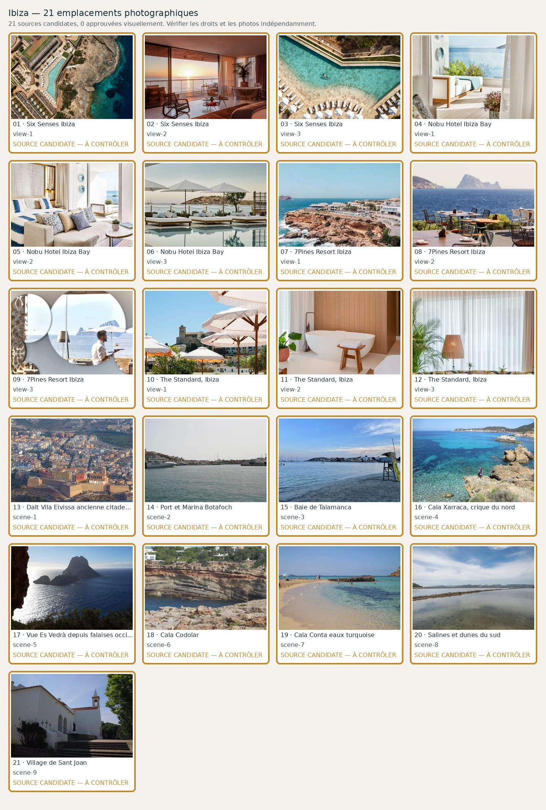

# Ibiza — 21 photographies à contrôler

**Candidats récupérés : 21/21 · Validés visuellement : 0/21**. Aucune validation ne résulte du seul téléchargement.

| No | Etablissement / lieu | Source et métadonnées | État |
|---:|---|---|---|
| 1 | Six Senses Ibiza — view-1 | [Source](https://www.sixsenses.com/en/hotels-resorts/europe/spain/ibiza/gallery/) · Official Six Senses Ibiza gallery, aerial view of the resort pool and cliffside Cala Xarraca setting| Candidate; **Downloaded source candidate only: real hotel/scene, premium visual, commercial licence and attribution must be checked.** |
| 2 | Six Senses Ibiza — view-2 | [Source](https://www.sixsenses.com/en/hotels-resorts/europe/spain/ibiza/gallery/) · Actual bedroom in Five Bedroom Mansion at Six Senses Ibiza, dusk sea-view; do not call it a standard guestroom| Candidate; **Downloaded source candidate only: real hotel/scene, premium visual, commercial licence and attribution must be checked.** |
| 3 | Six Senses Ibiza — view-3 | [Source](https://www.sixsenses.com/en/hotels-resorts/europe/spain/ibiza/gallery/) · Different official aerial photo of Six Senses Ibiza swimming pool and sea cliff terraces| Candidate; **Downloaded source candidate only: real hotel/scene, premium visual, commercial licence and attribution must be checked.** |
| 4 | Nobu Hotel Ibiza Bay — view-1 | [Source](https://www.nobuhotelibizabay.com/) ·     | Candidate; **Downloaded source candidate only: real hotel/scene, premium visual, commercial licence and attribution must be checked.** |
| 5 | Nobu Hotel Ibiza Bay — view-2 | [Source](https://www.nobuhotelibizabay.com/) ·     | Candidate; **Downloaded source candidate only: real hotel/scene, premium visual, commercial licence and attribution must be checked.** |
| 6 | Nobu Hotel Ibiza Bay — view-3 | [Source](https://www.nobuhotelibizabay.com/) ·     | Candidate; **Downloaded source candidate only: real hotel/scene, premium visual, commercial licence and attribution must be checked.** |
| 7 | 7Pines Resort Ibiza — view-1 | [Source](https://7pines-ibiza.com/en/resort) ·     | Candidate; **Downloaded source candidate only: real hotel/scene, premium visual, commercial licence and attribution must be checked.** |
| 8 | 7Pines Resort Ibiza — view-2 | [Source](https://7pines-ibiza.com/en/dining) ·     | Candidate; **Downloaded source candidate only: real hotel/scene, premium visual, commercial licence and attribution must be checked.** |
| 9 | 7Pines Resort Ibiza — view-3 | [Source](https://7pines-ibiza.com/en/resort) · A waiter carries a tray on a terrace at 7Pines Resort Ibiza overlooking the Mediterranean Sea and Es Vedrà.    | Candidate; **Downloaded source candidate only: real hotel/scene, premium visual, commercial licence and attribution must be checked.** |
| 10 | The Standard, Ibiza — view-1 | [Source](https://www.cntraveller.com/hotels/the-standard-ibiza-review) · Actual rooftop at The Standard Ibiza, source CN Traveller property review| Candidate; **Downloaded source candidate only: real hotel/scene, premium visual, commercial licence and attribution must be checked.** |
| 11 | The Standard, Ibiza — view-2 | [Source](https://www.cntraveller.com/hotels/the-standard-ibiza-review) · Actual guest suite at The Standard Ibiza, source hotel review| Candidate; **Downloaded source candidate only: real hotel/scene, premium visual, commercial licence and attribution must be checked.** |
| 12 | The Standard, Ibiza — view-3 | [Source](https://www.cntraveller.com/hotels/the-standard-ibiza-review) · Jara restaurant at The Standard Ibiza, photographed for hotel review| Candidate; **Downloaded source candidate only: real hotel/scene, premium visual, commercial licence and attribution must be checked.** |
| 13 | Dalt Vila Eivissa ancienne citadelle — scene-1 | [Source](https://commons.wikimedia.org/wiki/File:Eivissa_-_Dalt_Vila_from_Airplane.jpg) · Dalt Vila and cathedral photographed from a plane, 2024 by UnFUG-Fabi| Candidate; **Downloaded source candidate only: real hotel/scene, premium visual, commercial licence and attribution must be checked.** |
| 14 | Port et Marina Botafoch — scene-2 | [Source](https://commons.wikimedia.org/wiki/File:Ibiza_Port.jpg) · Ibiza city marina port panorama from shore, 2022 by Josi; not a claim of an exact Botafoch quay| Candidate; **Downloaded source candidate only: real hotel/scene, premium visual, commercial licence and attribution must be checked.** |
| 15 | Baie de Talamanca — scene-3 | [Source](https://commons.wikimedia.org/wiki/File:Platja_de_Talamanca_-_Playa_de_Talamanca.jpg) · True Talamanca Beach bay, Ibiza, not a resort pool| Candidate; **Downloaded source candidate only: real hotel/scene, premium visual, commercial licence and attribution must be checked.** |
| 16 | Cala Xarraca, crique du nord — scene-4 | [Source](https://commons.wikimedia.org/wiki/File:Cala_xarraca.JPG) · File:Cala xarraca.JPG| Candidate; **Downloaded source candidate only: real hotel/scene, premium visual, commercial licence and attribution must be checked.** |
| 17 | Vue Es Vedrà depuis falaises occidentales — scene-5 | [Source](https://commons.wikimedia.org/wiki/File:Es_Vedrà_from_a_cave,_Ibiza.jpg) · Es Vedra from coast cave, CC0, 2023 by Gerda Arendt| Candidate; **Downloaded source candidate only: real hotel/scene, premium visual, commercial licence and attribution must be checked.** |
| 18 | Cala Codolar — scene-6 | [Source](https://commons.wikimedia.org/wiki/File:Balearen,_Ibiza-Westküste,_Wanderung_Cala_Codola_geologische_Verwerfungen_-_panoramio.jpg) · West Ibiza coastline near Cala Codolar, geology and coves, NOT necessarily the beach itself| Candidate; **Downloaded source candidate only: real hotel/scene, premium visual, commercial licence and attribution must be checked.** |
| 19 | Cala Conta eaux turquoise — scene-7 | [Source](https://commons.wikimedia.org/wiki/File:Cala_Conta_Ibiza_17_May_2011_(2).JPG) · Cala Conta actual beach turquoise water, photographer Stavros1, CC BY 3.0| Candidate; **Downloaded source candidate only: real hotel/scene, premium visual, commercial licence and attribution must be checked.** |
| 20 | Salines et dunes du sud — scene-8 | [Source](https://commons.wikimedia.org/wiki/File:Ibiza_Ses_Salines_asv2023-04_img1.jpg) · Ses Salines saltpans, A.Savin, Free Art License; require FAL compliance| Candidate; **Downloaded source candidate only: real hotel/scene, premium visual, commercial licence and attribution must be checked.** |
| 21 | Village de Sant Joan — scene-9 | [Source](https://commons.wikimedia.org/wiki/File:Parish_Church_Sant_Joan_de_Labritja_31_May_2012.JPG) · Sant Joan de Labritja town historic church (not Cala Xarraca)| Candidate; **Downloaded source candidate only: real hotel/scene, premium visual, commercial licence and attribution must be checked.** |
