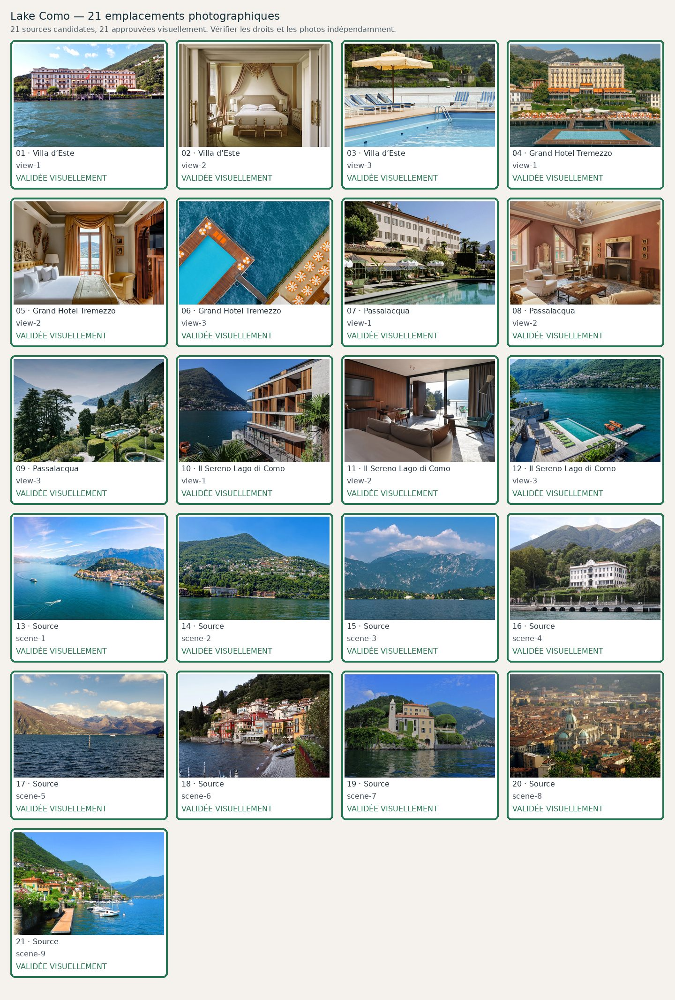

# Lake Como — 21 photographies à contrôler

**Candidats récupérés : 21/21 · Validés visuellement : 21/21**. Aucune validation ne résulte du seul téléchargement.

| No | Etablissement / lieu | Source et métadonnées | État |
|---:|---|---|---|
| 1 | Villa d’Este — view-1 | [Source](https://tg24.sky.it/economia/2025/09/04/forum-ambrosetti-cernobbio-2025) · Villa d&#x27;Este real cream historic lakefront façade photographed in brilliant daylight from water, wooded slopes behind| Validée visuellement |
| 2 | Villa d’Este — view-2 | [Source](https://www.villadeste.com/rooms-and-suites) ·     | Validée visuellement |
| 3 | Villa d’Este — view-3 | [Source](https://www.villadeste.com/sporting-club) ·     | Validée visuellement |
| 4 | Grand Hotel Tremezzo — view-1 | [Source](https://www.ad-italia.it/article/grand-hotel-tremezzo-lago-di-como/) · Genuine sunlit Grand Hotel Tremezzo Belle Epoque front and orange parasols, floating pool in foreground| Validée visuellement |
| 5 | Grand Hotel Tremezzo — view-2 | [Source](https://www.grandhoteltremezzo.com/en/rooms-suites/signature-suite/) ·     | Validée visuellement |
| 6 | Grand Hotel Tremezzo — view-3 | [Source](https://www.grandhoteltremezzo.com/en/resort/pools/) · Actual Water-on-the-Water lake floating pool, confirmed image DJI-0031| Validée visuellement |
| 7 | Passalacqua — view-1 | [Source](https://www.katefulller.com/post/passalacqua-lake-como-boutique-hotel) · Passalacqua real eighteenth-century pale villa façade with pink and green gardens, terraced pool, mountains and daylight| Validée visuellement |
| 8 | Passalacqua — view-2 | [Source](https://www.passalacqua.it/en/rooms/suite-agnese-in-the-villa/) · Actual Passalacqua Suite Agnese living room with antiques, blush walls and restored eighteenth century features| Validée visuellement |
| 9 | Passalacqua — view-3 | [Source](https://www.passalacqua.it/en/) ·     | Validée visuellement |
| 10 | Il Sereno Lago di Como — view-1 | [Source](https://www.spabusiness.com/wellness-news/Patricia-Urquiola-Sereno-Hotels-Lake-Como-Italy-Il-Sereno-Lago-di-Como-architecture-design/331014) · Il Sereno Torno genuine wood-slat lakeside facade with mountains and water| Validée visuellement |
| 11 | Il Sereno Lago di Como — view-2 | [Source](https://www.serenohotels.com/property/il-sereno/suites/1-bedroom-suites/corner-suite/) · Il Sereno actual corner suite with walnut furnishings and furnished lake view terrace| Validée visuellement |
| 12 | Il Sereno Lago di Como — view-3 | [Source](https://www.soldoutservice.com/sereno-lago-di-como-hotel-lusso/) · Real Il Sereno Lake Como aqua infinity pool, deck, green loungers and orange boats moored beside lake| Validée visuellement |
| 13 | Source — scene-1 | [Source](https://heliflygreece.com/helicopter-tours/from-milan-helicopter-tour/) · Actual sunny Lake Como central basin with blue lake, pastel villages and two boats| Validée visuellement |
| 14 | Source — scene-2 | [Source](https://commons.wikimedia.org/wiki/File:Cernobbio_hillside_from_Lake_Como.jpg) · Cernobbio hillside from Lake Como.jpg| Validée visuellement |
| 15 | Source — scene-3 | [Source](https://commons.wikimedia.org/wiki/File:Bellagio_panorama_from_Lake_Como_ferry.jpg) · Bellagio panorama from Lake Como ferry.jpg| Validée visuellement |
| 16 | Source — scene-4 | [Source](https://commons.wikimedia.org/wiki/File:Veduta_di_villa_Carlotta%2C_Tremezzo%2C_Lago_di_Como.jpg) · Veduta di villa Carlotta, Tremezzo, Lago di Como.jpg| Validée visuellement |
| 17 | Source — scene-5 | [Source](https://commons.wikimedia.org/wiki/File:Veduta_del_lago_di_Como_da_Bellagio.jpg) · Veduta del lago di Como da Bellagio.jpg| Validée visuellement |
| 18 | Source — scene-6 | [Source](https://www.pexels.com/photo/colorful-houses-along-lake-como-waterfront-29185823/) · Varenna colourful old-town houses on genuine Lake Como waterfront photographed in sunshine| Validée visuellement |
| 19 | Source — scene-7 | [Source](https://commons.wikimedia.org/wiki/File:Villa_del_Balbianello.jpg) · Villa del Balbianello.jpg| Validée visuellement |
| 20 | Source — scene-8 | [Source](https://commons.wikimedia.org/wiki/File:Como_Cathedral.jpg) · Como Cathedral.jpg| Validée visuellement |
| 21 | Source — scene-9 | [Source](https://www.italyreview.com/moltrasio.html) · Actual Moltrasio waterfront and verdant hillside, wooden private dock, blue lake| Validée visuellement |
