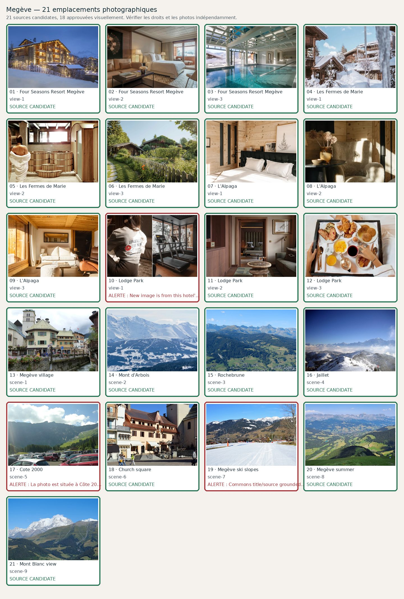

# Megève — 21 photographies à contrôler

**Candidats récupérés : 21/21 · Validés visuellement : 18/21**. Aucune validation ne résulte du seul téléchargement.

| No | Etablissement / lieu | Source et métadonnées | État |
|---:|---|---|---|
| 1 | Four Seasons Resort Megève — view-1 | [Source](https://hurlinghamtravel.co.uk/hotel/four-seasons-hotel-megeve) · Winter exterior confirmed at property| Candidate |
| 2 | Four Seasons Resort Megève — view-2 | [Source](https://www.momondo.in/hotels/megeve/Four-Seasons-Hotel-Megeve.mhd3148531.ksp) · Interior suite photographed at exact Four Seasons Megeve| Candidate |
| 3 | Four Seasons Resort Megève — view-3 | [Source](https://four-seasons.hotelsmegeve.com/) · Exact resort indoor pool photograph| Candidate |
| 4 | Les Fermes de Marie — view-1 | [Source](https://www.fermesdemarie.com/en) · Official page sharing image| Candidate |
| 5 | Les Fermes de Marie — view-2 | [Source](https://www.fermesdemarie.com/en/) · spa-pure-altitude-les-fermes-de-maria-megeve| Candidate |
| 6 | Les Fermes de Marie — view-3 | [Source](https://www.fermesdemarie.com/en/hiver/hotel-megeve) · Marie-farm-summer vacation| Candidate |
| 7 | L'Alpaga — view-1 | [Source](https://alpaga.com/fr/proprietes/hotel-alpaga/chambres-suites/) · Un lit douillet vert foncé est placé contre un mur en bois avec deux portraits au-dessus.| Candidate |
| 8 | L'Alpaga — view-2 | [Source](https://alpaga.com/fr/proprietes/hotel-alpaga/chambres-suites/) · Un canapé au toucher plume est placé près du mur en bois avec une table basse noire.| Candidate |
| 9 | L'Alpaga — view-3 | [Source](https://alpaga.com/fr/proprietes/hotel-alpaga/chambres-suites/) · Une photo de l&#x27;espace de vie présente un ensemble de canapés confortables placés près de la fenêtre.| Candidate |
| 10 | Lodge Park — view-1 | [Source](https://www.lodgepark.com/en/hotel-center-of-megeve) · the-lodge-reset-recovery-longevity-club-megeve| Candidate; **New image is from this hotel's photo page; independent visual identity, style and duplicate review still required.** |
| 11 | Lodge Park — view-2 | [Source](https://www.lodgepark.com/en/hotel-center-of-megeve) · Hotel-Lodge-Park-Megeve| Candidate |
| 12 | Lodge Park — view-3 | [Source](https://www.lodgepark.com/en/hotel-center-of-megeve) · exclusive-offer-good-kissers-from-megeve| Candidate |
| 13 | Megève village — scene-1 | [Source](https://commons.wikimedia.org/wiki/File:Megeve_-_panoramio_(18).jpg) · File:Megeve - panoramio (18).jpg| Candidate |
| 14 | Mont d'Arbois — scene-2 | [Source](https://commons.wikimedia.org/wiki/File:Mont-d'Arbois-Megève_(2017).jpg) · File:Mont-d&#x27;Arbois-Megève (2017).jpg| Candidate |
| 15 | Rochebrune — scene-3 | [Source](https://commons.wikimedia.org/wiki/File:Rochebrune_@_Megève_(51036605028).jpg) · File:Rochebrune @ Megève (51036605028).jpg| Candidate |
| 16 | Jaillet — scene-4 | [Source](https://commons.wikimedia.org/wiki/File:Tête_du_Torraz.JPG) · File:Tête du Torraz.JPG| Candidate |
| 17 | Cote 2000 — scene-5 | [Source](https://commons.wikimedia.org/wiki/File:Megève_Côte_2000-_Pour_village_EDT.jpg) · File:Megève Côte 2000- Pour village EDT.jpg| Candidate; **La photo est située à Côte 2000 mais montre surtout un parking de voitures ; qualité insuffisante pour un guide luxe. À remplacer par un panorama sans parking.** |
| 18 | Church square — scene-6 | [Source](https://commons.wikimedia.org/wiki/File:116-128_Place_de_l'Église,_Megève,_2025.jpg) · File:116-128 Place de l&#x27;Église, Megève, 2025.jpg| Candidate |
| 19 | Megève ski slopes — scene-7 | [Source](https://commons.wikimedia.org/wiki/File:View_of_the_Mont_d'Arbois_front_de_neige,_Megève,_2025.jpg) · File:View of the Mont d&#x27;Arbois front de neige, Megève, 2025.jpg| Candidate; **Commons title/source grounded, but manual geographic, season and aesthetic QA required.** |
| 20 | Megève summer — scene-8 | [Source](https://commons.wikimedia.org/wiki/File:Megève,_depuis_la_chaîne_du_Mont-Joly.jpg) · File:Megève, depuis la chaîne du Mont-Joly.jpg| Candidate |
| 21 | Mont Blanc view — scene-9 | [Source](https://commons.wikimedia.org/wiki/File:Mont_Blanc_@_Megève_(51037173286).jpg) · File:Mont Blanc @ Megève (51037173286).jpg| Candidate |
