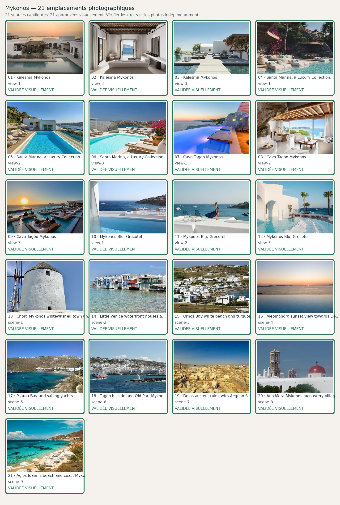

# Mykonos — 21 photographies à contrôler

**Candidats récupérés : 21/21 · Validés visuellement : 21/21**. Aucune validation ne résulte du seul téléchargement.

| No | Etablissement / lieu | Source et métadonnées | État |
|---:|---|---|---|
| 1 | Kalesma Mykonos — view-1 | [Source](https://www.timeout.com/greece/hotels/kalesma-mykonos) · Real Kalesma hilltop architectural pools with wooden pergola and Delos sunset| Validée visuellement |
| 2 | Kalesma Mykonos — view-2 | [Source](https://www.travelbeyond.se/resor/grekland/mykonos/kalesma) · Authentic Kalesma light bedroom with timber-beamed ceiling and doorway opening to blue sea| Validée visuellement |
| 3 | Kalesma Mykonos — view-3 | [Source](https://www.ttgmedia.com/luxury/why-kalesma-is-the-ultimate-greek-getaway-36079) · True Kalesma main pool and pergola with bougainvillea in sunny daylight| Validée visuellement |
| 4 | Santa Marina, a Luxury Collection Resort, Mykonos — view-1 | [Source](https://www.santa-marina.gr/accommodation) · THE PRESIDENTIAL   | Validée visuellement |
| 5 | Santa Marina, a Luxury Collection Resort, Mykonos — view-2 | [Source](https://www.santa-marina.gr/accommodation) · VILLA TURQUOISE   | Validée visuellement |
| 6 | Santa Marina, a Luxury Collection Resort, Mykonos — view-3 | [Source](https://www.santa-marina.gr/accommodation) · VILLA TANZANITE   | Validée visuellement |
| 7 | Cavo Tagoo Mykonos — view-1 | [Source](https://www.tatlerasia.com/lifestyle/travel/hk-5-heavenly-retreats-in-mykonos) · Actual Cavo Tagoo hotel stepped pool and sunset sea view, not a generic Mykonos infinity pool| Validée visuellement |
| 8 | Cavo Tagoo Mykonos — view-2 | [Source](https://kinoussis.gr/cavo-tagoo.html) · Actual Cavo Tagoo cliffside cave interior from design company and documented project| Validée visuellement |
| 9 | Cavo Tagoo Mykonos — view-3 | [Source](https://theluxurytravelexpert.com/cavo-tagoo-mykonos-review/) · Real Cavo Tagoo sunset infinity pool with floating daybeds and sea, original editorial review| Validée visuellement |
| 10 | Mykonos Blu, Grecotel — view-1 | [Source](https://www.grecotel.com/mykonosblu/accommodation/) ·    | Validée visuellement |
| 11 | Mykonos Blu, Grecotel — view-2 | [Source](https://www.grecotel.com/mykonosblu/) ·    | Validée visuellement |
| 12 | Mykonos Blu, Grecotel — view-3 | [Source](https://www.grecotel.com/mykonosblu/) ·    | Validée visuellement |
| 13 | Chora Mykonos whitewashed town and windmills — scene-1 | [Source](https://commons.wikimedia.org/wiki/File:Chora_Windmills,_Mykonos,_Greece_(53505710707).jpg) · File:Chora Windmills, Mykonos, Greece (53505710707).jpg| Validée visuellement |
| 14 | Little Venice waterfront houses and balconies — scene-2 | [Source](https://commons.wikimedia.org/wiki/File:Little_Venice,_Chora,_Mykonos,_Greece_(53505704507).jpg) · File:Little Venice, Chora, Mykonos, Greece (53505704507).jpg| Validée visuellement |
| 15 | Ornos Bay white beach and turquoise water — scene-3 | [Source](https://commons.wikimedia.org/wiki/File:GR-mykonos-ornos-beach.jpg) · Photograph of real sandy Ornos beach on Mykonos, author Bgabel 2012 CC BY-SA 3.0| Validée visuellement |
| 16 | Aleomandra sunset view towards Delos — scene-4 | [Source](https://saltyble.com/) · Genuine west-facing Aleomandra coast sunset and Aegean sea as seen from a local villa| Validée visuellement |
| 17 | Psarou Bay and sailing yachts — scene-5 | [Source](https://commons.wikimedia.org/wiki/File:Cyclades_Mykonos_Psarou_Plage_23062013_-_panoramio.jpg) · Actual Psarou Beach Mykonos, June 2013, verify quality at full size| Validée visuellement |
| 18 | Tagoo hillside and Old Port Mykonos — scene-6 | [Source](https://commons.wikimedia.org/wiki/File:Old_Port_of_Mykonos_01.jpg) · Geolocated Mykonos Old Port and Tagoo area, Bernard Gagnon| Validée visuellement |
| 19 | Delos ancient ruins with Aegean Sea — scene-7 | [Source](https://commons.wikimedia.org/wiki/File:A_panoramic_view_of_Delos.jpg) · File:A panoramic view of Delos.jpg| Validée visuellement |
| 20 | Ano Mera Mykonos monastery village — scene-8 | [Source](https://commons.wikimedia.org/wiki/File:Mykonos_–_Kloster_Ano_Mera_-_panoramio_(1).jpg) · File:Mykonos – Kloster Ano Mera - panoramio (1).jpg| Validée visuellement |
| 21 | Agios Ioannis beach and coast Mykonos — scene-9 | [Source](https://www.wowabouts.com/explore/post-agios-ioannis-beach) · Actual sandy Agios Ioannis beach in Mykonos with white parasols, clear turquoise water and hills| Validée visuellement |
