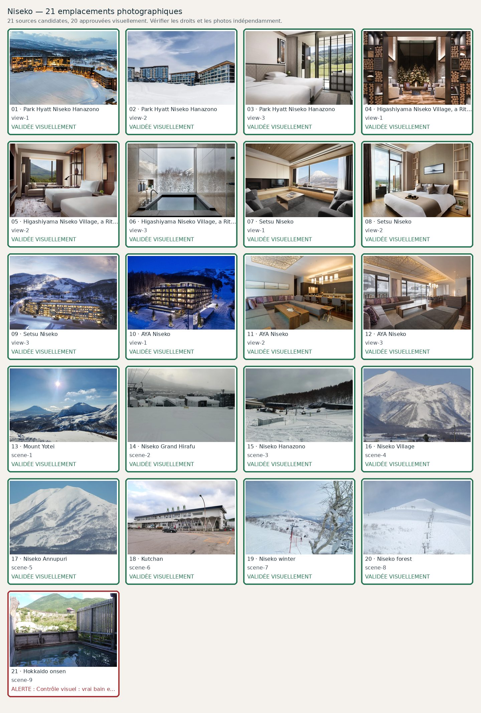

# Niseko — 21 photographies à contrôler

**Candidats récupérés : 21/21 · Validés visuellement : 20/21**. Aucune validation ne résulte du seul téléchargement.

| No | Etablissement / lieu | Source et métadonnées | État |
|---:|---|---|---|
| 1 | Park Hyatt Niseko Hanazono — view-1 | [Source](https://www.hyatt.com/park-hyatt/en-US/ctsph-park-hyatt-niseko-hanazono/gallery) · Verified property gallery asset| Validée visuellement |
| 2 | Park Hyatt Niseko Hanazono — view-2 | [Source](https://www.hyatt.com/park-hyatt/en-US/ctsph-park-hyatt-niseko-hanazono/gallery) · Verified property gallery asset| Validée visuellement |
| 3 | Park Hyatt Niseko Hanazono — view-3 | [Source](https://www.hyatt.com/park-hyatt/en-US/ctsph-park-hyatt-niseko-hanazono/gallery) · Verified property gallery asset| Validée visuellement |
| 4 | Higashiyama Niseko Village, a Ritz-Carlton Reserve — view-1 | [Source](https://www.ritzcarlton.com/en/hotels/ctsrz-higashiyama-niseko-village-a-ritz-carlton-reserve/overview/) · Official page sharing image| Validée visuellement |
| 5 | Higashiyama Niseko Village, a Ritz-Carlton Reserve — view-2 | [Source](https://www.ritzcarlton.com/en/hotels/ctsrz-higashiyama-niseko-village-a-ritz-carlton-reserve/rooms/) · Higashiyama Niseko Village Ritz-Carlton Reserve Yotei Twin Room| Validée visuellement |
| 6 | Higashiyama Niseko Village, a Ritz-Carlton Reserve — view-3 | [Source](https://www.ritzcarlton.com/en/hotels/ctsrz-higashiyama-niseko-village-a-ritz-carlton-reserve/overview/) · Guest Bathroom - Onsen-Style Soaking Tub| Validée visuellement |
| 7 | Setsu Niseko — view-1 | [Source](https://www.tatlerasia.com/places/setsu-niseko) · Real Setsu Niseko four-bedroom suite living room with snowy Mt Yotei view| Validée visuellement |
| 8 | Setsu Niseko — view-2 | [Source](https://setsuniseko.com/en/gallery/) · Setsu Niseko bedroom| Validée visuellement |
| 9 | Setsu Niseko — view-3 | [Source](https://setsuniseko.com/en/gallery/) · Setsu Exterior With Sign| Validée visuellement |
| 10 | AYA Niseko — view-1 | [Source](https://www.ayaniseko.com/) · Official page sharing image| Validée visuellement |
| 11 | AYA Niseko — view-2 | [Source](https://www.ayaniseko.com/accommodation/residences) · Official page sharing image| Validée visuellement |
| 12 | AYA Niseko — view-3 | [Source](https://www.ayaniseko.com/accommodation/residences) · Residence B 5| Validée visuellement |
| 13 | Mount Yotei — scene-1 | [Source](https://commons.wikimedia.org/wiki/File:Mount_Yōtei_and_Mount_Niseko-Annupuri.jpg) · File:Mount Yōtei and Mount Niseko-Annupuri.jpg| Validée visuellement |
| 14 | Niseko Grand Hirafu — scene-2 | [Source](https://commons.wikimedia.org/wiki/File:Grand_HIRAFU_Mountain_Center_and_Annex.jpg) · File:Grand HIRAFU Mountain Center and Annex.jpg| Validée visuellement |
| 15 | Niseko Hanazono — scene-3 | [Source](https://commons.wikimedia.org/wiki/File:HANAZONO_1st_Lift_(6-seater).jpg) · File:HANAZONO 1st Lift (6-seater).jpg| Validée visuellement |
| 16 | Niseko Village — scene-4 | [Source](https://commons.wikimedia.org/wiki/File:Niseko-Higashiyama.JPG) · File:Niseko-Higashiyama.JPG| Validée visuellement |
| 17 | Niseko Annupuri — scene-5 | [Source](https://commons.wikimedia.org/wiki/File:Niseko-Annupuri.JPG) · File:Niseko-Annupuri.JPG| Validée visuellement |
| 18 | Kutchan — scene-6 | [Source](https://commons.wikimedia.org/wiki/File:Kutchan-STA_2024.jpg) · Kutchan-STA 2024.jpg| Validée visuellement |
| 19 | Niseko winter — scene-7 | [Source](https://commons.wikimedia.org/wiki/File:2018_skiing_in_niseko.jpg) · File:2018 skiing in niseko.jpg| Validée visuellement |
| 20 | Niseko forest — scene-8 | [Source](https://commons.wikimedia.org/wiki/File:2010-02.niseko_annupuri.jpg) · File:2010-02.niseko annupuri.jpg| Validée visuellement |
| 21 | Hokkaido onsen — scene-9 | [Source](https://commons.wikimedia.org/wiki/File:Goshiki_spa_roten.JPG) · Goshiki spa roten.JPG| Candidate; **Contrôle visuel : vrai bain extérieur Goshiki Onsen mais photo estivale ancienne, qualité peu premium ; À REMPLACER par un visuel d'onsen local plus adapté avant publication.** |
