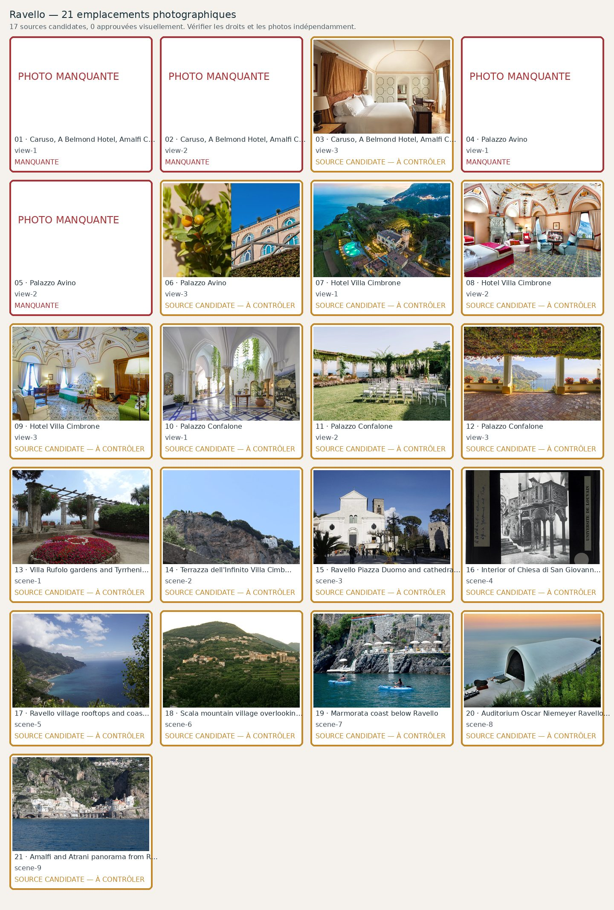

# Ravello — 21 photographies à contrôler

**Candidats récupérés : 17/21 · Validés visuellement : 0/21**. Aucune validation ne résulte du seul téléchargement.

| No | Etablissement / lieu | Source et métadonnées | État |
|---:|---|---|---|
| 1 | Caruso, A Belmond Hotel, Amalfi Coast — view-1 | [Source](https://www.belmond.com/en/hotels/europe/italy/caruso-amalfi-coast) · | Manquante; **Wrong subject: a person drinking coffee, not the Caruso hotel exterior or pool.** |
| 2 | Caruso, A Belmond Hotel, Amalfi Coast — view-2 | [Source](https://www.belmond.com/en/hotels/europe/italy/caruso-amalfi-coast) · | Manquante; **Wrong subject: Venice Simplon-Orient-Express attendant holding a train newspaper, not the hotel suite.** |
| 3 | Caruso, A Belmond Hotel, Amalfi Coast — view-3 | [Source](https://www.belmond.com/en/hotels/europe/italy/caruso-amalfi-coast/accommodation) · A king bed with white linens and heavy silk amber drapes sits centre of a Romanesque-styled room with ochre wall edge li| Candidate; **Source-backed photo candidate only: verify actual identity, seasonal photo accuracy, artistic quality and precise commercial reuse licence.** |
| 4 | Palazzo Avino — view-1 | [Source](https://www.palazzoavino.com/clubhouse-by-the-sea/) · | Manquante; **Wrong slot: swimming pool at the Marmorata Clubhouse by the Sea rather than the pink hilltop palace.** |
| 5 | Palazzo Avino — view-2 | [Source](https://www.palazzoavino.com/) · | Manquante; **Wrong slot: panoramic sea terrace, not a hotel room or suite.** |
| 6 | Palazzo Avino — view-3 | [Source](https://www.palazzoavino.com/) ·    | Candidate; **Source-backed photo candidate only: verify actual identity, seasonal photo accuracy, artistic quality and precise commercial reuse licence.** |
| 7 | Hotel Villa Cimbrone — view-1 | [Source](https://www.hotelvillacimbrone.com/) ·    | Candidate; **Source-backed photo candidate only: verify actual identity, seasonal photo accuracy, artistic quality and precise commercial reuse licence.** |
| 8 | Hotel Villa Cimbrone — view-2 | [Source](https://www.hotelvillacimbrone.com/rooms-and-suites/) ·    | Candidate; **Source-backed photo candidate only: verify actual identity, seasonal photo accuracy, artistic quality and precise commercial reuse licence.** |
| 9 | Hotel Villa Cimbrone — view-3 | [Source](https://www.hotelvillacimbrone.com/rooms-and-suite/studio-suite/) ·    | Candidate; **Source-backed photo candidate only: verify actual identity, seasonal photo accuracy, artistic quality and precise commercial reuse licence.** |
| 10 | Palazzo Confalone — view-1 | [Source](https://palazzoconfalone.com/) ·  hall  | Candidate; **Source-backed photo candidate only: verify actual identity, seasonal photo accuracy, artistic quality and precise commercial reuse licence.** |
| 11 | Palazzo Confalone — view-2 | [Source](https://palazzoconfalone.com/) ·  evento-matrimonio-esterno  | Candidate; **Source-backed photo candidate only: verify actual identity, seasonal photo accuracy, artistic quality and precise commercial reuse licence.** |
| 12 | Palazzo Confalone — view-3 | [Source](https://palazzoconfalone.com/) ·  esterni-confalone  | Candidate; **Source-backed photo candidate only: verify actual identity, seasonal photo accuracy, artistic quality and precise commercial reuse licence.** |
| 13 | Villa Rufolo gardens and Tyrrhenian Sea — scene-1 | [Source](https://commons.wikimedia.org/wiki/File:Jardines_de_Villa_Rufolo.jpg) · File:Jardines de Villa Rufolo.jpg| Candidate; **Source-backed photo candidate only: verify actual identity, seasonal photo accuracy, artistic quality and precise commercial reuse licence.** |
| 14 | Terrazza dell'Infinito Villa Cimbrone marble busts — scene-2 | [Source](https://commons.wikimedia.org/wiki/File:Cimbrone_IMG_9872.JPG) · File:Cimbrone IMG 9872.JPG| Candidate; **Source-backed photo candidate only: verify actual identity, seasonal photo accuracy, artistic quality and precise commercial reuse licence.** |
| 15 | Ravello Piazza Duomo and cathedral — scene-3 | [Source](https://commons.wikimedia.org/wiki/File:Duomo_Ravello,_from_Piazza_Duomo.jpg) · File:Duomo Ravello, from Piazza Duomo.jpg| Candidate; **Source-backed photo candidate only: verify actual identity, seasonal photo accuracy, artistic quality and precise commercial reuse licence.** |
| 16 | Interior of Chiesa di San Giovanni del Toro, Ravello — scene-4 | [Source](https://commons.wikimedia.org/wiki/File:Ravello._Chiesa_di_San_Giovanni_del_Toro_Interieur_Preekstoel,_GD012734.jpg) · File:Ravello. Chiesa di San Giovanni del Toro Interieur Preekstoel, GD012734.jpg| Candidate; **Source-backed photo candidate only: verify actual identity, seasonal photo accuracy, artistic quality and precise commercial reuse licence.** |
| 17 | Ravello village rooftops and coast — scene-5 | [Source](https://commons.wikimedia.org/wiki/File:Vue_emblématique_de_Ravello.jpg) · Authentic elevated Ravello town and sea panorama; inspect daylight and orientation| Candidate; **Source-backed photo candidate only: verify actual identity, seasonal photo accuracy, artistic quality and precise commercial reuse licence.** |
| 18 | Scala mountain village overlooking valley — scene-6 | [Source](https://commons.wikimedia.org/wiki/File:Scala_Campania_panorama.jpg) · Authentic Scala inland village and Lattari mountains| Candidate; **Source-backed photo candidate only: verify actual identity, seasonal photo accuracy, artistic quality and precise commercial reuse licence.** |
| 19 | Marmorata coast below Ravello — scene-7 | [Source](https://www.wexas.com/accommodation-offers/palazzo-avino-ravello-153313) · Marmorata coast kayak and authentic Palazzo Avino waterside platform| Candidate; **Source-backed photo candidate only: verify actual identity, seasonal photo accuracy, artistic quality and precise commercial reuse licence.** |
| 20 | Auditorium Oscar Niemeyer Ravello exterior — scene-8 | [Source](https://commons.wikimedia.org/wiki/File:Ravello_-_Auditorium_Oscar_Niemeyer_-_2024-09-29_19-16-49_001.jpg) · File:Ravello - Auditorium Oscar Niemeyer - 2024-09-29 19-16-49 001.jpg| Candidate; **Source-backed photo candidate only: verify actual identity, seasonal photo accuracy, artistic quality and precise commercial reuse licence.** |
| 21 | Amalfi and Atrani panorama from Ravello — scene-9 | [Source](https://commons.wikimedia.org/wiki/File:Atrani_(Italy).jpg) · Bernard Gagnon original daylight photograph of Atrani; coastal scene, not hotel location or a Ravello camera position| Candidate; **Source-backed photo candidate only: verify actual identity, seasonal photo accuracy, artistic quality and precise commercial reuse licence.** |
