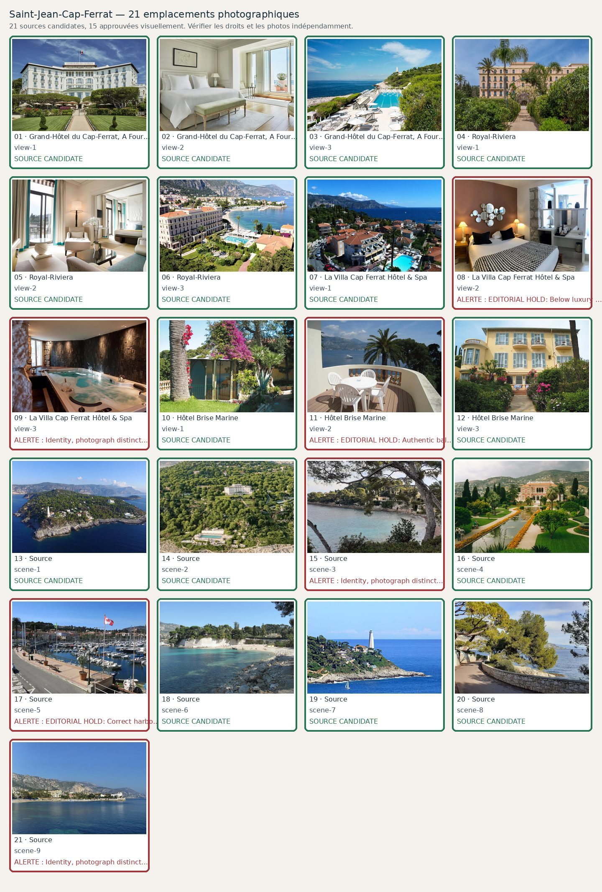

# Saint-Jean-Cap-Ferrat — 21 photographies à contrôler

**Candidats récupérés : 21/21 · Validés visuellement : 15/21**. Aucune validation ne résulte du seul téléchargement.

| No | Etablissement / lieu | Source et métadonnées | État |
|---:|---|---|---|
| 1 | Grand-Hôtel du Cap-Ferrat, A Four Seasons Hotel — view-1 | [Source](https://www.cntraveler.com/story/where-will-the-white-lotus-season-4-be-filmed) · Grand-Hôtel du Cap-Ferrat actual white Belle Époque façade and sunny formal gardens| Candidate |
| 2 | Grand-Hôtel du Cap-Ferrat, A Four Seasons Hotel — view-2 | [Source](https://www.forbestravelguide.com/hotels/french-riviera-france/grand-hotel-du-cap-ferrat-a-four-seasons-hotel) · Real Grand-Hôtel du Cap-Ferrat guestroom with pale mint bench and white linen| Candidate |
| 3 | Grand-Hôtel du Cap-Ferrat, A Four Seasons Hotel — view-3 | [Source](https://www.homeandartmag.com/2021/07/royal-riviera-st-jean-cap-ferrat.html) · Real Club Dauphin pool and lighthouse above the rocky Mediterranean headland| Candidate |
| 4 | Royal-Riviera — view-1 | [Source](https://www.royal-riviera.com/en/the-royal-riviera/the-royal-riviera-atmosphere/) · Royal-Riviera classic beige Belle Epoque hotel front framed by palm gardens| Candidate |
| 5 | Royal-Riviera — view-2 | [Source](https://decouvertes.fr/hotels-list/pro-hotel-royal-riviera/) · Daylight Royal-Riviera suite, turquoise curtains, terrace and natural light| Candidate |
| 6 | Royal-Riviera — view-3 | [Source](https://www.royal-riviera.com/en/the-royal-riviera/) · Actual Royal-Riviera hotel, outdoor pool and Baie des Fourmis in sunshine| Candidate |
| 7 | La Villa Cap Ferrat Hôtel & Spa — view-1 | [Source](https://villacapferrat.fr/en/home/) · Official CMS image matched by source context| Candidate |
| 8 | La Villa Cap Ferrat Hôtel & Spa — view-2 | [Source](https://villacapferrat.fr/en/rooms/) · Official CMS image matched by source context| Candidate; **EDITORIAL HOLD: Below luxury standard: dark dated bedroom composition and little recognisable sea outlook; seek a brighter true balcony/sea-view room.** |
| 9 | La Villa Cap Ferrat Hôtel & Spa — view-3 | [Source](https://villacapferrat.fr/en/gallery/) ·     | Candidate; **Identity, photograph distinctness, quality and attribution await human inspection.** |
| 10 | Hôtel Brise Marine — view-1 | [Source](https://www.hotel-brisemarine.com/) ·     | Candidate |
| 11 | Hôtel Brise Marine — view-2 | [Source](https://www.hotel-brisemarine.com/en/chambres-230.html) ·     | Candidate; **EDITORIAL HOLD: Authentic balcony but dated white plastic furniture dominates; replace with a clearer sunlit hotel interior/sea view.** |
| 12 | Hôtel Brise Marine — view-3 | [Source](https://www.hotel-brisemarine.com/en/) · Original Brise Marine yellow villa façade and flowering garden in daylight| Candidate |
| 13 | Source — scene-1 | [Source](https://www.explorenicecotedazur.com/en/nature/cap-ferrat/) · Actual Cap-Ferrat headland and peninsula coastline with real lighthouse visible| Candidate |
| 14 | Source — scene-2 | [Source](https://yeslondonmagazine.com/travel/grand-hotel-du-cap-ferrat-timeless-luxury-on-the-french-riviera) · Identifiable Grand-Hôtel du Cap-Ferrat exterior among pines and Club Dauphin below| Candidate |
| 15 | Source — scene-3 | [Source](https://commons.wikimedia.org/wiki/File:20211209_123405_Plage_de_la_Paloma.jpg) · 20211209 123405 Plage de la Paloma.jpg| Candidate; **Identity, photograph distinctness, quality and attribution await human inspection.** |
| 16 | Source — scene-4 | [Source](https://commons.wikimedia.org/wiki/File:France_PACA_06_Saint_Jean_Cap_Ferrat_Villa_Ephrussi_de_Rothschild_01.jpg) · File:France PACA 06 Saint Jean Cap Ferrat Villa Ephrussi de Rothschild 01.jpg| Candidate |
| 17 | Source — scene-5 | [Source](https://commons.wikimedia.org/wiki/File:Port_de_Saint-Jean_Cap-Ferrat.jpg) · Port de Saint-Jean Cap-Ferrat.jpg| Candidate; **EDITORIAL HOLD: Correct harbour, but ordinary roadside foreground dominates; prefer more premium marina-wide photograph.** |
| 18 | Source — scene-6 | [Source](https://commons.wikimedia.org/wiki/File:Plage_de_Passable.jpg) · Plage de Passable.jpg| Candidate |
| 19 | Source — scene-7 | [Source](https://commons.wikimedia.org/wiki/File:France-002563_-_Cap_Ferrat_Light_(15720311590).jpg) · France-002563 - Cap Ferrat Light (15720311590).jpg| Candidate |
| 20 | Source — scene-8 | [Source](https://commons.wikimedia.org/wiki/File:20211209_130841_Promenade_Maurice_Rouvier.jpg) · File:20211209 130841 Promenade Maurice Rouvier.jpg| Candidate |
| 21 | Source — scene-9 | [Source](https://commons.wikimedia.org/wiki/File:Panorama_baie_des_Fourmis_Beaulieu-sur-Mer.jpg) · Panorama baie des Fourmis Beaulieu-sur-Mer.jpg| Candidate; **Identity, photograph distinctness, quality and attribution await human inspection.** |
