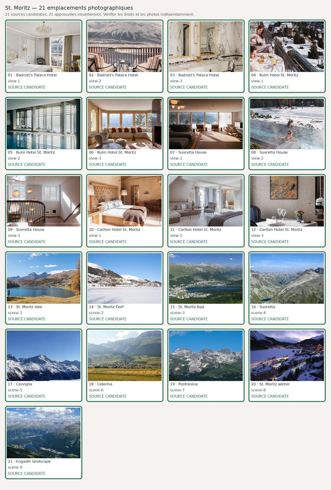

# St. Moritz — 21 photographies à contrôler

**Candidats récupérés : 21/21 · Validés visuellement : 21/21**. Aucune validation ne résulte du seul téléchargement.

| No | Etablissement / lieu | Source et métadonnées | État |
|---:|---|---|---|
| 1 | Badrutt's Palace Hotel — view-1 | [Source](https://badruttspalace.com/en/winter/accommodation/rooms/) · Badrutts Palace Rooms Signature Double Room Lake View With Balcony| Candidate |
| 2 | Badrutt's Palace Hotel — view-2 | [Source](https://badruttspalace.com/en/winter/accommodation/rooms/) · Badrutts Palace Rooms Signature Double Room Lake View With Balcony View Balcony| Candidate |
| 3 | Badrutt's Palace Hotel — view-3 | [Source](https://badruttspalace.com/en/winter/accommodation/rooms/) · Badrutts Palace Rooms Signature Double Room Lake View With Balcony Bathroom| Candidate |
| 4 | Kulm Hotel St. Moritz — view-1 | [Source](https://www.kulm.com/en/winter/) · Official page sharing image| Candidate |
| 5 | Kulm Hotel St. Moritz — view-2 | [Source](https://www.kulm.com/en/winter/) · The immersive St. Moritz alpine spa| Candidate |
| 6 | Kulm Hotel St. Moritz — view-3 | [Source](https://www.kulm.com/en/rooms/corvatsch-suite) · Corvatsch Suite — salon avec grandes baies vitrées donnant sur les montagnes enneigées| Candidate |
| 7 | Suvretta House — view-1 | [Source](https://suvrettahouse.ch/en/startseite-winter) · | Candidate |
| 8 | Suvretta House — view-2 | [Source](https://suvrettahouse.ch/en/startseite-winter) · | Candidate |
| 9 | Suvretta House — view-3 | [Source](https://suvrettahouse.ch/en/startseite-winter) · | Candidate |
| 10 | Carlton Hotel St. Moritz — view-1 | [Source](https://tschuggencollection.ch/en/hotel/carlton-hotel) · Elegant hotel bedroom with tufted headboard, white bedding, exposed beams, desk area, and warm lighting throughout.| Candidate |
| 11 | Carlton Hotel St. Moritz — view-2 | [Source](https://tschuggencollection.ch/en/hotel/carlton-hotel) · Spacious hotel suite with a gray sectional sofa, armchair, coffee table, blue curtains, and sloped ceilings.| Candidate |
| 12 | Carlton Hotel St. Moritz — view-3 | [Source](https://tschuggencollection.ch/en/hotel/carlton-hotel) · Elegant restaurant table with white linens, wine glasses, and floral centerpiece beneath Asian-inspired artwork on textu| Candidate |
| 13 | St. Moritz lake — scene-1 | [Source](https://commons.wikimedia.org/wiki/File:Blick_über_den_Sankt_Moritzersee_auf_Sankt_Moritz.jpg) · Blick über den Sankt Moritzersee auf Sankt Moritz.jpg| Candidate |
| 14 | St. Moritz Dorf — scene-2 | [Source](https://commons.wikimedia.org/wiki/File:SMoritz_Dorf_from_lake.jpg) · File:SMoritz Dorf from lake.jpg| Candidate |
| 15 | St. Moritz Bad — scene-3 | [Source](https://commons.wikimedia.org/wiki/File:St._Moritz_panorama_3.jpg) · St. Moritz panorama 3.jpg| Candidate |
| 16 | Suvretta — scene-4 | [Source](https://commons.wikimedia.org/wiki/File:Pass_Suvretta.jpg) · File:Pass Suvretta.jpg| Candidate |
| 17 | Corviglia — scene-5 | [Source](https://commons.wikimedia.org/wiki/File:St._Moritz_Corviglia_2.jpg) · St. Moritz Corviglia 2.jpg| Candidate |
| 18 | Celerina — scene-6 | [Source](https://commons.wikimedia.org/wiki/File:Celerina_Engadin.jpg) · Celerina Engadin.jpg| Candidate |
| 19 | Pontresina — scene-7 | [Source](https://commons.wikimedia.org/wiki/File:Engadin_-_mountains.jpg) · File:Engadin - mountains.jpg| Candidate |
| 20 | St. Moritz winter — scene-8 | [Source](https://commons.wikimedia.org/wiki/File:StMoritz.jpg) · File:StMoritz.jpg| Candidate |
| 21 | Engadin landscape — scene-9 | [Source](https://commons.wikimedia.org/wiki/File:St._Moritz_-_Pontresina.jpg) · St. Moritz - Pontresina.jpg| Candidate |
