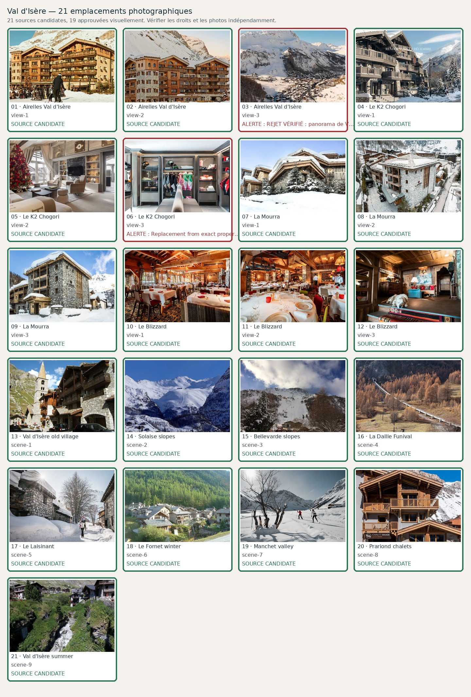

# Val d'Isère — 21 photographies à contrôler

**Candidats récupérés : 21/21 · Validés visuellement : 19/21**. Aucune validation ne résulte du seul téléchargement.

| No | Etablissement / lieu | Source et métadonnées | État |
|---:|---|---|---|
| 1 | Airelles Val d'Isère — view-1 | [Source](https://airelles.com/fr/destination/val-d-isere-hotel) · Official hotel&#x27;s page hero photograph| Candidate |
| 2 | Airelles Val d'Isère — view-2 | [Source](https://airelles.com/en/destination/val-d-isere-hotel) · Official page sharing image| Candidate |
| 3 | Airelles Val d'Isère — view-3 | [Source](https://airelles.com/fr/destination/val-d-isere-hotel) · | Candidate; **REJET VÉRIFIÉ : panorama de Val d'Isère sans Airelles identifiable ; pourrait illustrer la destination mais ne doit pas être une photo d'hôtel.** |
| 4 | Le K2 Chogori — view-1 | [Source](https://lek2chogori.com/fr/) · Hôtel de luxe à Val d&#x27;Isère, Le K2 Chogori| Candidate |
| 5 | Le K2 Chogori — view-2 | [Source](https://lek2chogori.com/fr/) · Chambre K2 Chogori, hôtel de luxe 5 étoiles à Val d&#x27;Isère| Candidate |
| 6 | Le K2 Chogori — view-3 | [Source](https://www.valdisere.com/preparer-mon-sejour/hebergements/hotels/k2-chogori-val-disere-fr-4194656/) · Ski Shop_Le K2 Chogori| Candidate; **Replacement from exact property/location page; needs visual verification before display.** |
| 7 | La Mourra — view-1 | [Source](https://www.hotellamourra.com/fr/) · Official page sharing image| Candidate |
| 8 | La Mourra — view-2 | [Source](https://www.hotellamourra.com/fr/) · Vue aérienne d&#x27;un bâtiment en montagne enneigée, Hôtel 5 Étoiles avec spa La Mourra à Val d’Isèr| Candidate |
| 9 | La Mourra — view-3 | [Source](https://www.hotellamourra.com/fr/) · Chalet enneigé en montagne sous ciel bleu, Hôtel 5 Étoiles avec spa La Mourra à Val d’Isèr| Candidate |
| 10 | Le Blizzard — view-1 | [Source](https://hotelblizzard.com/fr/) · restaurant le blizzard (1) hd 1920x1080| Candidate |
| 11 | Le Blizzard — view-2 | [Source](https://hotelblizzard.com/fr/) · restaurant le blizzard (3) hd 1920x1080| Candidate |
| 12 | Le Blizzard — view-3 | [Source](https://hotelblizzard.com/fr/) · | Candidate |
| 13 | Val d'Isère old village — scene-1 | [Source](https://commons.wikimedia.org/wiki/File:Val-dIsere-église-chemin-du-Charvet.JPG) · File:Val-dIsere-église-chemin-du-Charvet.JPG| Candidate |
| 14 | Solaise slopes — scene-2 | [Source](https://commons.wikimedia.org/wiki/File:Solaise_à_Val-d'Isère_depuis_Barrage_de_Tignes_(février_2026).JPG) · File:Solaise à Val-d&#x27;Isère depuis Barrage de Tignes (février 2026).JPG| Candidate |
| 15 | Bellevarde slopes — scene-3 | [Source](https://commons.wikimedia.org/wiki/File:Face_de_Bellevarde_2014.JPG) · File:Face de Bellevarde 2014.JPG| Candidate |
| 16 | La Daille Funival — scene-4 | [Source](https://commons.wikimedia.org/wiki/File:Funival_@_La_Daille_01.jpg) · File:Funival @ La Daille 01.jpg| Candidate |
| 17 | Le Laisinant — scene-5 | [Source](https://www.valdisere.com/en/val-disere-in-winter/walks-and-snowshoeing-tours/) · Photographie officielle du hameau du Laisinant en hiver : skieuse portant son matériel à pied| Candidate |
| 18 | Le Fornet winter — scene-6 | [Source](https://commons.wikimedia.org/wiki/File:Maisons_Le_Fornet_Val_d'Isère.jpg) · File:Maisons Le Fornet Val d&#x27;Isère.jpg| Candidate |
| 19 | Manchet valley — scene-7 | [Source](https://www.valdisere.com/en/val-disere-in-winter/skiing-winter-fun/cross-country-skiing/great-manchet-loop-val-disere-en-4710589/) · Manchet valley cross-country skiing, official tourism| Candidate |
| 20 | Prariond chalets — scene-8 | [Source](https://www.village-montana.com/val-disere/chalet-skadi) · Chalet Skadi facade, confirmed Avenue du Prariond Val d’Isère| Candidate |
| 21 | Val d'Isère summer — scene-9 | [Source](https://commons.wikimedia.org/wiki/File:Isère_au_Fornet_à_Val-d'Isère_en_été_(juillet_2022).JPG) · File:Isère au Fornet à Val-d&#x27;Isère en été (juillet 2022).JPG| Candidate |
