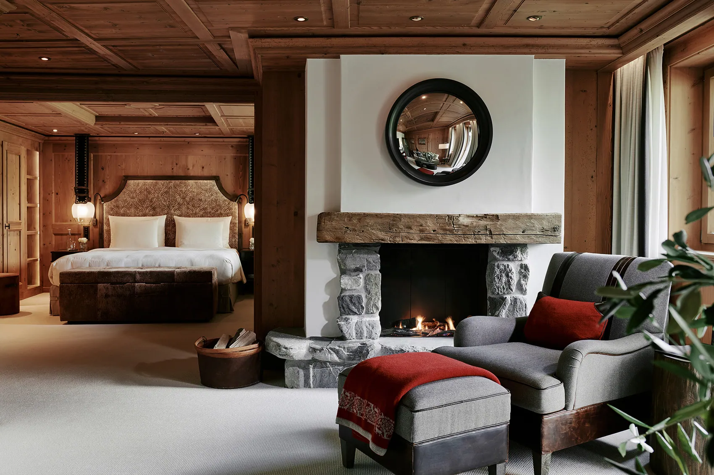
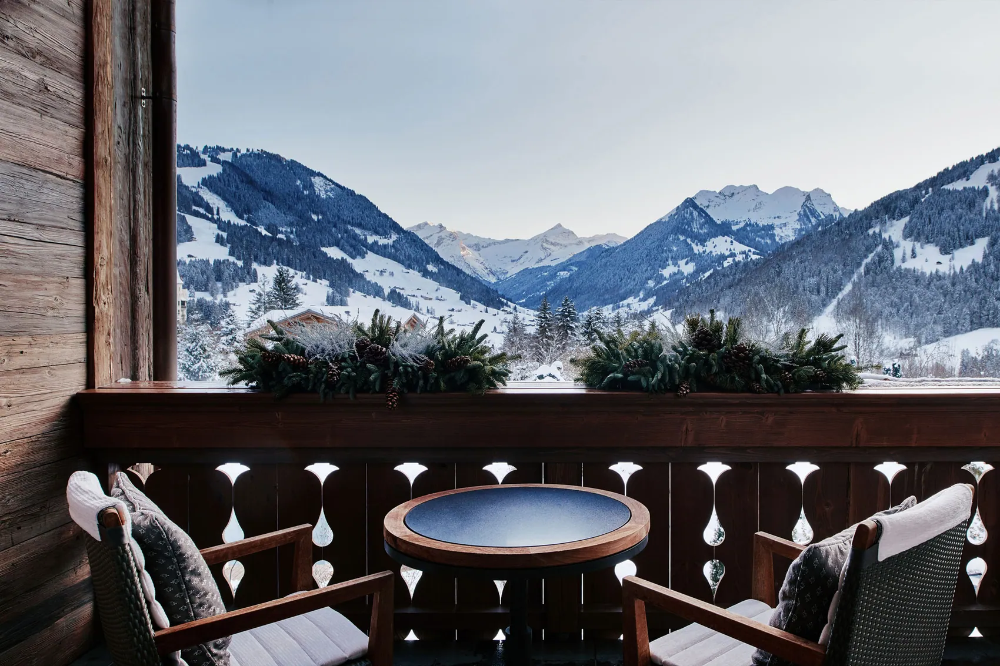
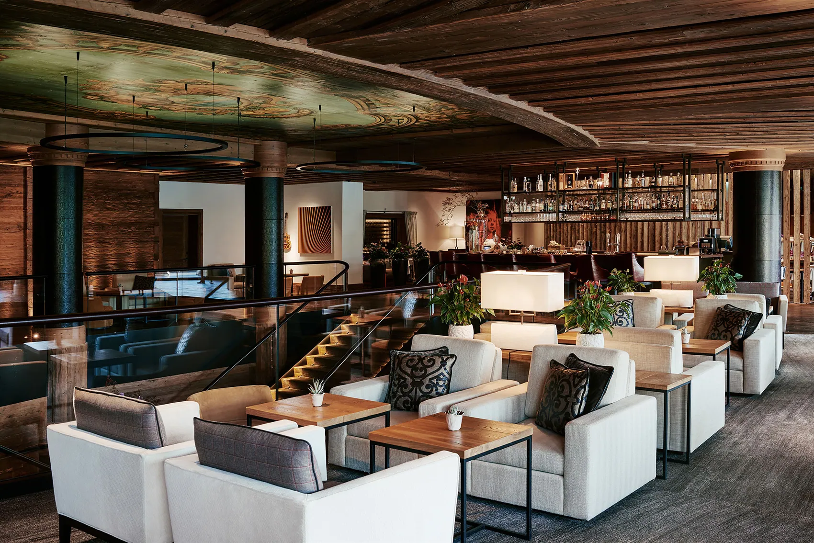
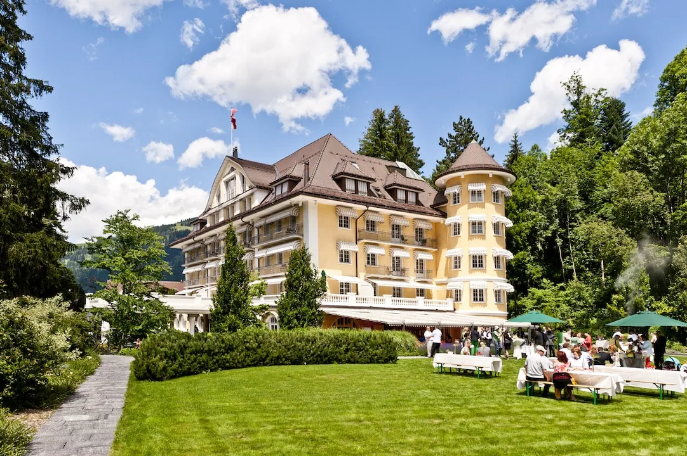
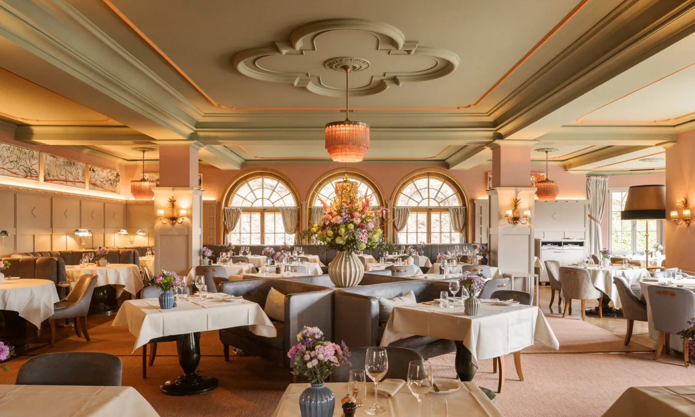
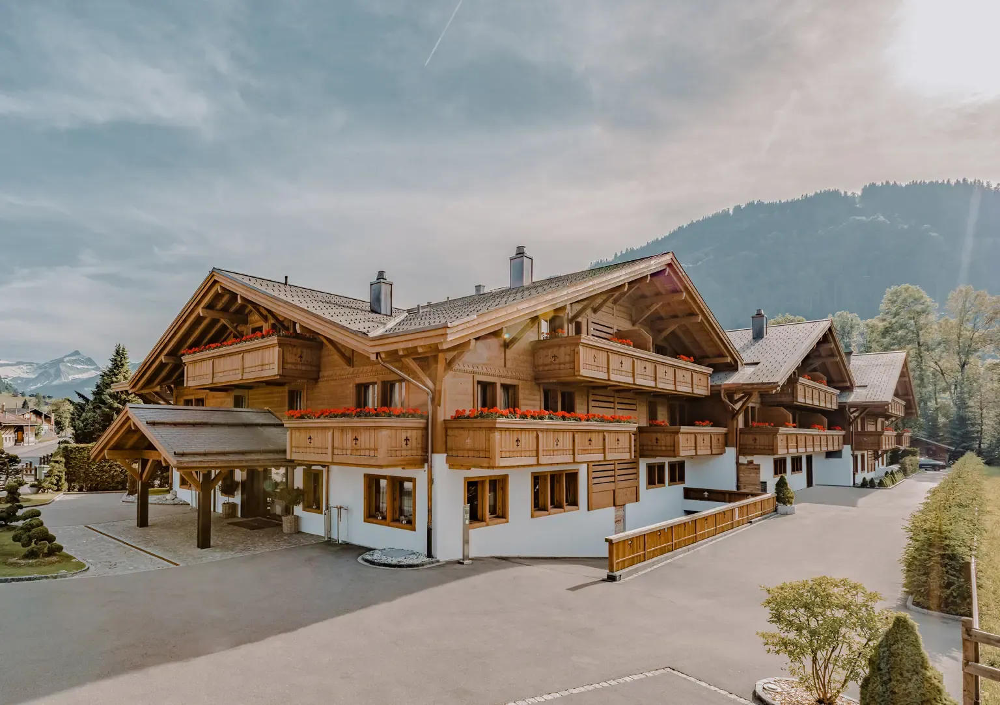
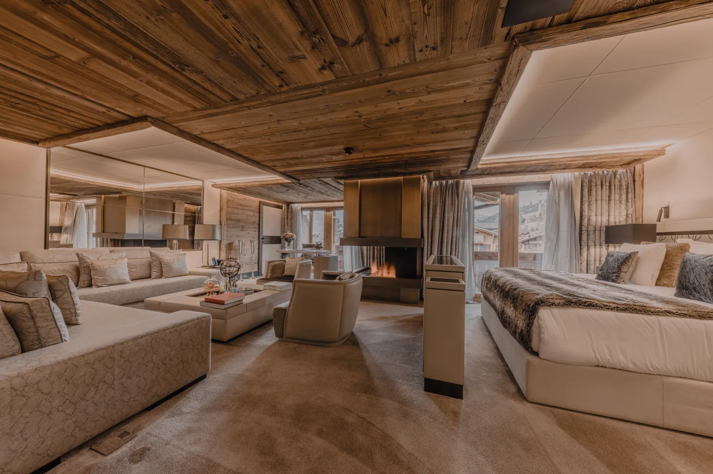
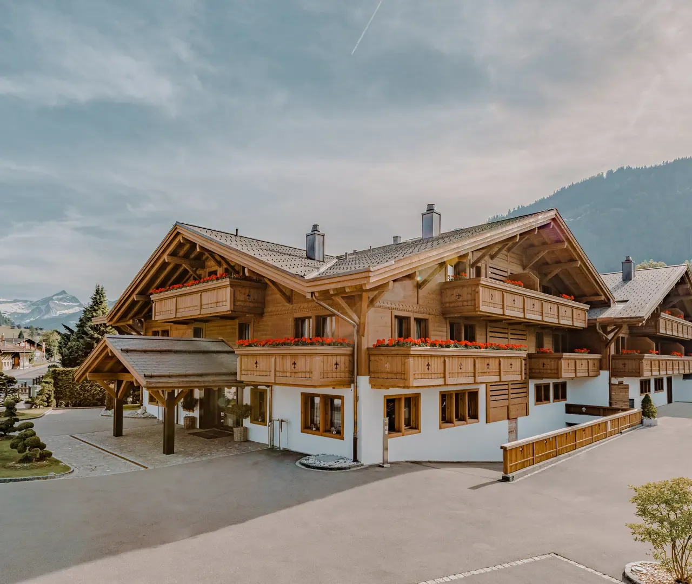
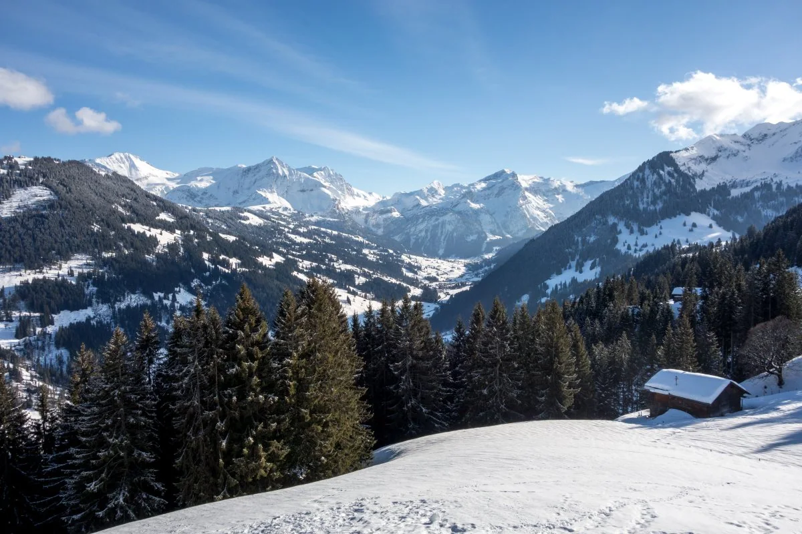

# Gstaad — revue photographique interne

> **PAS ENCORE PUBLIABLE** : source authentique ne signifie pas autorisation commerciale, photo adaptée ou image unique.

**Fichiers candidats : 10/21** ; scènes manquantes : 11 ; visuels sous alerte : 5 ; candidats sans alerte connue : 5 (toujours non approuvés).

## Établissements réels — 3 images attendues par maison

| Hôtel / cliché | WebP récupéré | Origine et droits | Problème à examiner |
|---|---|---|---|
| Gstaad Palace · view-1 | À rechercher | À trouver ; Droits de réutilisation indépendants à confirmer | FICHIER MANQUANT |
| Gstaad Palace · view-2 | À rechercher | À trouver ; Droits de réutilisation indépendants à confirmer | FICHIER MANQUANT |
| Gstaad Palace · view-3 | À rechercher | À trouver ; Droits de réutilisation indépendants à confirmer | FICHIER MANQUANT |
| The Alpina Gstaad · view-1 |  | <a href="https://www.thealpinagstaad.ch/en/5-star-alpina-gstaad-hotel">Voir la source</a> ; Droits de réutilisation indépendants à confirmer | Vérifier l&#x27;identité exacte et la licence |
| The Alpina Gstaad · view-2 |  | <a href="https://www.thealpinagstaad.ch/en/">Voir la source</a> ; Droits de réutilisation indépendants à confirmer | Vérifier l&#x27;identité exacte et la licence |
| The Alpina Gstaad · view-3 |  | <a href="https://www.thealpinagstaad.ch/en/5-star-alpina-gstaad-hotel">Voir la source</a> ; Droits de réutilisation indépendants à confirmer | Vérifier l&#x27;identité exacte et la licence |
| Le Grand Bellevue · view-1 |  | <a href="https://bellevue-gstaad.ch/">Voir la source</a> ; Droits de réutilisation indépendants à confirmer | Vérifier l&#x27;identité exacte et la licence |
| Le Grand Bellevue · view-2 |  | <a href="https://bellevue-gstaad.ch/">Voir la source</a> ; Droits de réutilisation indépendants à confirmer | Vérifier l&#x27;identité exacte et la licence |
| Le Grand Bellevue · view-3 |  | <a href="https://bellevue-gstaad.ch/">Voir la source</a> ; Droits de réutilisation indépendants à confirmer | Même cliché source que view-2 ; le redimensionnement ne constitue pas une nouvelle photo. |
| Ultima Hotel Gstaad · view-1 |  | <a href="https://www.ultimacollection.com/our-collection/ultima-hotel-gstaad">Voir la source</a> ; Droits de réutilisation indépendants à confirmer | Image estivale du vrai hôtel, ne pas la légender comme photo d&#x27;hiver. |
| Ultima Hotel Gstaad · view-2 |  | <a href="https://www.ultimacollection.com/our-collection/ultima-hotel-gstaad">Voir la source</a> ; Droits de réutilisation indépendants à confirmer | Même cliché source que view-1 ; le redimensionnement ne constitue pas une nouvelle photo. |
| Ultima Hotel Gstaad · view-3 |  | <a href="https://www.ultimacollection.com/our-collection/ultima-hotel-gstaad">Voir la source</a> ; Droits de réutilisation indépendants à confirmer | Même cliché source que view-1 ; le redimensionnement ne constitue pas une nouvelle photo. |

## Paysages et secteurs authentiques — 9 scènes attendues

| Lieu | WebP récupéré | Origine, licence | Problème à examiner |
|---|---|---|
| Gstaad chalet village | À rechercher | À trouver ; Licence à vérifier | SCÈNE MANQUANTE |
| Gstaad promenade | À rechercher | À trouver ; Licence à vérifier | SCÈNE MANQUANTE |
| Gstaad panoramic hillside | À rechercher | À trouver ; Licence à vérifier | SCÈNE MANQUANTE |
| Eggli |  | <a href="https://commons.wikimedia.org/wiki/File:Marcus_G._Lindner_an_der_Bergstation_Eggli,_Gstaad,_Schweiz.jpg">Voir la source</a> ; CC BY-SA 4.0 | À REMPLACER : portrait d&#x27;une personne en station, pas panorama du secteur Eggli. |
| Wispile | À rechercher | À trouver ; Licence à vérifier | SCÈNE MANQUANTE |
| Wasserngrat | À rechercher | À trouver ; Licence à vérifier | SCÈNE MANQUANTE |
| Saanen | À rechercher | À trouver ; Licence à vérifier | SCÈNE MANQUANTE |
| Schönried | À rechercher | À trouver ; Licence à vérifier | SCÈNE MANQUANTE |
| Saanenland mountains | À rechercher | À trouver ; Licence à vérifier | SCÈNE MANQUANTE |

## Checklist qualité avant routage

- [ ] 12 photographies distinctes des quatre hôtels EXACTS, sans logos, duplications ou images d'autres maisons
- [ ] 9 scènes locales géographiquement vérifiées et pertinentes pour leur légende
- [ ] Crédits et licences (CC BY, CC BY-SA, œuvres officielles) revus pour réutilisation commerciale
- [ ] Légendes originales FR et EN conformes aux photos et à leur saison
- [ ] Intégration des pages FR/EN + FAQ + SEO Schema sur la branche, avec maintien du noindex
- [ ] Aucune disponibilité Wink fictive ni lien de paiement inventé

