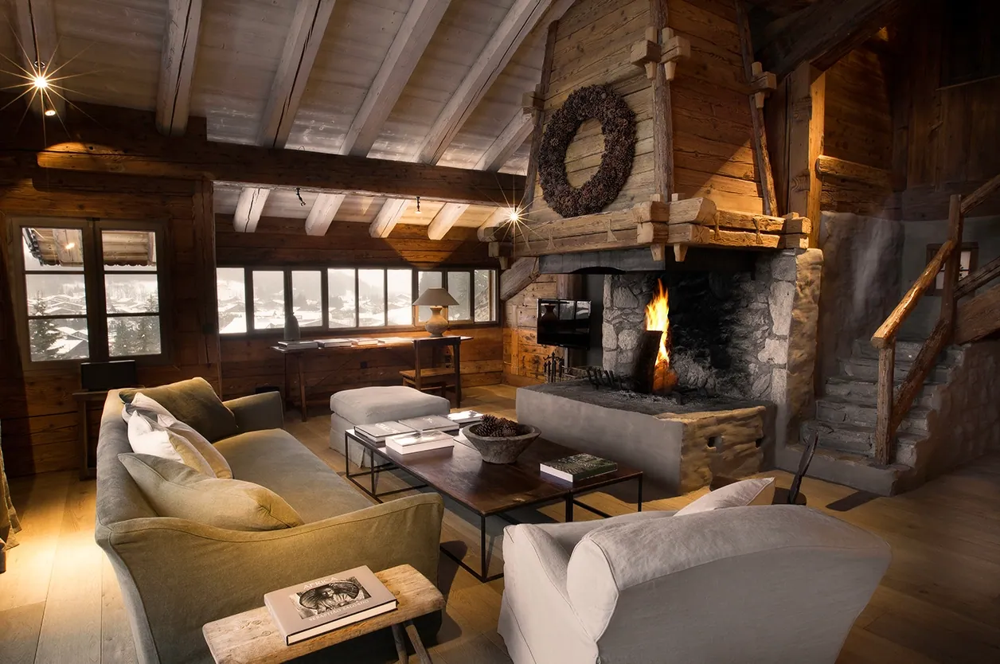
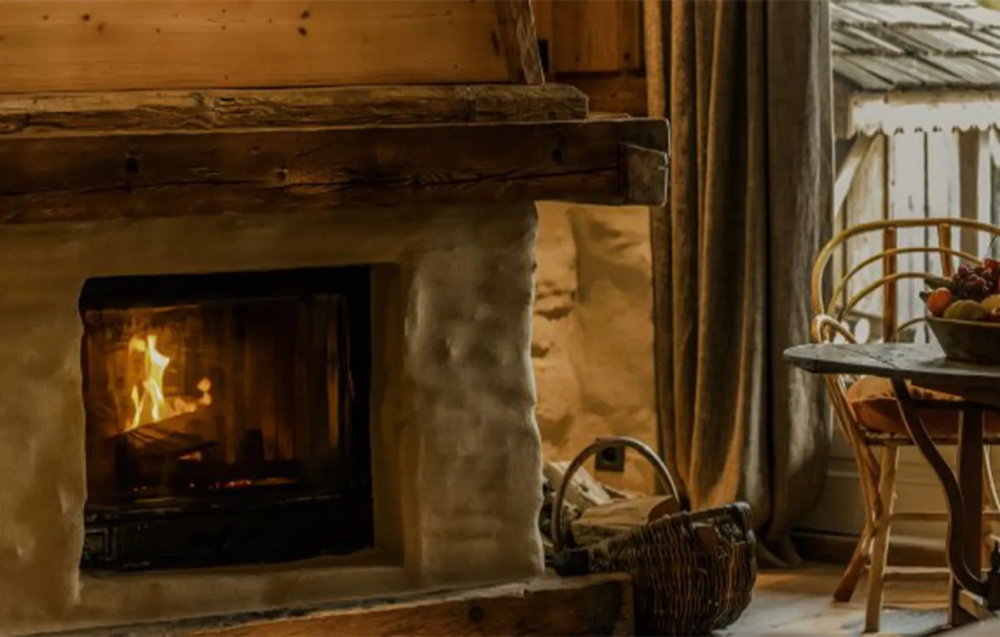
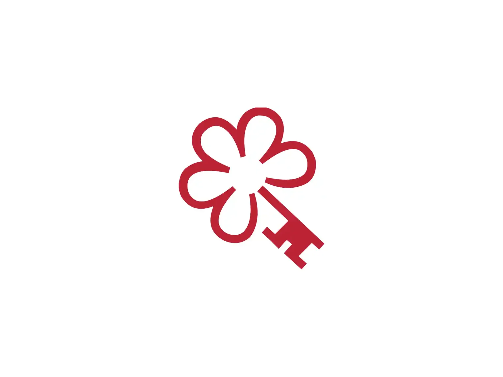

# Megève — revue photographique interne

> **PAS ENCORE PUBLIABLE** : source authentique ne signifie pas autorisation commerciale, photo adaptée ou image unique.

**Fichiers candidats : 12/21** ; scènes manquantes : 9 ; visuels sous alerte : 5 ; candidats sans alerte connue : 7 (toujours non approuvés).

## Établissements réels — 3 images attendues par maison

| Hôtel / cliché | WebP récupéré | Origine et droits | Problème à examiner |
|---|---|---|---|
| Four Seasons Resort Megève · view-1 | À rechercher | À trouver ; Droits de réutilisation indépendants à confirmer | FICHIER MANQUANT |
| Four Seasons Resort Megève · view-2 | À rechercher | À trouver ; Droits de réutilisation indépendants à confirmer | FICHIER MANQUANT |
| Four Seasons Resort Megève · view-3 | À rechercher | À trouver ; Droits de réutilisation indépendants à confirmer | FICHIER MANQUANT |
| Les Fermes de Marie · view-1 |  | <a href="https://www.fermesdemarie.com/en">Voir la source</a> ; Droits de réutilisation indépendants à confirmer | Vérifier l&#x27;identité exacte et la licence |
| Les Fermes de Marie · view-2 |  | <a href="https://www.fermesdemarie.com/en/hiver/hotel-megeve">Voir la source</a> ; Droits de réutilisation indépendants à confirmer | Vérifier l&#x27;identité exacte et la licence |
| Les Fermes de Marie · view-3 |  | <a href="https://www.fermesdemarie.com/en/hiver/hotel-megeve">Voir la source</a> ; Droits de réutilisation indépendants à confirmer | Même cliché source que view-2 ; le redimensionnement ne constitue pas une nouvelle photo. |
| Lodge Park · view-1 |  | <a href="https://www.lodgepark.com/en">Voir la source</a> ; Droits de réutilisation indépendants à confirmer | À CONTRÔLER : image de restauration. Ne pas l’utiliser comme façade ou chambre. |
| Lodge Park · view-2 |  | <a href="https://www.lodgepark.com/en/hotel-center-of-megeve">Voir la source</a> ; Droits de réutilisation indépendants à confirmer | Vérifier l&#x27;identité exacte et la licence |
| Lodge Park · view-3 |  | <a href="https://www.lodgepark.com/en/hotel-center-of-megeve">Voir la source</a> ; Droits de réutilisation indépendants à confirmer | Vérifier l&#x27;identité exacte et la licence |
| Zannier Le Chalet · view-1 |  | <a href="https://www.zannierhotels.com/hotels/le-chalet-winter/">Voir la source</a> ; Droits de réutilisation indépendants à confirmer | Vérifier l&#x27;identité exacte et la licence |
| Zannier Le Chalet · view-2 |  | <a href="https://www.zannierhotels.com/hotels/le-chalet-winter/">Voir la source</a> ; Droits de réutilisation indépendants à confirmer | À CONTRÔLER : image générique Zannier Warm, aucune chambre Le Chalet clairement identifiée. |
| Zannier Le Chalet · view-3 |  | <a href="https://www.zannierhotels.com/hotels/le-chalet-winter/">Voir la source</a> ; Droits de réutilisation indépendants à confirmer | À REMPLACER : visuel de récompense ou logo, ne représente ni chambre ni espace hôtelier. |

## Paysages et secteurs authentiques — 9 scènes attendues

| Lieu | WebP récupéré | Origine, licence | Problème à examiner |
|---|---|---|
| Megève village | À rechercher | À trouver ; Licence à vérifier | SCÈNE MANQUANTE |
| Mont d&#x27;Arbois | À rechercher | À trouver ; Licence à vérifier | SCÈNE MANQUANTE |
| Rochebrune |  | <a href="https://commons.wikimedia.org/wiki/File:Rochebrune_@_Megève_(51036605028).jpg">Voir la source</a> ; CC BY 2.0 | Vérifier l&#x27;identité du site et les attributions |
| Jaillet |  | <a href="https://commons.wikimedia.org/wiki/File:Tête_du_Torraz.JPG">Voir la source</a> ; CC BY 3.0 | Photo du Tête du Torraz ; n&#x27;affirmer le lien exact avec Jaillet qu&#x27;après contrôle cartographique. |
| Cote 2000 | À rechercher | À trouver ; Licence à vérifier | SCÈNE MANQUANTE |
| Church square | À rechercher | À trouver ; Licence à vérifier | SCÈNE MANQUANTE |
| Megève ski slopes | À rechercher | À trouver ; Licence à vérifier | SCÈNE MANQUANTE |
| Megève summer | À rechercher | À trouver ; Licence à vérifier | SCÈNE MANQUANTE |
| Mont Blanc view |  | <a href="https://commons.wikimedia.org/wiki/File:Mont_Blanc_@_Megève_(51037173286).jpg">Voir la source</a> ; CC BY 2.0 | Vérifier l&#x27;identité du site et les attributions |

## Checklist qualité avant routage

- [ ] 12 photographies distinctes des quatre hôtels EXACTS, sans logos, duplications ou images d'autres maisons
- [ ] 9 scènes locales géographiquement vérifiées et pertinentes pour leur légende
- [ ] Crédits et licences (CC BY, CC BY-SA, œuvres officielles) revus pour réutilisation commerciale
- [ ] Légendes originales FR et EN conformes aux photos et à leur saison
- [ ] Intégration des pages FR/EN + FAQ + SEO Schema sur la branche, avec maintien du noindex
- [ ] Aucune disponibilité Wink fictive ni lien de paiement inventé

