# Zermatt — revue photographique interne

> **PAS ENCORE PUBLIABLE** : source authentique ne signifie pas autorisation commerciale, photo adaptée ou image unique.

**Fichiers candidats : 13/21** ; scènes manquantes : 8 ; visuels sous alerte : 2 ; candidats sans alerte connue : 11 (toujours non approuvés).

## Établissements réels — 3 images attendues par maison

| Hôtel / cliché | WebP récupéré | Origine et droits | Problème à examiner |
|---|---|---|---|
| THE OMNIA · view-1 | 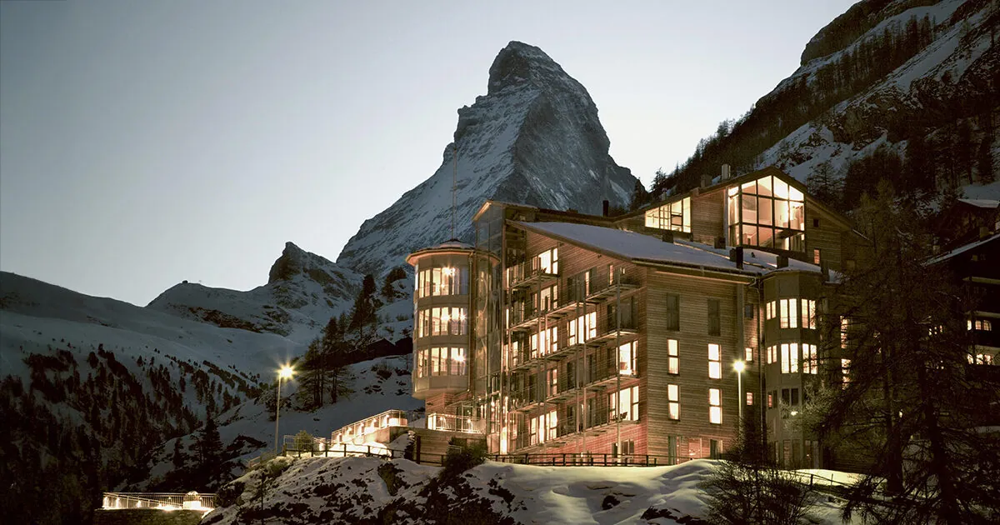 | <a href="https://www.the-omnia.com/">Voir la source</a> ; Droits de réutilisation indépendants à confirmer | Vérifier l&#x27;identité exacte et la licence |
| THE OMNIA · view-2 | À rechercher | À trouver ; Droits de réutilisation indépendants à confirmer | FICHIER MANQUANT |
| THE OMNIA · view-3 | À rechercher | À trouver ; Droits de réutilisation indépendants à confirmer | FICHIER MANQUANT |
| Mont Cervin Palace · view-1 | À rechercher | À trouver ; Droits de réutilisation indépendants à confirmer | FICHIER MANQUANT |
| Mont Cervin Palace · view-2 | À rechercher | À trouver ; Droits de réutilisation indépendants à confirmer | FICHIER MANQUANT |
| Mont Cervin Palace · view-3 | À rechercher | À trouver ; Droits de réutilisation indépendants à confirmer | FICHIER MANQUANT |
| CERVO Mountain Resort · view-1 | 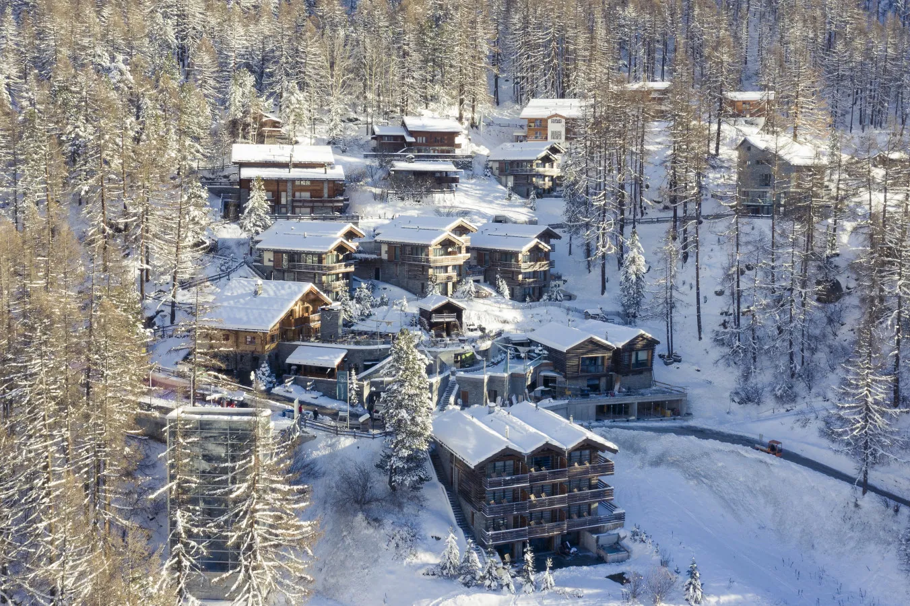 | <a href="https://cervo.swiss/en">Voir la source</a> ; Droits de réutilisation indépendants à confirmer | Vérifier l&#x27;identité exacte et la licence |
| CERVO Mountain Resort · view-2 | 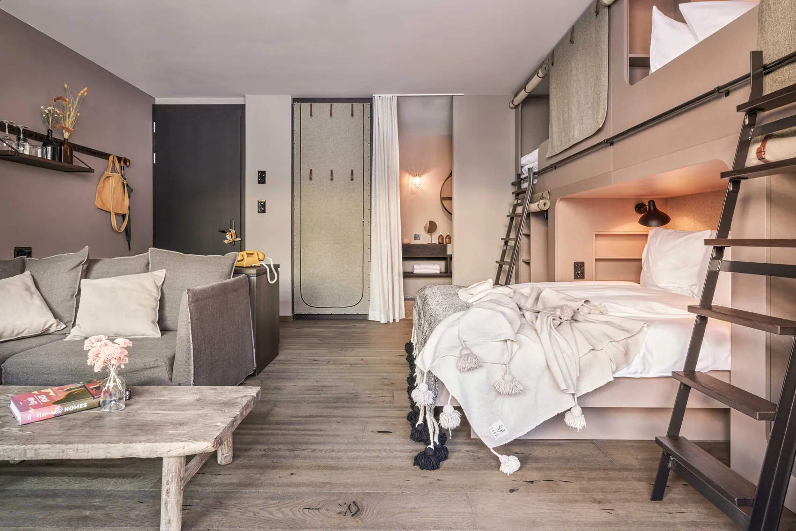 | <a href="https://cervo.swiss/en">Voir la source</a> ; Droits de réutilisation indépendants à confirmer | Vérifier l&#x27;identité exacte et la licence |
| CERVO Mountain Resort · view-3 | 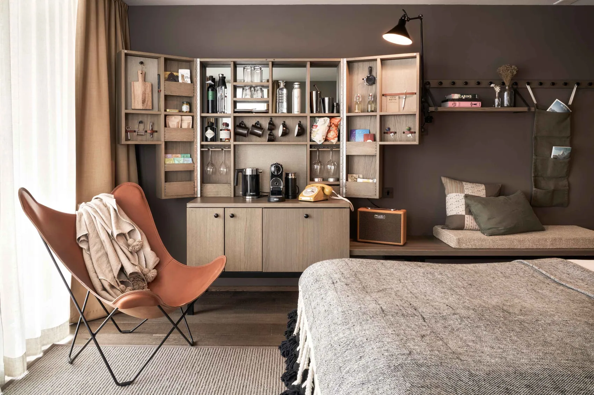 | <a href="https://cervo.swiss/en">Voir la source</a> ; Droits de réutilisation indépendants à confirmer | Vérifier l&#x27;identité exacte et la licence |
| Riffelalp Resort 2222m · view-1 | 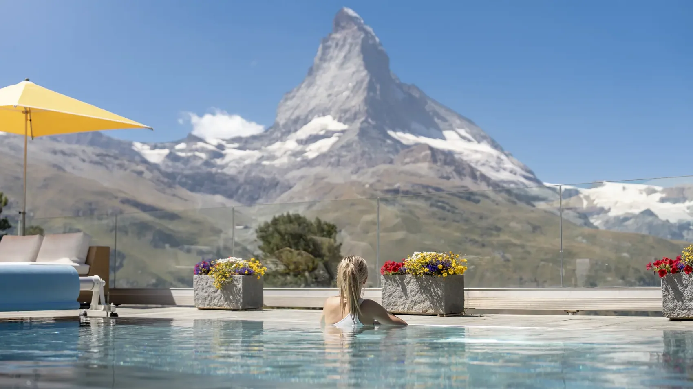 | <a href="https://www.riffelalp.com/">Voir la source</a> ; Droits de réutilisation indépendants à confirmer | Vérifier l&#x27;identité exacte et la licence |
| Riffelalp Resort 2222m · view-2 | 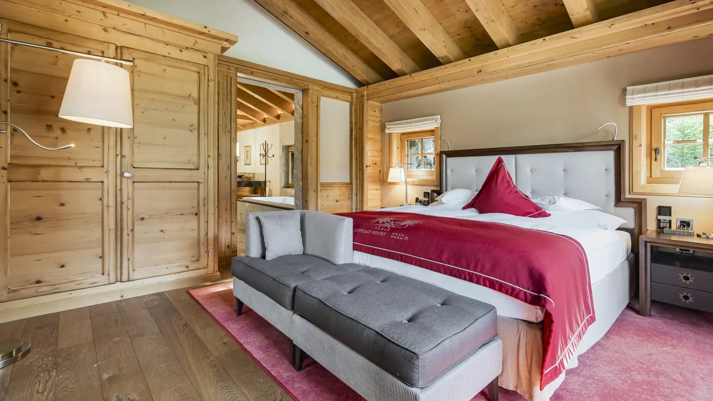 | <a href="https://www.riffelalp.com/">Voir la source</a> ; Droits de réutilisation indépendants à confirmer | Vérifier l&#x27;identité exacte et la licence |
| Riffelalp Resort 2222m · view-3 | 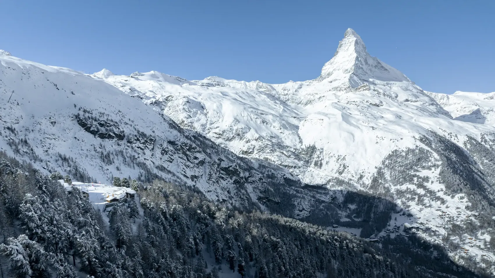 | <a href="https://www.riffelalp.com/">Voir la source</a> ; Droits de réutilisation indépendants à confirmer | Même cliché source que view-2 ; le redimensionnement ne constitue pas une nouvelle photo. |

## Paysages et secteurs authentiques — 9 scènes attendues

| Lieu | WebP récupéré | Origine, licence | Problème à examiner |
|---|---|---|
| Matterhorn | 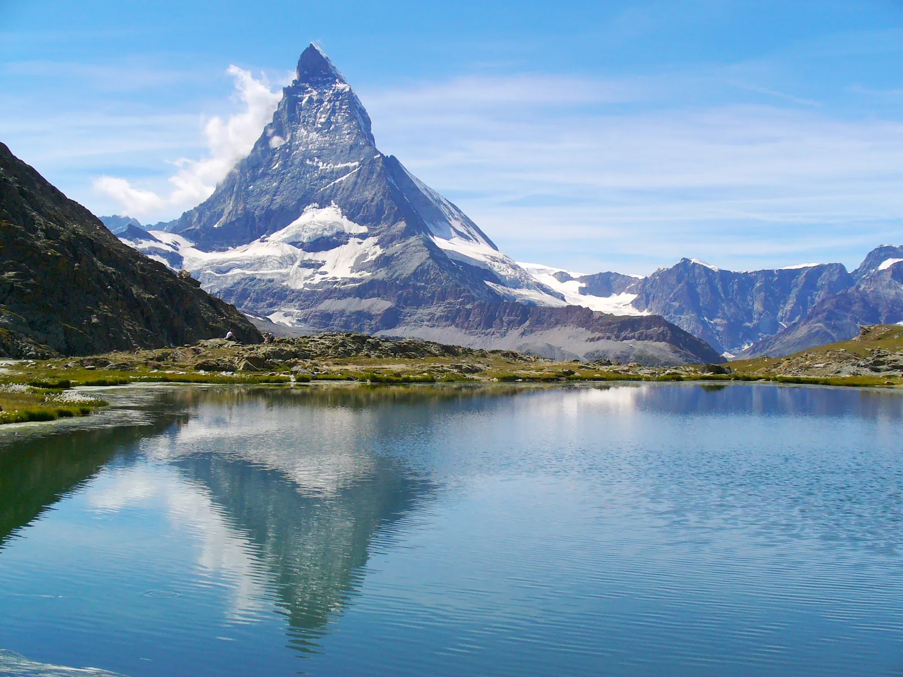 | <a href="https://commons.wikimedia.org/wiki/File:Riffelsee.JPG">Voir la source</a> ; CC BY 3.0 | Vérifier l&#x27;identité du site et les attributions |
| Zermatt village | À rechercher | À trouver ; Licence à vérifier | SCÈNE MANQUANTE |
| Bahnhofstrasse | 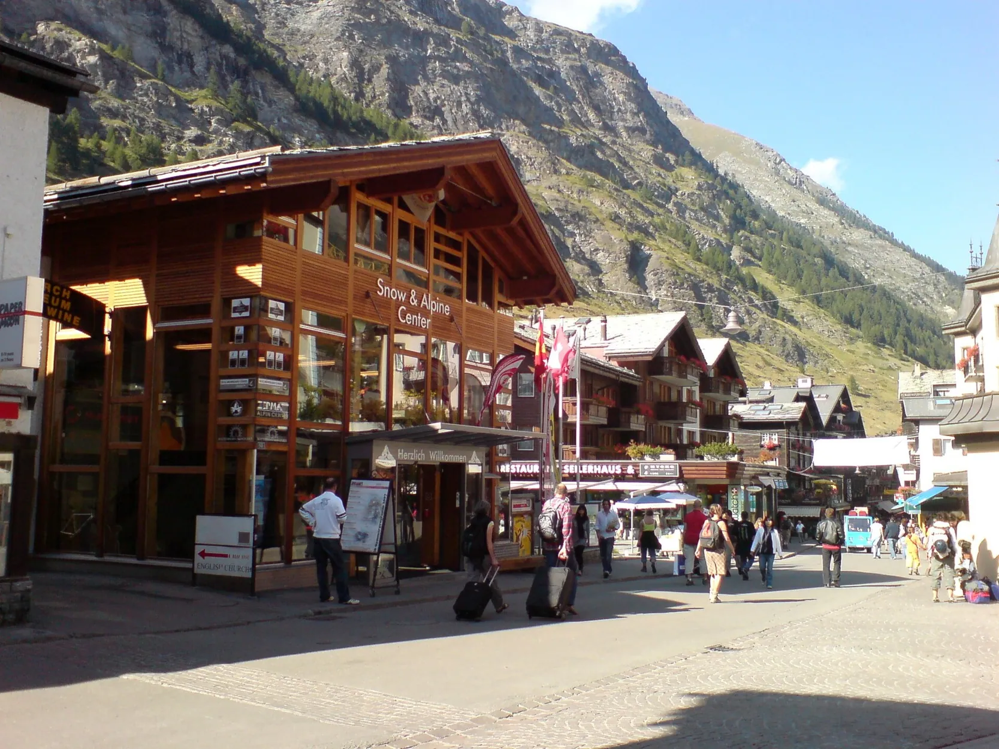 | <a href="https://commons.wikimedia.org/wiki/File:Bahnhofstrasse.jpg">Voir la source</a> ; CC BY-SA 3.0 | Vérifier l&#x27;identité du site et les attributions |
| Sunnegga | 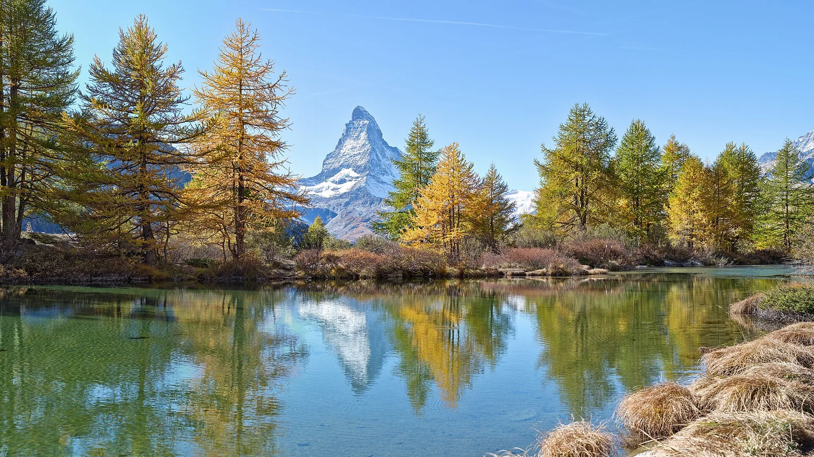 | <a href="https://commons.wikimedia.org/wiki/File:Sunnegga.jpg">Voir la source</a> ; CC BY-SA 3.0 | Vérifier l&#x27;identité du site et les attributions |
| Gornergrat | 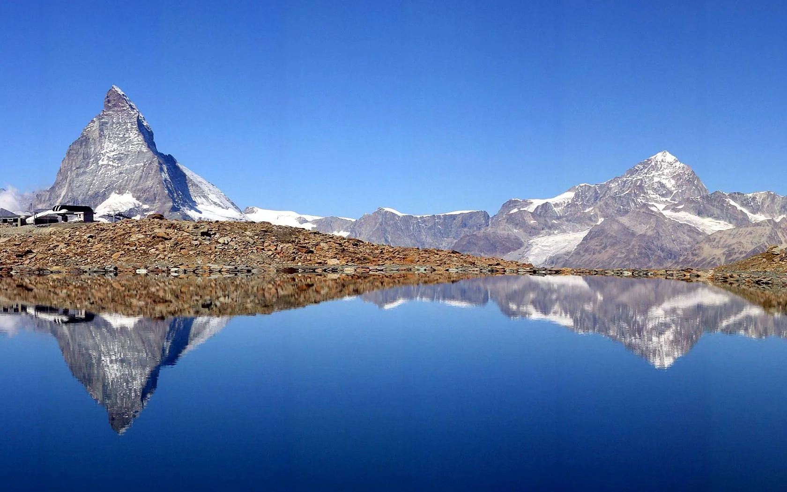 | <a href="https://commons.wikimedia.org/wiki/File:Matterhorn.jpg">Voir la source</a> ; CC BY 2.5 | Photo titrée Matterhorn : vérifier qu&#x27;elle montre réellement le Gornergrat, sinon remplacer. |
| Riffelalp | À rechercher | À trouver ; Licence à vérifier | SCÈNE MANQUANTE |
| Klein Matterhorn | 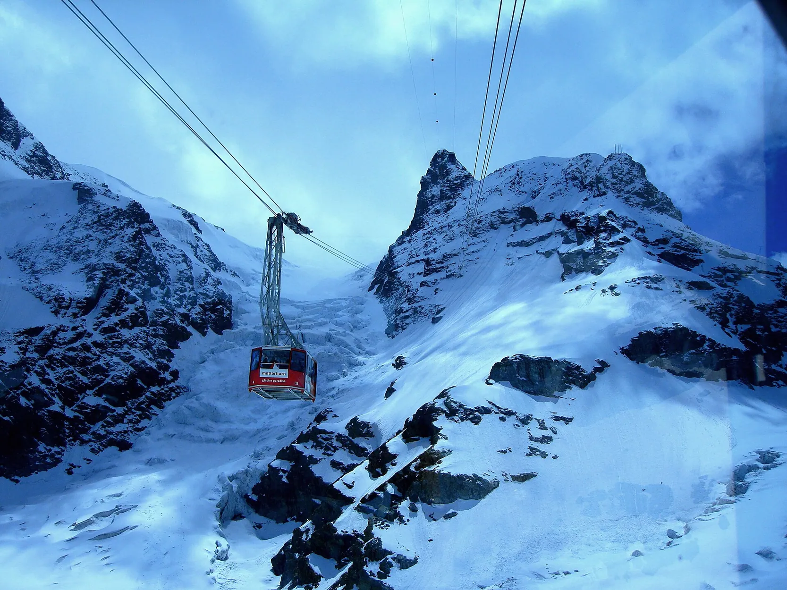 | <a href="https://commons.wikimedia.org/wiki/File:KleinMatterhorn.jpg">Voir la source</a> ; Public domain | Vérifier l&#x27;identité du site et les attributions |
| Findeln | 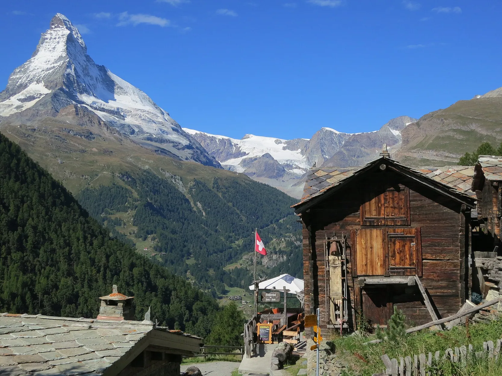 | <a href="https://commons.wikimedia.org/wiki/File:Findeln_Zermatt.jpg">Voir la source</a> ; CC BY-SA 4.0 | Vérifier l&#x27;identité du site et les attributions |
| Zermatt summer | À rechercher | À trouver ; Licence à vérifier | SCÈNE MANQUANTE |

## Checklist qualité avant routage

- [ ] 12 photographies distinctes des quatre hôtels EXACTS, sans logos, duplications ou images d'autres maisons
- [ ] 9 scènes locales géographiquement vérifiées et pertinentes pour leur légende
- [ ] Crédits et licences (CC BY, CC BY-SA, œuvres officielles) revus pour réutilisation commerciale
- [ ] Légendes originales FR et EN conformes aux photos et à leur saison
- [ ] Intégration des pages FR/EN + FAQ + SEO Schema sur la branche, avec maintien du noindex
- [ ] Aucune disponibilité Wink fictive ni lien de paiement inventé

